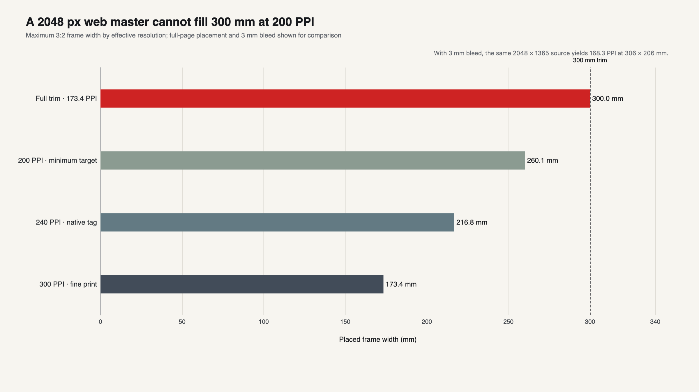

# Research: Photobook eBook (PDF) Generation & Long-Term Management Architecture

**Status:** consolidated architecture & design specification (2026-11-17)
**Scope:** End-to-end architecture, agentic orchestration (Rich Sutton's _The Bitter Lesson_), monochrome vs. color modality partitioning, visual design & spread layout specification for _Infinite Systems_, rendering toolchain evaluation, color/resolution physics, and long-term editorial maintenance for compiling the 127 sequenced photographs of `ryusoh.github.io` (`p1`–`p6`) into a publication-grade digital eBook PDF.

---

## 1. Research Question

If we build an eBook photobook titled _**Infinite Systems**_ (outputting a PDF file) from the photographic materials in `ryusoh.github.io`—without being forced to preserve the 6 web pages (`p1`–`p6`) as 6 rigid chapters or reuse their web layout verbatim, following Rich Sutton's _The Bitter Lesson_ to let an agentic system orchestrate the book across the 127 sequenced photographs while enforcing a strict separation between black-and-white (B&W) and color photographs—what is the single best way to design, generate, and manage it over the long term (including future photo additions, deletions, sequence adjustments, and visual/layout refinements) with zero design ambiguity?

---

## 2. Executive Summary & Consolidated Architecture

### 2.1 Definitive Architectural Decisions (Zero-Ambiguity Spec)

**Build a human-approved, file-based editorial state machine surrounded by proposal-generating agents and compiled deterministically by Typst.** Every previously open design option is consolidated into a single canonical choice below:

1. **Pool Eligibility, Completeness & Modality Partition Rule (`127` Photos = `51` B&W + `76` Color):**
    - **Gatekeeping (`index.md` authority):** Only the **127 photographs actively sequenced in `assets/img/p1/index.md` through `assets/img/p6/index.md`** enter the photobook pool (`201.0 MB` total; `127/127` landscape `3:2` orientation; `82.7%` low-key chiaroscuro or mid-tone twilight). The **12 unsequenced orphan files** sitting on disk (`1` in `p3`, `11` in `p6`) are deliberate editorial outtakes and **must be strictly ignored**.
    - **Complete 127-Frame Edition (Zero Book-Only Omissions):** The book includes **all 127 eligible sequenced photographs**. Culling lives in one place (`assets/img/p<N>/index.md`), ensuring the web portfolio and photobook pool never diverge into separate membership lists.
    - **Strict B&W vs. Color Separation:** Pixel-level chroma analysis (`sharp` 95th-percentile RGB channel delta `P95(max(|R-G|, |G-B|, |R-B|))`) across the 127 eligible photos partitions the pool into two disjoint visual modalities: **51 B&W** (`18` in `p1`, `32` in `p6`, and `1` tinted monochrome frame `p5/DSCF9004-3.jpg` neutralized to pure grayscale in book derivatives) and **76 Color** (`21` in `p2`, `23` in `p3`, `20` in `p4`, and `12` in `p5`).
    - **Never mix B&W and Color on the same spread or within the same movement:** The orchestrator partitions the search into two disjoint graph components containing **1,275 total B&W pairs** (**626 cross-series**) and **2,850 total Color pairs** (**2,131 cross-series**), separated at the macro-book level by an explicit **Phase Transition Divider** spread plus a silent `#070709` reset spread.
2. **Apply Rich Sutton's _The Bitter Lesson_ to Visual Curation & 2D Spread Search — Not to Free-Form AI Poetry or Autonomous Editorial Approval:**
    - **Dissolve the 6 web-folder silos within each modality component:** Pooling creates **4,125 valid same-modality pairs**, of which **2,757 cross a former web-series boundary**. Separating B&W from Color avoids a metric blind spot in CIELAB CIE76 $\Delta E$, where a dark low-saturation color photo has near-zero color distance to a dark B&W photo despite incompatible editorial modalities.
    - **Version every metric:** Breath thresholds `75` and `135` belong to weighted sRGB **`luma255`** on a 0–255 scale, not CIELAB **`lab.L`** on a 0–100 scale. Color search uses CIE76 chromatic distance, `lab.L` contrast, `luma255` respiratory rhythm, and gaze/vector geometry; B&W search uses `lab.L` luminance step contrast, local tonal entropy/grain density, and compositional geometry.
    - **Single Canonical Optimizer (`scripts/book/optimize.mjs`):** Pure Node.js **seeded multi-start beam search followed by 2-opt local swaps, relocations, and spread-archetype mutations** (no external Python solvers). It emits Pareto-diverse candidate proposals with score deltas and before/after contact-sheet proofs. Locks, bans, rights status, parity, and modality are hard constraints; aesthetic scores only rank constraint-valid candidates.
    - **Three-Move Text Policy (Silence, Verbatim Retrieval, Appendix):** Preserve **visual silence (~90% of spreads)**, retrieve verbatim stanzas only from the closed authentic corpus (`assets/img/p1..p6/index.md` `>` quotes plus optional `book/fragments.md`) with retained attribution and source line ranges, and route AI analytical commentary (`commentary.json`) exclusively to the back-of-book **Plate Index & System Colophon**.
3. **Persist Approved Editorial State in a Versioned Ledger (`book/sequence.yaml`):**
    - The ledger records stable movement, spread, page, asset, and fragment IDs; asset `sourceSha256` revisions; locks/bans/pins; and approval provenance. A logical `assetId` survives Lightroom re-export, while `sourceSha256` identifies the exact byte revision.
    - `book-sync` and `book-orchestrate` write **candidate proposals only** (under `.cache/book-runs/<runId>/`). Only explicit human promotion (`book-apply --plan <id>`) updates `book/sequence.yaml` after full schema and invariant validation.
4. **Canonical Visual Identity for _Infinite Systems_:**
    - **Macro-Structure — _The Four-Movement Chiaroscuro Envelope_ (`B&W` $\to$ `Color` $\to$ `Color` $\to$ `B&W`):**
        1. `SYS.01 // THRESHOLD` (`modality: 'bw'`): Nocturnal transit and chiaroscuro threshold (drawn from `p1` + `p5/DSCF9004-3.jpg`).
        2. `SYS.02 // KINEMATICS` (`modality: 'color'`): Daylight/twilight street choreography and kinetic confrontation (drawn from high/mid-luma `p2`, `p3`, `p5-color`).
        3. `SYS.03 // PHANTOM` (`modality: 'color'`): Nocturnal sodium/neon specters and urban surveillance (drawn from low-key `p4`, `p2`, `p5-color`).
        4. `SYS.04 // SINGULARITY` (`modality: 'bw'`): Gravitational collapse and subterranean coda (drawn from `p6` + remaining `p1` frames).
    - **Page Trim & Scope (`300 mm × 200 mm`, Digital-First eBook):** Exact `3:2` landscape trim (`600 mm × 200 mm` open spread in `TwoPageRight` view, `0 mm` bleed), where `2048 × 1365 px` masters deliver **173.355 PPI** at full page width with zero cropping and zero upscaling. Physical offset print (`press` / `PDF/X-4`) and `EPUB` are out of scope.
    - **Cover Design — _The Cybernetic Monolith_:** `#070709` Obsidian Void canvas, `INFINITE SYSTEMS` in `Syne ExtraBold` (`28 pt`, tracking `+0.12em`, `#E6E4DF`) above a `0.5 pt` `#CE2323` rule, asymmetric inset hero plate (`p1/DSCF4775.jpg`) on the right grid columns, and the full-book hairline `luma255(t)` waveform on the lower-left.
    - **WCAG-Compliant Semantic Color Tokens:** `#070709` (**Obsidian Void** plate canvas), `#111317` (**Blueprint Slate** endmatter canvas), `#E6E4DF` (**Silver Bone**, `15.840:1` primary text), `#D8D5CE` (**Warm Parchment**, `13.733:1` epigraph text), `#8A9099` (**Calibrated Tungsten**, `6.259:1` on `#070709` and `5.782:1` on `#111317`, passing WCAG AA `4.5:1` for `7.5 pt` folios and telemetry), `#2A2D34` (**Graphite Hairline** non-text rules), and `#CE2323` (**Safelight Red**, restricted strictly to non-text rules and waveform markers on the Cover, Phase Dividers, and Endmatter—never on B&W plate spreads).
    - **Vendored, Hash-Pinned Font Stack (`assets/fonts/book/`):** `Syne-ExtraBold.ttf` (`800`), `Syne-Bold.ttf` (`700`), `Syne-Regular.ttf` (`400`), `GlowSansSC-Extended-Regular.otf`, `GlowSansSC-Extended-Bold.otf`, and `JetBrainsMono-Regular.ttf` (`400`, tabular numerals), all under SIL OFL 1.1.
5. **Single Production Compiler (`Typst v0.15.1`), Two Output Profiles (`display` & `screen`), and QPDF Finalization:**
    - **Sole Renderer — Typst (`v0.15.1`, Apache-2.0):** Compiles canonical layout IR with `--ignore-system-fonts --font-path assets/fonts/book` and `--creation-timestamp <SOURCE_DATE_EPOCH>`.
    - **Two Concrete Output Profiles:**
        1. **`display` (`dist/infinite-systems-display.pdf`, Archival / 4K Display Master):** PDF/A-2b (`--pdf-standard a-2b`), lossless `/DCTDecode` passthrough for all eligible `<=2048px` JPEGs (preserving embedded `sRGB` and `Display P3` ICC profiles), downsampling only the 5 oversized `>2048px` files in `p3`/`p5` to `2048 × 1365 px` (`quality: 92, mozjpeg: true`), and neutralizing `p5/DSCF9004-3.jpg` to pure grayscale.
        2. **`screen` (`dist/infinite-systems-screen.pdf`, Portable Distribution Edition):** PDF 1.7, `2048 × 1365 px` max dimensions, 76 Color frames converted to `sRGB` (`quality: 82, mozjpeg: true, chromaSubsampling: '4:2:0'`) and 51 B&W frames encoded as 1-channel `/DeviceGray` (`quality: 84, mozjpeg: true`).
    - **Finalization & Verification:** **QPDF** (`qpdf --deterministic-id`) stamps `/PageLayout /TwoPageRight` and `/PageMode /UseOutlines` without re-encoding image streams; **Poppler** (`pdffonts`, `pdfimages`, `pdftoppm`) and **veraPDF** (for `display` PDF/A-2b) verify the final post-processed artifact.

### 2.2 Authority Boundaries and End-to-End Architecture

Source photographs, authentic text, rights information, and human taste decisions are authoritative. A deterministic inventory derives observations without modifying them. Candidate generation proposes sequences and layouts; only human approval changes the approved ledger. The approved ledger then flows through canonical layout IR, the deterministic Typst renderer, release gates, and a signed-off edition. LLMs may explain or propose inside the candidate stage, but no LLM call belongs in deterministic inventory, validation, layout, rendering, or preflight.

Editorial review uses a **two-tier preview**: an immediate interactive estimate for candidate editing, followed by an authoritative Typst/QPDF render rasterized back into the interface. Both consume the same canonical layout IR and display its revision/hash. Preview builds remain derived candidates; viewing never approves a ledger change, and export requires the reviewed PDF and preflight report to match the same final artifact hash (§7.3).


| Boundary                  | May write                                                               | Must never do                                                                |
| ------------------------- | ----------------------------------------------------------------------- | ---------------------------------------------------------------------------- |
| Source ingest / inventory | Disposable inventory JSON, hashes, metrics, candidate-pool observations | Overwrite originals, trim text, or silently import an asset into an edition  |
| Candidate agent           | Versioned proposal, rationale, and proof diff                           | Write the approved ledger or promote its own candidate                       |
| Human decision            | Approval/rejection and a new reviewed ledger revision                   | Delegate final editorial or rights approval to a score                       |
| Deterministic compiler    | Layout IR, renderer source, derivatives, and output manifest            | Invoke an LLM, discover new edition members implicitly, or relax constraints |
| Release gate              | Final preflight and sign-off record                                     | Declare visual or accessibility approval without human evidence              |

Approved state is reviewed and versioned; derived state is disposable and reproducible. Candidate runs belong under `.cache/book-runs/<runId>/`, while `book/sequence.yaml` remains Git-tracked. The existing web builder's `ensureImageVariants()` sanitizes source JPEG metadata in place and must never be reused by the book pipeline.

---

## 3. Primary Sources Consulted

1. **Repository Source Code & Governing Documentation (`ryusoh.github.io`)**
    - [`scripts/build-page.mjs`](file:///Users/lz/dev/ryusoh.github.io/scripts/build-page.mjs): `parseMarkdownSource()` (lines 63–80), `ensureImageVariants()` (lines 85–164), `buildPage()` (lines 308–420).
    - [`.agents/skills/sequence/SKILL.md`](file:///Users/lz/dev/ryusoh.github.io/.agents/skills/sequence/SKILL.md) and [`docs/sequence-skill-architecture.md`](file:///Users/lz/dev/ryusoh.github.io/docs/sequence-skill-architecture.md): Sequence authority rules, Eisenstein/Webb/Kawauchi/Eskenazi montage theory, CIELAB waveform/transition metrics, and target-aware transition schema.
    - [`docs/design-research.md`](file:///Users/lz/dev/ryusoh.github.io/docs/design-research.md): Hardboiled noir/evidence-file aesthetic direction, Swiss grid discipline, true-black chiaroscuro surface rules, and `#ce2323` safelight/evidence accent (lines 50–160).
    - [`docs/critique-calibration-design.md`](file:///Users/lz/dev/ryusoh.github.io/docs/critique-calibration-design.md): Roland Barthes's _studium_ vs. _punctum_ distinction (lines 15–17) and human-machine taste calibration log.
    - [`docs/page-generation-pipeline.md`](file:///Users/lz/dev/ryusoh.github.io/docs/page-generation-pipeline.md): 3-tier hybrid architecture separating editorial markdown from deterministic compilation.
    - [`docs/archive-protocol.md`](file:///Users/lz/dev/ryusoh.github.io/docs/archive-protocol.md) and [`docs/contact-sheet-ledger-design.md`](file:///Users/lz/dev/ryusoh.github.io/docs/contact-sheet-ledger-design.md): RAW/JPEG master archive protocol and XMP/Lightroom ingest pipeline.
    - [`tools/subset_fonts.py`](file:///Users/lz/dev/ryusoh.github.io/tools/subset_fonts.py): CJK character extraction and `GlowSansSC-Extended-Bold.otf` source path resolution (lines 17–68).
2. **Agentic Search Theory**
    - **Rich Sutton (2019), _The Bitter Lesson_**: [incompleteideas.net/IncIdeas/BitterLesson.html](http://www.incompleteideas.net/IncIdeas/BitterLesson.html) — establishes that general methods leveraging **search** and **learning** that scale with computation reliably outperform human-engineered domain priors and rigid handcrafted decompositions.
3. **Typst Official Documentation & Compiler Source Code (`v0.15.1`, released 2026-07-17)**
    - Typst Reference: [`image`](https://typst.app/docs/reference/visualize/image/), [`page`](https://typst.app/docs/reference/layout/page/), [`pdf`](https://typst.app/docs/reference/pdf/), [`document`](https://typst.app/docs/reference/model/document/), [`text`](https://typst.app/docs/reference/text/text/), [`heading`](https://typst.app/docs/reference/model/heading/), [`json`](https://typst.app/docs/reference/data-loading/json/), [`yaml`](https://typst.app/docs/reference/data-loading/yaml/), [Accessibility Guide](https://typst.app/docs/guides/accessibility/), and [Changelogs `0.12.0`–`0.15.1`](https://typst.app/docs/changelog/0.15.1/).
    - `typst-pdf` crate source (`v0.15.1`): [`crates/typst-pdf/src/image.rs`](https://github.com/typst/typst/blob/v0.15.1/crates/typst-pdf/src/image.rs) (lines 164–230) and [`crates/typst-cli/src/args.rs`](https://github.com/typst/typst/blob/v0.15.1/crates/typst-cli/src/args.rs) (lines 346–490).
    - `krilla` PDF generation engine (`v0.8.2`, used by `typst-pdf`): [`crates/krilla/src/graphics/image/mod.rs`](https://github.com/LaurenzV/krilla/blob/main/crates/krilla/src/graphics/image/mod.rs) (lines 259–285, 416–560, 708–736).
    - `fontdb` font loader (`RazrFalcon/fontdb`, used by `typst-kit`): [`src/lib.rs`](https://github.com/RazrFalcon/fontdb/blob/master/src/lib.rs) (line 301).
4. **Chromium / Skia PDF Backend, Puppeteer, and W3C CSS Paged Media (Evaluated Benchmark)**
    - Skia PDF JPEG serialization source: [`src/pdf/SkPDFBitmap.cpp`](https://skia.googlesource.com/skia/+/refs/heads/main/src/pdf/SkPDFBitmap.cpp) (`write_icc_profile()` lines 172–193, `do_jpeg()` lines 287–350, `serialize_image()` lines 375–405).
    - Chrome Developer Documentation: [Add content to the margins of web pages when printed using CSS (Chrome 131)](https://developer.chrome.com/blog/print-margins) and [Chrome Platform Status #5195769732923392 (`@page` margin boxes, milestone 131)](https://chromestatus.com/feature/5195769732923392) / [#5173237715566592 (Named pages, milestone 85)](https://chromestatus.com/feature/5173237715566592).
    - Puppeteer API Reference: [`PDFOptions`](https://github.com/puppeteer/puppeteer/blob/main/docs/api/puppeteer.pdfoptions.md).
    - Paged.js repository & registry metadata: [`github.com/pagedjs/pagedjs`](https://github.com/pagedjs/pagedjs) and `registry.npmjs.org/pagedjs` (`v0.4.3`).
5. **WeasyPrint & Prince XML Documentation and Source Code (Evaluated Benchmarks)**
    - WeasyPrint (`v70.0`) documentation ([API Reference](https://doc.courtbouillon.org/weasyprint/stable/api_reference.html), [Common Use Cases](https://doc.courtbouillon.org/weasyprint/stable/common_use_cases.html)) and source code [`weasyprint/images.py`](https://github.com/Kozea/WeasyPrint/blob/main/weasyprint/images.py) (lines 36–160) & [`weasyprint/pdf/stream.py`](https://github.com/Kozea/WeasyPrint/blob/main/weasyprint/pdf/stream.py) (lines 325–345).
    - Prince XML documentation: [PDF Output Options](https://www.princexml.com/doc/prince-output/), [Graphics & Color Management](https://www.princexml.com/doc/graphics/), [Command-Line Reference](https://www.princexml.com/doc/command-line/), and [Purchase / Licensing](https://www.princexml.com/purchase/).
6. **ISO PDF Standards, Validation, Asset & Reproducibility Specifications**
    - **ISO 32000-1:2008 (PDF 1.7 Specification)**: [Clause 7.7.2 _Document Catalog_ (Table 28: `PageLayout` and `PageMode`)](https://opensource.adobe.com/dc-acrobat-sdk-docs/pdfstandards/PDF32000_2008.pdf), Clause 8.4.5 _Graphics State Parameter Dictionaries_, Clause 8.6.5.5 _ICCBased Colour Spaces_, and Clause 14.11.2 _Page Boundaries_ (`MediaBox`, `CropBox`, `BleedBox`, `TrimBox`, `ArtBox`).
    - **Blurb Print Specifications**: [Image Quality & Resolution Checklist (300 PPI standard)](https://www.blurb.com/blog/image-quality-checklist/) and [A Brief Note on Color Management (PDF/X-3, CMYK vs. sRGB workflow)](https://www.blurb.com/downloads/pdf_to_book/BriefNoteColor.pdf).
    - **Validation, Schema, Image & Reproducibility Contracts**: [veraPDF CLI validation](https://docs.verapdf.org/cli/validation/), [QPDF CLI documentation](https://qpdf.readthedocs.io/en/stable/cli.html), [Sharp output documentation](https://sharp.pixelplumbing.com/api-output/), [Ajv JSON Schema documentation](https://ajv.js.org/json-schema.html), [Reproducible build perimeter](https://reproducible-builds.org/docs/perimeter/), [SOURCE_DATE_EPOCH specification](https://reproducible-builds.org/specs/source-date-epoch/), and [Syne SIL OFL 1.1 license](https://raw.githubusercontent.com/google/fonts/main/ofl/syne/OFL.txt).

---

## 4. Claim-by-Claim Evidence & Technical Analysis

### 4.1 Audit of Eligible Repository Materials (`assets/img/p1`–`p6`)

An audit of `assets/img/p1` through `assets/img/p6` using `sips`, `exiftool`, `sharp` pixel-level RGB channel-delta inspection, `sequence-report.md`, and `scripts/build-page.mjs` established the exact inventory of sequenced photographs eligible for the eBook pool versus unsequenced disk outtakes (which are excluded):

| Series  | Title (`index.md` Frontmatter)                         | Eligible JPEGs | Excluded Orphans | Modality (`B&W / Color`) | Breath (`Inh / Exh / Grd`) | `>` Quote Lines | CJK Lines | Sequenced Display P3 | Sequenced Payload |
| :------ | :----------------------------------------------------- | -------------: | ---------------: | :----------------------: | :------------------------: | --------------: | --------: | -------------------: | ----------------: |
| `p1`    | _I TEAR UP THE BAY WHEN I COME THROUGH_                |             18 |                0 |         `18 / 0`         |        `2 / 11 / 5`        |              17 |         0 |                    2 |           35.0 MB |
| `p2`    | _I DO NOT CARE IF WE GO DOWN IN HISTORY AS BARBARIANS_ |             21 |                0 |         `0 / 21`         |        `3 / 6 / 12`        |               5 |         0 |                    2 |           28.1 MB |
| `p3`    | _AEROBATIC ACTIVITIES_                                 |             23 |                1 |         `0 / 23`         |        `7 / 3 / 13`        |               4 |         0 |                    0 |           60.4 MB |
| `p4`    | _DAS GESPENST_                                         |             20 |                0 |         `0 / 20`         |        `3 / 2 / 15`        |               9 |         0 |                    1 |           21.6 MB |
| `p5`    | _SELF PORTRAITS AND BEHIND THE SCENES_                 |             13 |                0 |        `1* / 12`         |        `3 / 5 / 5`         |              17 |         0 |                    3 |           23.9 MB |
| `p6`    | _HYPERSTARS SUCKED INTO THE HYPERMASSIVE_              |             32 |               11 |         `32 / 0`         |       `4 / 11 / 17`        |              70 |        43 |                    2 |           32.0 MB |
| **All** | **Unified Eligible Pool (`p1`–`p6` `index.md`)**       |        **127** | **12 (Ignored)** |      **`51 / 76`**       |     **`22 / 38 / 67`**     |         **122** |    **43** |               **10** |      **201.0 MB** |

_(`*Note on p5`: 12 of 13 sequenced frames in `p5` are color, while 1 frame—`assets/img/p5/DSCF9004-3.jpg`, the opener self-portrait in a white helmet—is a warm-tinted monochrome image with 95th-percentile RGB channel delta $P_{95} = 11$ and mean channel delta $6.1$, documented in `assets/img/p5/commentary.json` as `"Monochrome, high-grain self-portrait"`.)\_

#### Key Material Findings (127 Eligible Pool Photographs)

1. **Strict Pool Boundary (`index.md` Gatekeeping)**:
    - Only the **127 JPEG filenames explicitly listed in `assets/img/p1..p6/index.md`** are ingested into the photobook pool.
    - The 12 unsequenced JPEGs on disk (`p3/DSCF2056-2.jpg` and 11 files in `p6/`) are outtakes rejected during gallery curation and are **strictly ignored** by the book pipeline.
2. **Disjoint Modality Partition: 51 Black-and-White (`40.2%`) vs. 76 Color (`59.8%`)**:
    - Measuring per-pixel RGB channel spread `deltaRGB = max(|R-G|, |G-B|, |R-B|)` across a `160 × 160` downsample of each eligible image via `sharp` partitions the 127-photo pool into two disjoint modality components:
        - **Pure B&W (`50` frames, `P95(deltaRGB) <= 3`):** All `18` frames in `p1` and all `32` frames in `p6`. These grayscale files are stored on disk as 3-channel RGB JPEGs, including 4 with Display P3 ICC tags.
        - **Tinted / Warm Monochrome (`1` frame, `3 < P95(deltaRGB) <= 12`):** `p5/DSCF9004-3.jpg` (`P95 = 11`). It is assigned to the B&W component and neutralized to pure grayscale in `.cache/book-img/` derivatives (while leaving the source file untouched) so all 51 B&W plates share identical silver-gelatin neutrality.
        - **Color (`76` frames, `P95(deltaRGB) > 12`):** All `21` frames in `p2`, all `23` in `p3`, all `20` in `p4`, and `12` in `p5`.
    - Pair counts within the two disjoint modality components distinguish total same-modality pairs from cross-series pairs:

    | Modality | Web-series groups   | All same-modality pairs | Intra-series pairs | Actual cross-series pairs |
    | -------- | ------------------- | ----------------------: | -----------------: | ------------------------: |
    | B&W      | `18 / 32 / 1`       |               **1,275** |                649 |                   **626** |
    | Color    | `21 / 23 / 20 / 12` |               **2,850** |                719 |                 **2,131** |
    | Combined | 127 frames          |               **4,125** |              1,368 |                 **2,757** |

3. **Uniform 3:2 Landscape Orientation & Photometric Chiaroscuro Distribution**:
    - **100% (`127 / 127`) of the eligible photographs are Landscape (`width > height`, 3:2 aspect ratio)**. There are zero portrait-orientation photographs in the sequenced pool.
    - Across the 127 frames, **38 are Exhalations** (`luma255 <= 75`), **67 are Grounding** (`75 < luma255 < 135`), and only **22 are Inhalations** (`luma255 >= 135`). Thus **82.7% (`105 / 127`)** operates in low-key shadow or mid-tone atmospheric density. These thresholds use the existing parser's weighted sRGB luma on a **0–255** scale; CIELAB lightness is tracked separately as `lab.L` on a **0–100** scale, and chromatic distance uses **CIE76**.
4. **Pixel Dimensions & Digital-First Resolution Policy**:
    - **114 of 127 eligible JPEGs** have a long edge of **`2048 px`** (`109` at `2048 × 1365` and `5` at `2048 × 1364`); **5** are higher-resolution exports (`3079–6240 px` long edge in `p3`/`p5`); and **8** are lower-resolution crops (`910–2047 px` long edge).
    - At the locked **`300 × 200 mm`** page trim (`0 mm` bleed), a `2048 × 1365 px` frame yields **173.355 PPI** (and higher for `82%`, `74%`, and `55%` inset plates: **211.4 PPI**, **234.3 PPI**, and **315.2 PPI**, respectively). Because _Infinite Systems_ is explicitly scoped as a **digital eBook PDF** rather than an offset print run ([Blurb Image Quality Checklist](https://www.blurb.com/blog/image-quality-checklist/)), `2048 × 1365 px` provides native Retina/4K screen fidelity without upscaling. The arithmetic in this subsection is reproducible with `python3 docs/assets/photobook-ebook-review/calculate_metrics.py`.

    

5. **Mixed ICC Color Profiles (`sRGB` + `Display P3`)**:
    - Among the 127 eligible JPEGs, **117 carry `sRGB IEC61966-2.1`** and **10 carry Apple `Display P3` ICC profiles** (`p1`: 2, `p2`: 2, `p4`: 1, `p5`: 3, `p6`: 2). Preserving embedded ICC profiles in the `display` profile ensures the Display P3 color photographs retain their wide-gamut saturation in color-managed PDF viewers.
6. **Multilingual Typography (`Latin` + `Simplified Chinese`)**:
    - `assets/img/p6/index.md` contains 43 lines of Simplified Chinese verse interleaved with English stanzas.
    - While `assets/fonts/` stores web-only `.woff2` subsets, `/Users/lz/Library/Fonts/` ([`tools/subset_fonts.py`](file:///Users/lz/dev/ryusoh.github.io/tools/subset_fonts.py#L17-L22)) holds the full OpenType `GlowSansSC` family. For deterministic book compilation, the exact required `.ttf`/`.otf` font files are vendored and hash-pinned in `assets/fonts/book/`.

---

### 4.2 Toolchain Evaluation & Selection of Typst (`v0.15.1`)

#### 1. Typst (`v0.15.1`) — Sole Production PDF Compiler

- **Lossless JPEG Passthrough & ICC Profile Preservation**:
    - In [`crates/typst-pdf/src/image.rs`](https://github.com/typst/typst/blob/v0.15.1/crates/typst-pdf/src/image.rs#L194-L230), `convert_raster()` checks `if let RasterFormat::Exchange(ExchangeFormat::Jpg) = raster.format()` and invokes `krilla::image::Image::from_jpeg_with_icc()`, passing the raw file buffer (`raster.data()`) and extracted ICC profile (`raster.icc()`).
    - A code comment in `exif_transform()` (`crates/typst-pdf/src/image.rs:219-221`) explicitly notes: `"For JPEGs, we want to apply the EXIF orientation as a transformation because we don't recode them."`
    - In `krilla` (`v0.8.2`), [`crates/krilla/src/graphics/image/mod.rs`](https://github.com/LaurenzV/krilla/blob/main/crates/krilla/src/graphics/image/mod.rs#L517-L545) serializes `Repr::Jpeg` via `FilterStreamBuilder::new_from_jpeg_data(j.data.as_ref())` with `/Filter /DCTDecode` and attaches the `ICCBasedColorSpace` object reference (`image_x_object.pair(Name(b"ColorSpace"), icc_ref)`).
    - In Typst's [`image` function reference](https://typst.app/docs/reference/visualize/image/#parameters-icc), the `icc` parameter defaults to `auto`: `"When set to auto, Typst will try to extract an ICC profile from the image."`
- **Page Geometry & Data-Driven Authoring (`json()` / `yaml()`)**:
    - Typst's [`page` setup](https://typst.app/docs/reference/layout/page/) supports exact `width: 300mm`, `height: 200mm`, and `margin` dictionaries, and natively loads structured data via [`json("path.json")`](https://typst.app/docs/reference/data-loading/json/) and [`yaml("path.yaml")`](https://typst.app/docs/reference/data-loading/yaml/).
- **Typography, CJK Support, and Font Format Constraints**:
    - Typst's [`text` element](https://typst.app/docs/reference/text/text/#parameters-font) accepts `#set text(font: ("Syne", "Glow Sans SC Extended"), cjk-latin-spacing: auto)`.
    - Font loading in `typst-kit` delegates to `fontdb` ([`RazrFalcon/fontdb/src/lib.rs:301`](https://github.com/RazrFalcon/fontdb/blob/master/src/lib.rs#L301)): `"Will load ttf, otf, ttc and otc fonts."` Because Typst does not load `.woff2` web fonts, the pipeline vendors and hash-pins the static `.ttf`/`.otf` Latin and CJK font files under `assets/fonts/book/` and invokes Typst with `--ignore-system-fonts --font-path assets/fonts/book`.
- **PDF/A-2b Conformance, Outlines, and Reproducibility**:
    - Per the [Typst PDF Reference](https://typst.app/docs/reference/pdf/), `--pdf-standard a-2b` emits ISO 19005-2 (PDF 1.7 archival) output for the `display` master profile, and headings with `bookmarked: true` populate the PDF bookmark outline tree ([`heading.bookmarked`](https://typst.app/docs/reference/model/heading/#parameters-bookmarked)).
    - Timestamp determinism is enforced via `--creation-timestamp <UNIX_TIMESTAMP>` / `SOURCE_DATE_EPOCH` ([`crates/typst-cli/src/args.rs:425-429`](https://github.com/typst/typst/blob/v0.15.1/crates/typst-cli/src/args.rs#L425-L429)) within the pinned build perimeter (§8.2).

#### 2. Evaluated & Rejected Alternatives (Benchmark Evidence Only)

- **Headless Chrome (`v157.0.8103.79` / `Skia/PDF m157`)**: Empirically verified on this machine (`src/pdf/SkPDFBitmap.cpp:287-395`) to pass through original `sRGB` and `Display P3` JPEG streams byte-for-byte (`/Filter /DCTDecode`) and support CSS `@page` margin boxes (Chrome 131+). Rejected as production compiler because it outputs only PDF 1.4, lacks PDF/A-2b support, and has no `SOURCE_DATE_EPOCH` determinism.
- **WeasyPrint (`v70.0`, BSD)**: Rejected because [`weasyprint/images.py:134-158`](https://github.com/Kozea/WeasyPrint/blob/main/weasyprint/images.py#L134-L158) hardcodes `color_space = '/DeviceRGB'` on RGB image XObjects, stripping per-image Display P3 ICC profiles.
- **Prince XML (`v16`)**: Rejected due to proprietary licensing ($495–$2,000+; free version adds a watermark).
- **Adobe Lightroom CC / Classic & InDesign**: Rejected because locally installed Lightroom CC lacks the Book module ([Adobe Helpx](https://helpx.adobe.com/lightroom-classic/help/create-photo-books.html)), and GUI book files (`.lrcat`, `.indd`) break Git-tracked single-source-of-truth automation.

### 4.3 Toolchain Comparison Matrix

| Capability / Criterion                  | **Typst (`v0.15.1`)** (Selected)                 | **Headless Chrome (`m157`)** (Evaluated)          | **WeasyPrint (`v70.0`)** (Rejected)              | **Prince XML (`v16`)** (Rejected)            | **LaTeX (`LuaLaTeX`)** (Rejected)     | **InDesign / LrC** (Rejected)        |
| :-------------------------------------- | :----------------------------------------------- | :------------------------------------------------ | :----------------------------------------------- | :------------------------------------------- | :------------------------------------ | :----------------------------------- |
| **Driven directly from YAML/JSON**      | Native (`json()`, `yaml()`)                      | Via Node HTML generator                           | Via Node/Python HTML generator                   | Via Node HTML generator                      | Requires TeX escaping & codegen       | Manual GUI import (breaks Git sync)  |
| **Lossless JPEG `/DCTDecode` embed**    | Yes (`krilla::Image::from_jpeg_with_icc`)        | Yes (verified in `SkPDFBitmap.cpp` & locally)     | Yes (when `optimize` & `jpeg_quality` unset)     | Yes (unless `-prince-image-magic` set)       | Yes                                   | Re-encodes at export quality setting |
| **Per-image Display P3 ICC preserved**  | **Yes** (`icc: auto` extracts embedded ICC)      | **Yes** (verified 536-byte P3 `/ICCBased` stream) | **No** (hardcodes `/DeviceRGB` in `images.py`)   | **Yes**                                      | Requires manual `/ColorSpace` objekts | Converts to single export space      |
| **CJK (`p6`) + Latin (`Syne`) layout**  | Native fallback list + `cjk-latin-spacing: auto` | Native browser font fallback + `.woff2` support   | Pango font fallback                              | Native CSS font fallback                     | `luatexja` package (complex setup)    | Manual style mapping                 |
| **Font formats accepted**               | `.ttf`, `.otf`, `.ttc`, `.otc` (no `.woff2`)     | `.woff2`, `.ttf`, `.otf`                          | `.woff2`, `.ttf`, `.otf`                         | `.woff2`, `.ttf`, `.otf`                     | `.ttf`, `.otf`                        | `.ttf`, `.otf`                       |
| **PDF/A-2b archival conformance**       | **Yes** (`--pdf-standard a-2b`)                  | None (PDF 1.4 only)                               | Yes (`--pdf-variant pdf/a-2b`)                   | Yes (`--pdf-profile=PDF/A-2b`)               | Via `pdfx` / LaTeX PDF management     | Export preset                        |
| **Deterministic (`SOURCE_DATE_EPOCH`)** | **Yes** (`--creation-timestamp`)                 | No (`CreateDate` changes every run)               | Partially                                        | No                                           | Yes (`FORCE_SOURCE_DATE=1`)           | No                                   |
| **Install & License footprint**         | `brew install typst` (~15 MB single binary, OSS) | Installed (`Google Chrome.app`)                   | `brew install weasyprint` (Python + Cairo/Pango) | Proprietary ($495–$2,000+, free watermarked) | `brew install --cask mactex` (4+ GB)  | Proprietary GUI apps                 |

---

## 5. Global Agentic Orchestration ("The Bitter Lesson") & Long-Term Lifecycle

### 5.1 Applying Rich Sutton's _The Bitter Lesson_ to Photobook Curation

In _The Bitter Lesson_ ([Sutton, 2019](http://www.incompleteideas.net/IncIdeas/BitterLesson.html)), Sutton argues for general methods that leverage search and computation rather than rigid human-engineered domain buckets. Applied here, search explores visual relationships across all 127 frames rather than locking photographs inside their 6 web folders (`p1`–`p6`). Because photobook curation has no objective win/loss verifier, the machine computes the Barthesian **_studium_** (colorimetry, luminance rhythm, gaze, geometry), while the human author supplies the **_punctum_** and final acceptance ([`docs/critique-calibration-design.md`](file:///Users/lz/dev/ryusoh.github.io/docs/critique-calibration-design.md#L15-L17)).

The canonical optimizer (`scripts/book/optimize.mjs`) is a deterministic, zero-external-solver Node.js engine using **seeded multi-start beam search followed by 2-opt local swaps, relocations, bounded reversals, and spread-archetype mutations**:

| Search layer           | Canonical implementation in `scripts/book/optimize.mjs`                                                                         |
| ---------------------- | ------------------------------------------------------------------------------------------------------------------------------- |
| Candidate construction | Seeded multi-start beam search over the disjoint `bw` (`51`) and `color` (`76`) sub-pools                                       |
| Local improvement      | 2-opt swaps, single-frame relocations, bounded segment reversals, archetype mutations                                           |
| Editorial diversity    | 4 seeded Pareto-diverse proposals per run (Cross-Series Montage, Respiratory Smoothness, Vector Continuity, Web-Order Baseline) |
| Hard constraints       | Strict predicate gate before scoring (modality separation, locks, bans, pins, 127-frame completeness, recto/verso parity)       |
| Explanation            | Structured JSON diff, per-objective score delta, and before/after contact-sheet proof                                           |
| Acceptance             | Explicit human promotion (`book-apply --plan <id>`) against the matching parent ledger revision                                 |

Within the disjoint B&W (`1,275` pairs; `626` cross-series) and Color (`2,850` pairs; `2,131` cross-series) components:

- **Color Component Objective (`76` frames across `p2`, `p3`, `p4`, `p5-color`):** Evaluates CIE76 chromatic distance, `lab.L` contrast, `luma255` respiratory rhythm, and gaze/vector momentum.
- **B&W Component Objective (`51` frames across `p1`, `p6`, and neutralized `p5/DSCF9004-3.jpg`):** Evaluates `lab.L` luminance step contrast, local tonal entropy / grain density contrast, `luma255` respiratory rhythm, and compositional vector geometry.
- **Text Policy (Silence, Verbatim Retrieval, Appendix):** ~90% of spreads remain silent; epigraph spreads retrieve verbatim fragments from the closed Authentic Text Pool (`assets/img/p1..p6/index.md` `>` quotes + `book/fragments.md`) with exact line-range provenance and retained attribution; analytical critiques from `commentary.json` are placed exclusively in the back-of-book Plate Index & System Colophon.

### 5.2 Versioned State Ledger (`book/sequence.yaml`) & Long-Term Maintenance

Approved book structure lives in `book/sequence.yaml`; candidate proposals and derived inventories live under `.cache/book-runs/`. The ledger uses stable logical IDs (`assetId`, `fragmentId`, `movementId`, `spreadId`) so a photograph retains its `assetId` after a Lightroom crop/color re-export while `sourceSha256` tracks the exact file bytes.

```yaml
schemaVersion: 1
editionId: 'infinite-systems'
title: 'INFINITE SYSTEMS'
subtitle: 'Photographs 2021–2026'
author: 'Zhuang Liu'
revision: 1
parentRevision: null
sourceFingerprint: '<canonical-source-set-sha256>'
approval:
    proposalId: 'seed-envelope-001'
    reviewer: 'Zhuang Liu'
    approvedAt: '2026-11-17T00:00:00+08:00'
includeCommentaryAppendix: true

assets:
    - assetId: 'p1-dscf4775'
      source: 'assets/img/p1/DSCF4775.jpg'
      sourceSha256: '<64-hex-source-revision>'
      modality: 'bw'
      derivativeRecipe: 'passthrough-or-downsample-2048'
      rightsStatus: 'approved'
      altText: 'Inside a dark transit car, a diagonal shaft of sunlight illuminates a bowed passenger.'
    - assetId: 'p5-dscf9004-3'
      source: 'assets/img/p5/DSCF9004-3.jpg'
      sourceSha256: '<64-hex-source-revision>'
      modality: 'bw'
      derivativeRecipe: 'neutralize-grayscale-2048'
      rightsStatus: 'approved'
      altText: 'Monochrome high-grain self-portrait wearing a white helmet with both hands covering the face.'

fragments:
    - fragmentId: 'p1-lines-15-17'
      source: 'assets/img/p1/index.md'
      sourceRange: { startLine: 15, endLine: 17 }
      language: 'en'
      text: "The sun goes down\nI feel the light betray me"
      attribution: null
      originality: 'series-epigraph'
      rightsStatus: 'approved'
      excerptPolicy: 'verbatim-only'

constraints:
    strictModalitySeparation: true
    requireCompletePool: true
    pinnedOpenerAssetId: 'p1-dscf4775'
    pinnedCloserAssetId: 'p6-dscf0167-2'
    bannedAssetPairs:
        - ['p2-dscf8739', 'p4-dscf6872-5']

movements:
    - movementId: 'SYS.01'
      title: 'THRESHOLD'
      modality: 'bw'
      spreads:
          - spreadId: 's01'
            layout: 'monolith-epigraph'
            locked: true
            verso: { fragmentId: 'p1-lines-15-17' }
            recto: { assetId: 'p1-dscf4775', scale: 'full-bleed' }
          - spreadId: 's02'
            layout: 'asymmetric-diptych'
            locked: false
            verso: { assetId: 'p5-dscf9004-3', scale: 'full-bleed' }
            recto: { assetId: 'p1-dscf1093', scale: 'inset-55' }
    - movementId: 'SYS.02'
      title: 'KINEMATICS'
      modality: 'color'
      spreads:
          - spreadId: 's15'
            layout: 'symmetric-diptych'
            locked: false
            verso: { assetId: 'p3-dscf1113', scale: 'inset-74' }
            recto: { assetId: 'p2-dscf8772', scale: 'inset-74' }
    - movementId: 'SYS.03'
      title: 'PHANTOM'
      modality: 'color'
      spreads: []
    - movementId: 'SYS.04'
      title: 'SINGULARITY'
      modality: 'bw'
      spreads: []
```

#### How Long-Term Operations Work (`Add`, `Delete`, `Adjust`, `Resequence`)

`book-sync` is **plan-only by default**. A separate `book-apply --plan <id>` operation validates the approved plan and atomically replaces `book/sequence.yaml`. Derived caches in `.cache/book-img/` are content-addressed by `sourceSha256` + canonical recipe + `sharp`/libvips version + ICC profile hash.

| Editorial action                               | Inventory/plan behavior (`make book-plan`)                                                             | Approved-ledger behavior (`make book-apply PLAN=<id>`)                   |
| ---------------------------------------------- | ------------------------------------------------------------------------------------------------------ | ------------------------------------------------------------------------ |
| Add a sequenced photo to `p<N>/index.md`       | Auto-classify modality (`bw` or `color`) via `sharp` and propose lowest-cost slot in matching movement | Places the new asset into `book/sequence.yaml` only when plan is applied |
| Drop an unsequenced file into `p<N>/`          | Strictly ignored, as with the 12 existing outtakes                                                     | Zero effect                                                              |
| Delete a photo from `p<N>/index.md` (unlocked) | Emit a local spread-repair proposal within the same modality                                           | Applies the repaired spread after human review                           |
| Delete a photo from `p<N>/index.md` (locked)   | Emit a blocking human-resolution conflict                                                              | Never auto-deletes or substitutes a locked spread                        |
| Re-export a crop/color under the same filename | Preserve `assetId`; update `sourceSha256`; invalidate content-addressed derivative cache               | Retains placement; next `make book` embeds the updated derivative        |
| Approve/reject a candidate spread              | Record `locked: true` or `bannedAssetPairs` in `book/sequence.yaml`                                    | Future optimizer runs treat them as hard constraints                     |
| Re-orchestrate an edition (`book-orchestrate`) | Generate 4 seeded proposals against current `sourceFingerprint` and `constraints`                      | Never overwrites `book/sequence.yaml` until `book-apply` is run          |

### 5.3 The Two Canonical Output Profiles (`display` and `screen`)

The 127 eligible JPEGs total **201.0 MB** (`p3/DSCF7318-3.jpg` at `6240 × 4160` is **28.9 MB** alone, and the 50 pure-B&W files in `p1` and `p6` are stored as 3-channel RGB JPEGs). Book derivatives are written exclusively to `.cache/book-img/`; source files in `assets/img/p1..p6/` are never mutated.

| Output Profile | Output Artifact                     | PDF Standard | Color & Compression Contract                                                                                                                                                                                                                                                                                     |
| :------------- | :---------------------------------- | :----------- | :--------------------------------------------------------------------------------------------------------------------------------------------------------------------------------------------------------------------------------------------------------------------------------------------------------------- |
| **`display`**  | `dist/infinite-systems-display.pdf` | `PDF/A-2b`   | **Archival / 4K Display Master:** Lossless `/DCTDecode` passthrough for all eligible `<=2048px` JPEGs (preserving `sRGB` and `Display P3` ICC profiles); downsamples only the 5 oversized `>2048px` files to `2048 × 1365` (`q92` MozJPEG, ICC kept); neutralizes `p5/DSCF9004-3.jpg` to pure grayscale (`q92`). |
| **`screen`**   | `dist/infinite-systems-screen.pdf`  | `PDF 1.7`    | **Portable Distribution Edition:** Resizes `>2048px` frames to `2048 × 1365`; converts all 76 Color frames to `sRGB` (`q82` MozJPEG, `4:2:0`); encodes all 51 B&W frames as 1-channel `/DeviceGray` (`q84` MozJPEG), shrinking B&W streams by ~25% and eliminating display tint.                                 |

### 5.4 Setting Two-Page Spread View (`/PageLayout /TwoPageRight`)

Per **ISO 32000-1:2008 §7.7.2 (_Document Catalog_, Table 28)** ([PDF 32000-1:2008 Specification](https://opensource.adobe.com/dc-acrobat-sdk-docs/pdfstandards/PDF32000_2008.pdf)):

- `/PageLayout /TwoPageRight`: `"Display the pages two at a time, with odd-numbered pages on the right."` Page 1 (the front cover) appears alone on the right-hand side, and subsequent even/odd pairs (`2–3`, `4–5`, ...) appear as facing spreads.
- `/PageMode /UseOutlines`: Opens the PDF with the movement bookmark sidebar visible.

**QPDF** (`qpdf --deterministic-id`) is the single canonical post-processor used by `scripts/book/render.mjs` to set `/PageLayout /TwoPageRight` and `/PageMode /UseOutlines` on the `/Type /Catalog` dictionary without re-encoding any `/DCTDecode` image stream, followed by full structural and veraPDF validation on the finalized file ([QPDF CLI documentation](https://qpdf.readthedocs.io/en/stable/cli.html)).

---

## 6. Visual Design, Cover & Spread Layout Specification (_Infinite Systems_)

### 6.1 Conceptual Premise & The Four-Movement Chiaroscuro Envelope

The title _**Infinite Systems**_ unifies the subject matter of the photographs with the computational architecture that curates them:

1. **Thematic Layer (Within the Frames):** Across `p1`–`p6`, solitary human figures are caught inside vast, impersonal urban, transit, historical, and physical systems—BART transit cars, concrete overpasses, fogged glass, neon grids, state history (`p2`), spectral urban surveillance (`p4`), and gravitational collapse (`p6`).
2. **Methodological Layer (The Book Engine):** The monograph itself is an emergent trajectory through a modality-partitioned combinatorial state space (`1,275` B&W pairs + `2,850` Color pairs) governed by CIELAB colorimetry, respiratory luminance cycles, gaze vectors, and Hamiltonian transition energy.
3. **Canonical Macro-Architecture — _The Four-Movement Chiaroscuro Envelope_ (`B&W` $\to$ `Color` $\to$ `Color` $\to$ `B&W`):**
    - To honor the strict `51 B&W / 76 Color` separation while creating a unified dramatic arc across all 127 frames, the book is locked to four movements separated by two silent `#070709` phase-reset spreads:
        - **`SYS.01 // THRESHOLD` (`modality: 'bw'`):** Opens in austere B&W chiaroscuro (drawn from `p1` and the neutralized self-portrait `p5/DSCF9004-3.jpg`), establishing the solitary observer descending into the urban transit system.
        - _[Chromatic Ignition Phase Reset: 1 blank `#070709` spread before `SYS.02`]_
        - **`SYS.02 // KINEMATICS` (`modality: 'color'`):** Erupts into color across the high/mid-luma frames of `p2`, `p3`, and `p5-color`—street choreography, physical velocity, and daylight/twilight human friction.
        - **`SYS.03 // PHANTOM` (`modality: 'color'`):** Descends into the nocturnal sodium-vapor and neon color frames of `p4`, `p2`, and `p5-color`—fogged glass, surveillance shadows, and spectral isolation.
        - _[Event Horizon Phase Reset: 1 blank `#070709` spread before `SYS.04`]_
        - **`SYS.04 // SINGULARITY` (`modality: 'bw'`):** Collapses back into pure achromatic chiaroscuro across `p6` and the deepest nocturnal frames of `p1`, closing on gravitational solitude and bilingual English/Chinese stanzas.

Following [`docs/design-research.md`](file:///Users/lz/dev/ryusoh.github.io/docs/design-research.md#L58-L62), the visual direction is **Swiss-precise structural control framing hardboiled nocturnal photography**: razor-sharp grid geometry and restrained monospace telemetry acting as a quiet frame so the photographs carry 100% of the emotional violence.

### 6.2 Consolidated Color Palette & WCAG-Compliant Surface Tokens

Because **82.7% (`105 / 127`)** of the eligible photographs are low-key Exhalations (`luma255 <= 75`) or mid-tone Grounding frames (`75 < luma255 < 135`), `#070709` **Obsidian Void** serves as the primary plate canvas so dark photo edges dissolve seamlessly into the page and highlights glow without white-border glare. Every text token below is verified to pass WCAG 2.1 AA contrast (`>= 4.5:1` for small text) on both `#070709` and `#111317` via `python3 docs/assets/photobook-ebook-review/calculate_metrics.py`:

| Semantic Token    | Hex Code  | Contrast on `#070709` | Contrast on `#111317` | Canonical Role                                                                                                                                                                    |
| :---------------- | :-------- | --------------------: | --------------------: | :-------------------------------------------------------------------------------------------------------------------------------------------------------------------------------- |
| `surface-plate`   | `#070709` |                     — |                     — | **Obsidian Void:** Primary canvas for Cover, Phase Dividers, and all Plate spreads (`SYS.01`–`SYS.04`).                                                                           |
| `surface-dossier` | `#111317` |                     — |                     — | **Blueprint Slate:** Canvas for the back-of-book System Colophon and Illustrated Plate Index.                                                                                     |
| `text-primary`    | `#E6E4DF` |          **15.840:1** |          **14.634:1** | **Silver Bone:** Book title, movement headers, and primary colophon headings (passes WCAG AAA).                                                                                   |
| `text-secondary`  | `#D8D5CE` |          **13.733:1** |          **12.688:1** | **Warm Parchment:** Bilingual epigraph stanzas (`monolith-epigraph`, `phase-divider`) and plate index descriptions (passes WCAG AAA).                                             |
| `text-telemetry`  | `#8A9099` |           **6.259:1** |           **5.782:1** | **Calibrated Tungsten:** `7.5 pt` outer-corner plate numbers (`042`), movement coordinates, and colophon telemetry tables (passes WCAG AA `>= 4.5:1`).                            |
| `rule-muted`      | `#2A2D34` |           **1.460:1** |           **1.349:1** | **Graphite Hairline:** Non-text decorative grid dividers in the back-of-book colophon only (tagged as PDF Artifact).                                                              |
| `accent-signal`   | `#CE2323` |           **3.727:1** |           **3.444:1** | **Safelight Red:** Strictly non-text graphical accent (`0.5 pt` phase-divider rules, cover rule, waveform threshold line); **never used for small text or on B&W plate spreads**. |

### 6.3 Page Geometry (`300 × 200 mm`) & The Five Spread Layout Archetypes

#### 1. Trim Size: Exact `3:2` Landscape (`300 mm × 200 mm` Page / `600 mm × 200 mm` Open Spread)

- Because **100% (`127 / 127`) of the eligible photographs have a 3:2 landscape aspect ratio**, setting the single-page trim size to **`300 mm × 200 mm`** (`1.5 : 1` page ratio; `600 mm × 200 mm` / `3 : 1` panoramic dual-page spread in `TwoPageRight` view, `0 mm` bleed) guarantees that:
    - Any **full-bleed single-page plate** fills **100.0% of the page (`300 × 200 mm`) with zero cropping** of the original 3:2 camera frame.
    - Any **inset plate** maintains uniform, harmonic margins across top, bottom, and outer edges.

#### 2. The Five Spread Layout Archetypes (Preventing 3:2 Scale Monotony)

When every photograph shares the same 3:2 aspect ratio, placing identically sized centered rectangles on every page induces visual fatigue. To enforce Eisensteinian **Metric Montage** ([`docs/sequence-skill-architecture.md`](file:///Users/lz/dev/ryusoh.github.io/docs/sequence-skill-architecture.md#L66)), the layout engine maps each spread to one of five archetypes on a **12-column × 8-row Swiss modular grid**:

```text
+-----------------------+-----------------------+   +-----------------------+-----------------------+
|                       |                       |   |                       |  +-----------------+  |
|                       |  +-----------------+  |   |  FULL-BLEED PLATE     |  |  SMALL INSET    |  |
|     [VOID VERSO]      |  |  LARGE PLATE    |  |   |  (300 x 200 mm,       |  |  ECHO PLATE     |  |
|   or tiny epigraph    |  |  (82% width)    |  |   |   0mm margin)         |  |  (55% width)    |  |
|   at lower-left       |  +-----------------+  |   |                       |  +-----------------+  |
|                       |                       |   |                       |                       |
+-----------------------+-----------------------+   +-----------------------+-----------------------+
  1. THE MONOLITH (Slow / High Gravity)               2. ASYMMETRIC WEIGHT DIPTYCH (Call & Response)

+-----------------------+-----------------------+   +-----------------------+-----------------------+
|  +-----------------+  |  +-----------------+  |   |  +--------------+     |                       |
|  |                 |  |  |                 |  |   |  | UPPER-LEFT   |     |     +--------------+  |
|  |  VERSO PLATE    |  |  |  RECTO PLATE    |  |   |  | DRIFT PLATE  |     |     | LOWER-RIGHT  |  |
|  |  (74% width)    |  |  |  (74% width)    |  |   |  +--------------+     |     | DRIFT PLATE  |  |
|  +-----------------+  |  +-----------------+  |   |                       |     +--------------+  |
+-----------------------+-----------------------+   +-----------------------+-----------------------+
  3. SYMMETRIC COLLISION (Direct Slant Rhyme)         4. DIAGONAL MODULAR OFFSET (Kinetic Counterpoint)
```

1. **Archetype 1 — `The Monolith` (`monolith` / `monolith-epigraph`, ~30% of spreads):**
    - Left page (`verso`) is pure `#070709` negative space (or carries a retrieved authentic epigraph anchored at the lower-left grid intersection); right page (`recto`) holds a single full-bleed (`100%`) or large inset (`82%` width) plate. Used for movement openers, deep Exhalations (`luma255 <= 75`), and emotional climaxes.
2. **Archetype 2 — `Asymmetric Weight Diptych` (`asymmetric-diptych`, ~25% of spreads):**
    - One page is `100%` full-bleed (`0 mm` margin, visceral primary impact); the facing page holds a smaller `55%`-width inset plate of the **same modality (`bw` or `color`)** surrounded by deep obsidian margin, acting as an observational echo or psychological afterimage.
3. **Archetype 3 — `Symmetric Collision Diptych` (`symmetric-diptych`, ~30% of spreads):**
    - Matched `74%`-width same-modality plates on both verso and recto (`18 mm` outer margin, `14 mm` inner spine margin) for direct Webb-style slant rhymes, opposing gaze vectors, or luminance/chromatic collisions across the gutter.
4. **Archetype 4 — `Diagonal Modular Offset` (`diagonal-offset`, ~10% of spreads):**
    - Verso plate anchored to the upper-left grid rows; recto plate anchored to the lower-right grid rows. Used for kinetic sequences (such as the street choreography frames in `p3`) to drive diagonal eye momentum across the spread.
5. **Archetype 5 — `System Phase Divider` (`phase-divider`, 4 spreads total — one per movement):**
    - Marks the 4 canonical movements (`SYS.01 // THRESHOLD [MONOCHROME]`, `SYS.02 // KINEMATICS [CHROMATIC]`, `SYS.03 // PHANTOM [CHROMATIC]`, `SYS.04 // SINGULARITY [MONOCHROME]`), displaying a `0.5 pt` `#CE2323` hairline rule, movement telemetry (frame count, mean `luma255`, CIE76 $\Delta E$ variance), and one retrieved authentic stanza. At the `SYS.01 -> SYS.02` and `SYS.03 -> SYS.04` modality transitions, a silent `#070709` buffer spread precedes the divider so chromatic adaptation resets cleanly.

### 6.4 Consolidated Typography System & Micro-Layout Rules

All six font binaries are vendored and SHA-256-pinned in `assets/fonts/book/` (with SIL OFL 1.1 license files):

| Typographic Voice               | Pinned Font Files (`assets/fonts/book/`)                                    | Scale, Tracking & Token Role                                                                                                                |
| :------------------------------ | :-------------------------------------------------------------------------- | :------------------------------------------------------------------------------------------------------------------------------------------ |
| **1. Display / Architectural**  | `Syne-ExtraBold.ttf` (`800`), `Syne-Bold.ttf` (`700`)                       | Book title (`28 pt`, tracking `+0.12em` uppercase, `#E6E4DF`) and movement headers (`14 pt`, tracking `+0.16em`, `#E6E4DF`).                |
| **2. Bilingual Epigraph Verse** | `Syne-Regular.ttf` (`400`) + `GlowSansSC-Extended-Regular.otf` / `Bold.otf` | Retrieved stanzas on `monolith-epigraph` and `phase-divider` spreads (`10 pt`, line-height `1.75`, `#D8D5CE`, `cjk-latin-spacing: auto`).   |
| **3. System Telemetry / Folio** | `JetBrainsMono-Regular.ttf` (`400`, `tabular-nums`)                         | Outer-corner plate numbers (`7.5 pt`, `#8A9099`), movement coordinates (`8 pt`, `#8A9099`), and back-of-book CIELAB / EXIF tables (`8 pt`). |

- **Zero Captions on Plate Spreads:** Never print filenames, titles, dates, or AI commentary beneath photographs on plate pages. Only a minimal `7.5 pt` `JetBrainsMono-Regular` plate index (`042`, color `#8A9099`, `6.259:1` contrast) appears in the bottom outer margin (`10 mm` from trim) on inset pages, and is suppressed on full-bleed pages.
- **Achromatic Purity on B&W Plate Spreads:** On all spreads within `SYS.01` and `SYS.04` (`modality: 'bw'`), zero chromatic elements (`#CE2323` or otherwise) may appear; folio numbers use neutral `#8A9099` and epigraph text uses `#D8D5CE` so the viewer remains in pure monochrome adaptation.

### 6.5 Canonical Cover Design: _The Cybernetic Monolith_

```text
+-------------------------------------------------------------------+
|  SYS // 2021–2026                                      ZHUANG LIU |
|  ---------------------------------------------------------------  | <- 0.5pt #CE2323 rule
|  INFINITE SYSTEMS                                                 | <- Syne ExtraBold 800, tracked
|                                                                   |
|                                   +----------------------------+  |
|                                   |                            |  |
|                                   |   [Hero Chiaroscuro Frame  |  |
|                                   |    p1/DSCF4775.jpg         |  |
|                                   |    shaft of light in dark] |  |
|                                   |                            |  |
|  /\    /\  /\      /\             +----------------------------+  |
| /  \  /  \/  \  /\/  \___/\                                       | <- Hairline luma255(t)
| ---------------------------                                       |    waveform of the book
|  127 STATES · 51 MONO / 76 CHROMA                        [PDF.01] |
+-------------------------------------------------------------------+
```

- **Locked Cover Specification (_The Cybernetic Monolith_ — MACK / Lars Müller Systems Aesthetic):**
    - **Canvas:** `#070709` Obsidian Void (`300 × 200 mm`, Page 1 recto opener in `TwoPageRight` view).
    - **Header Grid (Row 1):** `SYS // 2021–2026` on the left and `ZHUANG LIU` on the right in `JetBrainsMono-Regular` (`8.5 pt`, tracking `+0.10em`, `#8A9099`), underlined by a full-grid `0.5 pt` `#CE2323` rule.
    - **Title (Row 2):** `INFINITE SYSTEMS` set in `Syne-ExtraBold` (`28 pt`, tracking `+0.12em`, `#E6E4DF`).
    - **Hero Plate (Columns 6–12, Rows 3–7):** Asymmetric inset plate `p1/DSCF4775.jpg` (the diagonal shaft of sunlight piercing the dark transit car), emerging directly from `#070709`.
    - **Waveform & Telemetry Footer (Columns 1–5, Rows 6–8):** The compiled book's 127-frame **Photometric Luminance Waveform `luma255(t)`** rendered as a `0.5 pt` `#E6E4DF` vector trace with `#CE2323` inhalation/exhalation threshold ticks, above the `JetBrainsMono-Regular` (`8 pt`, `#8A9099`) signature `127 STATES · 51 MONO / 76 CHROMA`.

### 6.6 Back-of-Book "System Colophon & Plate Index"

On `#111317` **Blueprint Slate**, the final 6–8 pages of the PDF make the underlying neuro-symbolic system visible as part of the artwork:

1. **System Telemetry Spread:** Embeds the full-book **Photometric Luminance Waveform `luma255(t)`** (marking `SYS.01`–`SYS.04` phase boundaries) and **Hamiltonian Pairwise Transition Energy Graph** (generated by [`.agents/skills/sequence/scripts/charts.mjs`](file:///Users/lz/dev/ryusoh.github.io/.agents/skills/sequence/scripts/charts.mjs)) across a double-page spread.
2. **Illustrated Plate Index & Curatorial Notes:** A structured contact-sheet index (`[001]`–`[127]`) pairing miniature thumbnails with their source coordinates (`p1`–`p6`), modality tag (`MONO` vs. `CHROMA`), `luma255` and CIELAB values (`lab.L, lab.a, lab.b`), and the curatorial critique from `assets/img/p1..p6/commentary.json`.

### 6.7 Accessibility, Reading Order, and Font Provenance

Accessibility is a mandatory semantic contract ([Typst Accessibility Guide](https://typst.app/docs/guides/accessibility/)):

- **Reading Order & Alt Text:** Every spread defines a deterministic reading order (`verso` $\to$ `recto`), language tags (`en` or `zh-Hans` on `p6` Chinese fragments), and `altText` on every plate from `book/sequence.yaml` (while decorative hairline rules carry `pdf.artifact`).
- **Font Provenance:** All six font files under `assets/fonts/book/` (`Syne` under [SIL OFL 1.1](https://raw.githubusercontent.com/google/fonts/main/ofl/syne/OFL.txt), `GlowSansSC` under SIL OFL 1.1, and `JetBrains Mono` under SIL OFL 1.1) are hash-pinned in the build manifest and verified for 100% glyph coverage (including CJK punctuation) during preflight.

---

## 7. Concrete Implementation Blueprint (When Ready to Build)

### 7.1 Directory Layout and Required Scripts

The implementation uses the repository's existing Node.js tooling and a single `scripts/book.mjs` CLI dispatcher with focused modules under `scripts/book/`. Command names enforce the authority boundary: `inventory` observes, `optimize` proposes, `sync` plans, `apply` promotes an approved plan, and `render` consumes only an approved ledger revision. None of these scripts or Make targets exists yet; the names below define the target specification.

| Proposed file                | Responsibility                                                                                                                       | Default output and safety behavior                                                                  |
| ---------------------------- | ------------------------------------------------------------------------------------------------------------------------------------ | --------------------------------------------------------------------------------------------------- |
| `scripts/book/inventory.mjs` | Read the 127 sequenced photos/fragments; hash bytes; classify `bw`/`color`; compute versioned metrics                                | Disposable inventory JSON; **read-only toward all sources**                                         |
| `scripts/book/validate.mjs`  | Ajv JSON Schema (draft 2020-12) plus semantic invariants, modality separation, 127-frame completeness, locks, parity                 | Structured errors/warnings; no automatic repair                                                     |
| `scripts/book/assets.mjs`    | Content-addressed `display` and `screen` derivatives in `.cache/book-img/` with explicit ICC and grayscale behavior                  | Writes only to `.cache/book-img/`; never mutates source images                                      |
| `scripts/book/optimize.mjs`  | Seeded multi-start beam search + 2-opt local search within disjoint `bw` and `color` components                                      | Proposal JSON and rationale in `.cache/book-runs/`; never edits ledger                              |
| `scripts/book/sync.mjs`      | Diff inventory against `book/sequence.yaml`; detect additions, revisions, deletions, locked conflicts                                | Plan by default; explicit apply requires plan ID and atomic validation                              |
| `scripts/book/layout.mjs`    | Approved ledger or frozen preview candidate + profile (`display` or `screen`) $\to$ canonical layout IR                              | Deterministic JSON with stable ordering and effective-PPI annotations                               |
| `scripts/book/render.mjs`    | Compile frozen layout IR with `typst compile` and finalize `/PageLayout /TwoPageRight` + `/PageMode /UseOutlines` via `qpdf`         | Approved builds emit `dist/`; preview builds stay in `.cache/book-runs/`; both include a manifest   |
| `scripts/book/preview.mjs`   | Coordinate interactive candidate editing, revisioned render queue, browser preview, and exact-PDF raster review                      | Interactive estimates are labeled; stale renders cannot replace newer edits; viewing never approves |
| `scripts/book/proof.mjs`     | Rasterize final PDF spreads via Poppler `pdftoppm`; generate contact sheets and candidate before/after diffs                         | Review evidence in `.cache/book-runs/`, never automatic approval                                    |
| `scripts/book/preflight.mjs` | Structural (`qpdf`), geometry, image/PPI, font (`pdffonts`), accessibility, veraPDF (`display`), and two-build reproducibility gates | Machine-readable report; nonzero exit on required failures                                          |

### 7.2 Required Skill and External Tools

Add one canonical **`.agents/skills/photobook/SKILL.md`** defining the edition lifecycle, strict source non-mutation, proposal/approval protocol, allowed file sets, artifact locations, locked-conflict behavior, and resume protocol anchored in `git status`, `book/sequence.yaml` revision, and the active run manifest. After adding the skill, regenerate commands with `python3 tools/sync_commands.py` and verify `make sync-check`.

| Capability                   | Selected Tool / Dependency                       | Status / Role in Pipeline                                                                                                                       |
| ---------------------------- | ------------------------------------------------ | ----------------------------------------------------------------------------------------------------------------------------------------------- |
| Editorial orchestration      | `.agents/skills/photobook/`                      | Proposal-only automation, explicit human approval, disk-backed resume state                                                                     |
| Schema validation            | **Ajv** + custom invariants                      | JSON Schema draft 2020-12 validation of `book/sequence.yaml`, proposals, and output manifests ([Ajv docs](https://ajv.js.org/json-schema.html)) |
| PDF compilation              | **Typst (`v0.15.1`)**                            | Sole PDF compiler (`brew install typst`); invoked with `--ignore-system-fonts --font-path assets/fonts/book`                                    |
| Catalog finalization & check | **QPDF (`v12.4+`)**                              | Sets `/PageLayout /TwoPageRight`, `/PageMode /UseOutlines`, `--deterministic-id`, and runs `qpdf --check`                                       |
| PDF inspection/raster proofs | **Poppler (`pdffonts`, etc.)**                   | Inspects embedded fonts/images (`pdffonts`, `pdfimages -list`) and rasterizes spread proofs (`pdftoppm`)                                        |
| PDF/A-2b validation          | **veraPDF**                                      | Validates `dist/infinite-systems-display.pdf` against ISO 19005-2 (`PDF/A-2b`) ([veraPDF CLI](https://docs.verapdf.org/cli/validation/))        |
| Image & EXIF processing      | **Sharp (`^0.35.5`), ExifTool**                  | Already installed; read-only source inspection and content-addressed `.cache/book-img/` derivative generation                                   |
| Interactive preview shell    | Existing browser + local Node.js preview service | Immediate candidate editing over canonical layout IR; local-only by default, with no second pagination/PDF engine                               |
| Authoritative PDF preview    | **Typst + QPDF + Poppler**                       | Renders the frozen candidate revision, finalizes its PDF, and rasterizes that exact artifact back into the review interface                     |

### 7.3 Two-Tier Live Preview and Rendered-PDF Review

The book needs a first-class preview subsystem because sequence YAML, score deltas, and static contact sheets are not sufficient for rapid editorial iteration. The correct design is **two fidelity levels over one canonical layout IR**, not a browser-only claim of perfect WYSIWYG. The interactive tier favors immediate feedback; the authoritative tier shows the actual Typst/QPDF artifact. Both tiers display the candidate revision and layout hash so the reviewer always knows whether they are inspecting an estimate or a rendered PDF.

| Preview tier                  | Data path                                                                                                 | Editorial purpose                                                                              | Fidelity contract                                                                                                   |
| ----------------------------- | --------------------------------------------------------------------------------------------------------- | ---------------------------------------------------------------------------------------------- | ------------------------------------------------------------------------------------------------------------------- |
| **Interactive estimate**      | In-memory candidate edit → canonical layout IR → browser spread view                                      | Immediate sequencing, archetype, scale, text-placement, lock, and ban experiments              | Uses the same geometry and asset references as the compiler, but browser fonts, color, and rasterization may differ |
| **Authoritative PDF preview** | Frozen candidate revision → `layout.mjs` → derivatives → Typst → QPDF → final PDF → Poppler rasterization | Inspect actual typography, CJK glyphs, images, page boxes, and spread appearance before export | Displays the hash of the exact post-processed PDF being reviewed; no browser-renderer substitution                  |
| **Release proof**             | Same final PDF → `proof.mjs` + `preflight.mjs`                                                            | Contact sheets, before/after diffs, measurable release gates, and archived human sign-off      | Evidence belongs to the same artifact hash; an earlier preview cannot approve a later export                        |

#### Shared State and Revision Discipline

A preview session starts from an approved ledger revision and creates an editable **candidate**, never an unrecorded mutation of `book/sequence.yaml`. Every interaction produces a new preview revision and canonical layout hash. The interactive tier may update immediately in memory. Each authoritative render receives an immutable snapshot of one revision and runs asynchronously; if the user continues editing, older jobs may be cancelled or allowed to finish, but their output must never replace a newer preview. A visible state badge distinguishes **Interactive estimate**, **Rendering revision N**, **PDF preview revision N**, and **Stale / preflight required**.

Approval and export are separate actions. Approving a candidate applies the normal proposal protocol and atomic ledger validation. Export requires that the reviewed PDF's artifact hash, candidate revision, layout hash, and preflight report all match. The interface must not label an interactive browser frame “PDF-accurate,” and it must not enable release merely because a preview exists. No LLM call participates in either rendering path.

#### Interactive Editing and Inspection Surface

| Surface             | Required behavior                                                                                                                 |
| ------------------- | --------------------------------------------------------------------------------------------------------------------------------- |
| Spread navigator    | Thumbnail filmstrip, keyboard/page navigation, single-page and facing-spread modes, movement/phase-divider markers                |
| Candidate editing   | Reorder, swap, omit, choose archetype, adjust approved scale options, place fragments, and set locks/bans as proposal operations  |
| Geometry overlays   | Toggle 12×8 grid, trim, bleed, gutter, safe margins, image bounds, and reading-order indicators                                   |
| Visual inspection   | Fit-to-screen, 100%, and 200% zoom; current-versus-candidate comparison; before/after spread diff                                 |
| Diagnostics         | Per-placement effective PPI, missing asset/font warnings, modality/parity violations, attribution/rights state, alt-text presence |
| Output/profile view | Explicit `screen` or `display` selection and ICC-action labels; any future press soft proof is identified as process-specific     |
| Review state        | Candidate/parent revision, layout hash, PDF artifact hash, render progress, stale state, and preflight status remain visible      |

The interactive view should respond immediately to ordinary local edits, while authoritative rendering starts automatically after a short debounce and remains non-blocking. A changed-spread cache can avoid repeating unchanged asset work, but no fixed full-book render-time promise is made until Typst performance has been benchmarked on the reference machine. The reviewer can continue navigating and editing while an authoritative render is in progress.

#### Implementation Boundary and Acceptance Tests

Add proposed **`scripts/book/preview.mjs`** as the local preview coordinator: it owns the preview session, candidate revisions, file/watch events, render queue, and browser interface. It reuses `layout.mjs`, `render.mjs`, and Poppler rather than introducing Paged.js or a second PDF implementation. `proof.mjs` remains the static release-evidence generator; `preview.mjs` is the interactive review surface. The initial browser shell can follow the repository's vanilla JavaScript architecture and remains local-only unless remote access is explicitly requested.

Preview tests use synthetic `p99`/`p98` fixtures and cover rapid edit sequences, stale-worker completion, cancellation, cache invalidation, recto/verso overlays, locked-edit rejection, and source non-mutation. The critical race test performs edits A → B → C, completes their authoritative renders out of order, and verifies that only C can become the current PDF preview. Additional tests assert that interactive and authoritative paths consume the same canonical layout hash, export rejects stale preflight evidence, and approval never occurs as a side effect of viewing.

The interactive tier accelerates editorial judgment; it does not prove visual fidelity, accessibility, or print quality. Final sign-off still requires the authoritative PDF preview, automated preflight, human visual/assistive-technology review, and—when applicable—a physical print proof.

---

## 8. Validation, Reproducibility, and Release Gates

### 8.1 Test Layers and Final-Artifact Preflight

Automated tests use synthetic `p99`/`p98` fixtures and hermetic scratch paths, never production `p1`–`p6` membership, counts, or filenames.

| Test layer                 | Required cases                                                                                                | Release evidence                                                                      |
| -------------------------- | ------------------------------------------------------------------------------------------------------------- | ------------------------------------------------------------------------------------- |
| Schema and migration       | Old/new schema fixtures, unknown fields, invalid enums, migration idempotence                                 | Validation report with no required errors                                             |
| Identity and path safety   | Duplicate IDs, missing assets, renamed paths, revised hashes, traversal attempts                              | Structured diagnostics; no out-of-scope writes                                        |
| Editorial constraints      | Locks, bans, pins, recto/verso parity, `bw`/`color` modality separation, 127-frame completeness               | Constraint report for every candidate                                                 |
| Text governance            | Verbatim ranges, attribution retention, third-party rights, excerpt approval                                  | Fragment/provenance report                                                            |
| Derivative cache           | Source-byte, recipe, ICC, and tool-version changes; valid cache reuse                                         | Content-addressed cache tests and manifest                                            |
| Optimizer                  | Same-seed reproducibility, distinct-seed diversity, invalid-move rejection, score explanations                | Proposal JSON plus before/after proof                                                 |
| Preview fidelity & races   | Shared layout hash, A → B → C out-of-order renders, stale-result rejection, locked edits, source non-mutation | Current PDF preview/export hash matches the reviewed candidate and preflight evidence |
| PDF structure and geometry | QPDF check, page count, `300 × 200 mm` Media/Trim boxes, `/TwoPageRight` catalog preference                   | Final-artifact structural report                                                      |
| Images and fonts           | Effective PPI (`>= 173.355 PPI`), ICC actions, font embedding/subsetting, zero missing glyphs                 | Per-page image/font report                                                            |
| Standards/accessibility    | veraPDF `PDF/A-2b` pass (`display`), title/language, alt text, reading order, WCAG AA contrast                | Automated report plus manual review record                                            |
| Reproducibility            | Two clean final builds with identical inputs and pinned environment                                           | Byte-hash comparison and semantic PDF diff                                            |

### 8.2 Reproducible Build Perimeter

`SOURCE_DATE_EPOCH` standardizes the creation timestamp ([SOURCE_DATE_EPOCH spec](https://reproducible-builds.org/specs/source-date-epoch/)), and the output manifest pins the full build perimeter ([Reproducible builds perimeter](https://reproducible-builds.org/docs/perimeter/)): Typst `v0.15.1` binary hash, QPDF version, `sharp`/libvips versions, the 6 vendored font file SHA-256 hashes in `assets/fonts/book/`, ICC profile hashes, `LC_ALL=C`, `TZ=UTC`, optimizer seed, and metric version. `make book-repro` executes two clean builds in isolated temporary directories and verifies identical final output.

### 8.3 Human Review Gate

Automated preflight proves structural, colorimetric, and standards invariants; human review signs off on sequence pacing, shadow detail on `#070709`, gutter interplay, and bilingual typography before an edition revision is tagged. The interactive tier supports rapid experimentation, but final visual review uses the **authoritative rasterization of the exact PDF candidate**, with its artifact hash visible. An interactive estimate, stale PDF preview, or earlier contact sheet cannot approve a newer export.

---

## 9. Action Items (Mechanical Work Orders)

### 9.1 Preamble — Rules for the Implementing Agent

1. **One work order at a time, commit per item, never push:** Execute the numbered work orders (`WO-01` through `WO-12`) sequentially. After each item's **Verify** commands pass, stage only the files touched by that item (`git add <specific-files>`, never `git add -A` or `git add .`) and create a single Conventional Commit (`type(scope): summary`, referencing `WO-XX` in the body). **Never push, never amend, and never rebase** — pushing stays a human decision (see the `implement-action-items` skill).
2. **Exact `Find` anchors:** Every `Find` string below was verified against the live repository files on 2026-11-17. Line numbers are dated and may drift, but the `Find` text must match verbatim. If a `Find` anchor does not match — or if a file marked `(new file — must not exist prior to this work order)` already exists — **STOP that item, record the mismatch, and move to the next item.** Do not improvise.
3. **Tag routing (`[trivial]`, `[low]`, `[visual]` — zero `[skip]` items):**
    - `[trivial]` / `[low]` — complete, paste-ready file creation or anchored edit with self-contained hermetic Jest verification; paste the exact code blocks provided without improvising.
    - `[visual]` — produces or governs rendered PDF/preview output; implement normally and flag `"visual — human review required"` in the final report.
4. **Hard guardrails:** Never edit `js/vendor/` or any `*.min.js`. Never mutate source photographs under `assets/img/p1..p6/`. Never import or call `ensureImageVariants()` from `scripts/build-page.mjs` (it strips EXIF metadata from source JPEGs in place).
5. **Per-item formatting & lint:** After editing any file in a work order, run `./scripts/run-npx.sh prettier -w <touched-files>` (and `./scripts/run-npx.sh eslint <touched-js-files>` when `.mjs`/`.js` files are touched) before running the item's **Verify** command.

### 9.2 Ranked Work Orders

#### WO-01 `[trivial]` `[DONE]` — Ignore book build cache and candidate run directories in `.gitignore`

- **File:** `.gitignore` (lines 57–60)
- **Find:**

    ```gitignore
    # Private practice corpora (never commit: in-copyright study images, rejects, ledger)
    contact-sheets/
    contact-sheet-ledger/
    eye-gym/corpus/
    ```

- **Change:** Replace with:

    ```gitignore
    # Private practice corpora (never commit: in-copyright study images, rejects, ledger)
    contact-sheets/
    contact-sheet-ledger/
    eye-gym/corpus/

    # Photobook derived image cache and candidate proposal runs
    .cache/book-img/
    .cache/book-runs/
    ```

- **Verify:** `./scripts/run-npx.sh prettier -c .gitignore && git check-ignore .cache/book-img/test.jpg .cache/book-runs/run-01/proposal.json`
- **Guardrail:** Never ignore `book/` or `assets/fonts/book/`, which store Git-tracked schemas, profiles, `book/sequence.yaml`, and pinned fonts.

#### WO-02 `[low]` `[DONE]` — Create canonical ledger JSON Schema (`book/schema/sequence.schema.json`)

- **File:** `book/schema/sequence.schema.json`
- **Find:** `(new file — must not exist prior to this work order)`
- **Change:** Create `book/schema/sequence.schema.json` with the following exact contents:

    ```json
    {
        "$schema": "https://json-schema.org/draft/2020-12/schema",
        "$id": "https://ryusoh.github.io/book/schema/sequence.schema.json",
        "title": "Infinite Systems Photobook Sequence Ledger",
        "type": "object",
        "additionalProperties": false,
        "required": [
            "schemaVersion",
            "editionId",
            "title",
            "subtitle",
            "author",
            "revision",
            "parentRevision",
            "sourceFingerprint",
            "approval",
            "includeCommentaryAppendix",
            "assets",
            "fragments",
            "constraints",
            "movements"
        ],
        "properties": {
            "schemaVersion": { "const": 1 },
            "editionId": { "const": "infinite-systems" },
            "title": { "const": "INFINITE SYSTEMS" },
            "subtitle": { "type": "string", "minLength": 1 },
            "author": { "type": "string", "minLength": 1 },
            "revision": { "type": "integer", "minimum": 1 },
            "parentRevision": { "type": ["integer", "null"], "minimum": 1 },
            "sourceFingerprint": { "type": "string", "pattern": "^[a-f0-9]{64}$" },
            "approval": {
                "type": "object",
                "additionalProperties": false,
                "required": ["proposalId", "reviewer", "approvedAt"],
                "properties": {
                    "proposalId": { "type": "string", "minLength": 1 },
                    "reviewer": { "type": "string", "minLength": 1 },
                    "approvedAt": { "type": "string", "minLength": 1 }
                }
            },
            "includeCommentaryAppendix": { "type": "boolean" },
            "assets": {
                "type": "array",
                "minItems": 1,
                "items": {
                    "type": "object",
                    "additionalProperties": false,
                    "required": [
                        "assetId",
                        "source",
                        "sourceSha256",
                        "modality",
                        "derivativeRecipe",
                        "rightsStatus",
                        "altText"
                    ],
                    "properties": {
                        "assetId": { "type": "string", "pattern": "^p[1-9][0-9]*-[a-z0-9_-]+$" },
                        "source": {
                            "type": "string",
                            "pattern": "^assets/img/p[1-9][0-9]*/[^/]+\\.(?:jpe?g|JPG)$"
                        },
                        "sourceSha256": { "type": "string", "pattern": "^[a-f0-9]{64}$" },
                        "modality": { "enum": ["bw", "color"] },
                        "derivativeRecipe": {
                            "enum": ["passthrough-or-downsample-2048", "neutralize-grayscale-2048"]
                        },
                        "rightsStatus": { "enum": ["approved", "review-required"] },
                        "altText": { "type": "string", "minLength": 1 }
                    }
                }
            },
            "fragments": {
                "type": "array",
                "items": {
                    "type": "object",
                    "additionalProperties": false,
                    "required": [
                        "fragmentId",
                        "source",
                        "sourceRange",
                        "language",
                        "text",
                        "attribution",
                        "originality",
                        "rightsStatus",
                        "excerptPolicy"
                    ],
                    "properties": {
                        "fragmentId": { "type": "string", "minLength": 1 },
                        "source": { "type": "string", "minLength": 1 },
                        "sourceRange": {
                            "type": "object",
                            "additionalProperties": false,
                            "required": ["startLine", "endLine"],
                            "properties": {
                                "startLine": { "type": "integer", "minimum": 1 },
                                "endLine": { "type": "integer", "minimum": 1 }
                            }
                        },
                        "language": { "enum": ["en", "zh-Hans", "de", "mixed"] },
                        "text": { "type": "string", "minLength": 1 },
                        "attribution": { "type": ["string", "null"] },
                        "originality": {
                            "enum": ["author-original", "series-epigraph", "third-party"]
                        },
                        "rightsStatus": { "enum": ["approved", "review-required"] },
                        "excerptPolicy": { "const": "verbatim-only" }
                    }
                }
            },
            "constraints": {
                "type": "object",
                "additionalProperties": false,
                "required": [
                    "strictModalitySeparation",
                    "requireCompletePool",
                    "pinnedOpenerAssetId",
                    "pinnedCloserAssetId",
                    "bannedAssetPairs"
                ],
                "properties": {
                    "strictModalitySeparation": { "const": true },
                    "requireCompletePool": { "const": true },
                    "pinnedOpenerAssetId": { "type": "string", "minLength": 1 },
                    "pinnedCloserAssetId": { "type": "string", "minLength": 1 },
                    "bannedAssetPairs": {
                        "type": "array",
                        "items": {
                            "type": "array",
                            "prefixItems": [{ "type": "string" }, { "type": "string" }],
                            "minItems": 2,
                            "maxItems": 2
                        }
                    }
                }
            },
            "movements": {
                "type": "array",
                "minItems": 4,
                "maxItems": 4,
                "items": {
                    "type": "object",
                    "additionalProperties": false,
                    "required": ["movementId", "title", "modality", "spreads"],
                    "properties": {
                        "movementId": { "enum": ["SYS.01", "SYS.02", "SYS.03", "SYS.04"] },
                        "title": { "enum": ["THRESHOLD", "KINEMATICS", "PHANTOM", "SINGULARITY"] },
                        "modality": { "enum": ["bw", "color"] },
                        "spreads": {
                            "type": "array",
                            "items": {
                                "type": "object",
                                "additionalProperties": false,
                                "required": ["spreadId", "layout", "locked", "verso", "recto"],
                                "properties": {
                                    "spreadId": { "type": "string", "pattern": "^s[0-9]{2,3}$" },
                                    "layout": {
                                        "enum": [
                                            "monolith",
                                            "monolith-epigraph",
                                            "asymmetric-diptych",
                                            "symmetric-diptych",
                                            "diagonal-offset",
                                            "phase-divider"
                                        ]
                                    },
                                    "locked": { "type": "boolean" },
                                    "verso": { "type": ["object", "null"] },
                                    "recto": { "type": ["object", "null"] }
                                }
                            }
                        }
                    }
                }
            }
        }
    }
    ```

- **Verify:** `./scripts/run-npx.sh prettier -w book/schema/sequence.schema.json && node -e "const s = JSON.parse(require('fs').readFileSync('book/schema/sequence.schema.json','utf8')); if (s.properties.editionId.const !== 'infinite-systems') process.exit(1);"`
- **Guardrail:** Keep `additionalProperties: false` on every object level so unrecognised YAML keys fail validation immediately.

#### WO-03 `[trivial]` `[DONE]` — Create the two locked output profile definitions (`book/profiles/display.json` and `book/profiles/screen.json`)

- **File:** `book/profiles/display.json` and `book/profiles/screen.json`
- **Find:** `(new files — must not exist prior to this work order)`
- **Change:**
    1. Create `book/profiles/display.json`:

        ```json
        {
            "profileId": "display",
            "artifactName": "infinite-systems-display.pdf",
            "pdfStandard": "a-2b",
            "pageSize": { "widthMm": 300, "heightMm": 200, "bleedMm": 0 },
            "viewerPreferences": { "pageLayout": "TwoPageRight", "pageMode": "UseOutlines" },
            "colorContract": {
                "colorAssets": "passthrough-or-downsample-2048-keep-icc-q92",
                "bwAssets": "passthrough-or-neutralize-grayscale-2048-q92"
            },
            "tokens": {
                "surfacePlate": "#070709",
                "surfaceDossier": "#111317",
                "textPrimary": "#E6E4DF",
                "textSecondary": "#D8D5CE",
                "textTelemetry": "#8A9099",
                "ruleMuted": "#2A2D34",
                "accentSignal": "#CE2323"
            }
        }
        ```

    2. Create `book/profiles/screen.json`:

        ```json
        {
            "profileId": "screen",
            "artifactName": "infinite-systems-screen.pdf",
            "pdfStandard": "1.7",
            "pageSize": { "widthMm": 300, "heightMm": 200, "bleedMm": 0 },
            "viewerPreferences": { "pageLayout": "TwoPageRight", "pageMode": "UseOutlines" },
            "colorContract": {
                "colorAssets": "srgb-2048-mozjpeg-q82-420",
                "bwAssets": "device-gray-1ch-2048-mozjpeg-q84"
            },
            "tokens": {
                "surfacePlate": "#070709",
                "surfaceDossier": "#111317",
                "textPrimary": "#E6E4DF",
                "textSecondary": "#D8D5CE",
                "textTelemetry": "#8A9099",
                "ruleMuted": "#2A2D34",
                "accentSignal": "#CE2323"
            }
        }
        ```

- **Verify:** `./scripts/run-npx.sh prettier -w book/profiles/display.json book/profiles/screen.json && node -e "for (const p of ['display','screen']) { const d = JSON.parse(require('fs').readFileSync('book/profiles/'+p+'.json','utf8')); if (d.tokens.textTelemetry !== '#8A9099' || d.pageSize.widthMm !== 300) process.exit(1); }"`
- **Guardrail:** Do not create `press.json` or `epub.json`; only `display` and `screen` are in scope (§2.1 #5, §5.3).

#### WO-04 `[low]` `[DONE]` — Create the CLI dispatcher (`scripts/book.mjs`)

- **File:** `scripts/book.mjs`
- **Find:** `(new file — must not exist prior to this work order)`
- **Change:** Create `scripts/book.mjs` with the following exact contents:

    ```javascript
    #!/usr/bin/env node
    /**
     * CLI dispatcher for the Infinite Systems photobook pipeline.
     * Enforces authority boundaries across inventory, validate, sync, optimize, layout, render, preview, proof, and preflight.
     */

    import { fileURLToPath } from 'url';

    export const SUBCOMMANDS = Object.freeze({
        inventory: './book/inventory.mjs',
        validate: './book/validate.mjs',
        plan: './book/sync.mjs',
        apply: './book/sync.mjs',
        orchestrate: './book/optimize.mjs',
        layout: './book/layout.mjs',
        render: './book/render.mjs',
        preview: './book/preview.mjs',
        proof: './book/proof.mjs',
        preflight: './book/preflight.mjs',
        repro: './book/preflight.mjs',
    });

    export function formatHelp() {
        return [
            'Usage: node scripts/book.mjs <subcommand> [options]',
            '',
            'Subcommands:',
            '  inventory    Scan p1..p6 index.md pool (127 photos) and classify bw/color',
            '  validate     Validate book/sequence.yaml against JSON Schema and invariants',
            '  plan         Diff inventory against book/sequence.yaml (read-only plan)',
            '  apply        Apply an approved plan ID (--plan <id>) to book/sequence.yaml',
            '  orchestrate  Generate seeded candidate proposals in .cache/book-runs/',
            '  layout       Compile approved ledger + profile into canonical layout IR',
            '  render       Render display and screen PDFs via Typst and QPDF',
            '  preview      Launch two-tier live preview and exact-PDF review service',
            '  proof        Rasterize PDF spreads and contact-sheet diffs via Poppler',
            '  preflight    Run structural, PPI, font, contrast, and veraPDF gates',
            '  repro        Run two-build reproducibility check in isolated temp dirs',
        ].join('\n');
    }

    export async function runCli(argv = process.argv.slice(2)) {
        const [cmd, ...rest] = argv;
        if (!cmd || cmd === '--help' || cmd === '-h' || cmd === 'help') {
            process.stdout.write(`${formatHelp()}\n`);
            return 0;
        }
        const targetModule = SUBCOMMANDS[cmd];
        if (!targetModule) {
            process.stderr.write(`Unknown book subcommand: ${cmd}\n${formatHelp()}\n`);
            return 1;
        }
        const mod = await import(targetModule);
        if (typeof mod.run === 'function') {
            return await mod.run(rest, { subcommand: cmd });
        }
        throw new Error(`Module ${targetModule} does not export a run() function.`);
    }

    const isMain = process.argv[1] && fileURLToPath(import.meta.url) === process.argv[1];
    if (isMain) {
        runCli().then(
            (code) => {
                process.exitCode = code || 0;
            },
            (err) => {
                process.stderr.write(`${err?.stack || err}\n`);
                process.exitCode = 1;
            }
        );
    }
    ```

- **Verify:** `./scripts/run-npx.sh prettier -w scripts/book.mjs && ./scripts/run-npx.sh eslint scripts/book.mjs && node scripts/book.mjs --help`
- **Guardrail:** Do not import subcommand modules eagerly at the top of `scripts/book.mjs`; keep dynamic `await import(targetModule)` inside `runCli()` so `--help` works before `WO-06`–`WO-12` are implemented.

#### WO-05 `[trivial]` `[DONE]` — Wire photobook targets into `Makefile`

- **File:** `Makefile` (lines 1, 35–36, and 245–247; note that `<TAB>` below represents a single literal ASCII TAB `\t` character in `Makefile`)
- **Find (Anchor 1, line 1):**

    ```makefile
    .PHONY: help hooks precommit precommit-fix gate update-hooks fmt-check fmt lint lint-js lint-css lint-md depcheck lint-fix type check fix test mutate-js sync-check sync-pages sync-pages-check thinking-check bot-pr-check images thumbhashes assets page extract ledger-sync ledger-stats ledger-longitudinal ledger-montage ledger-critique gaze-models fonts sync-mirror
    ```

- **Change (Anchor 1):** Append `book-inventory book-validate book-plan book-apply book-orchestrate book book-preview book-proof book-preflight book-repro` to `.PHONY`:

    ```makefile
    .PHONY: help hooks precommit precommit-fix gate update-hooks fmt-check fmt lint lint-js lint-css lint-md depcheck lint-fix type check fix test mutate-js sync-check sync-pages sync-pages-check thinking-check bot-pr-check images thumbhashes assets page extract ledger-sync ledger-stats ledger-longitudinal ledger-montage ledger-critique gaze-models fonts sync-mirror book-inventory book-validate book-plan book-apply book-orchestrate book book-preview book-proof book-preflight book-repro
    ```

- **Find (Anchor 2, lines 34–36, where `<TAB>` is a literal TAB character):**

    ```makefile
    <TAB>@echo "  gaze-models   Download ONNX face models and verify checksums via MODELS.lock"
    <TAB>@echo "  fonts         Extract CJK characters and generate subsetted WOFF2 webfont"
    ```

- **Change (Anchor 2):** Append help lines for the book targets (using a literal TAB character for `<TAB>`):

    ```makefile
    <TAB>@echo "  gaze-models   Download ONNX face models and verify checksums via MODELS.lock"
    <TAB>@echo "  fonts         Extract CJK characters and generate subsetted WOFF2 webfont"
    <TAB>@echo "  book          Compile approved Infinite Systems PDF editions (display + screen)"
    <TAB>@echo "  book-plan     Plan pool additions/deletions against book/sequence.yaml"
    <TAB>@echo "  book-preview  Launch two-tier live preview and exact-PDF review server"
    ```

- **Find (Anchor 3, lines 245–247, where `<TAB>` is a literal TAB character):**

    ```makefile
    # Character extraction and WOFF2 font subsetting
    fonts:
    <TAB>@python3 tools/subset_fonts.py
    ```

- **Change (Anchor 3):** Append the photobook target recipes at the end of `Makefile` (using a literal TAB character for `<TAB>`):

    ```makefile
    # Character extraction and WOFF2 font subsetting
    fonts:
    <TAB>@python3 tools/subset_fonts.py

    # Photobook eBook pipeline (docs/photobook-ebook-research.md)
    book-inventory:
    <TAB>@node scripts/book.mjs inventory

    book-validate:
    <TAB>@node scripts/book.mjs validate

    book-plan:
    <TAB>@node scripts/book.mjs plan

    book-apply:
    <TAB>@node scripts/book.mjs apply --plan "$(PLAN)"

    book-orchestrate:
    <TAB>@node scripts/book.mjs orchestrate

    book:
    <TAB>@node scripts/book.mjs render

    book-preview:
    <TAB>@node scripts/book.mjs preview

    book-proof:
    <TAB>@node scripts/book.mjs proof

    book-preflight:
    <TAB>@node scripts/book.mjs preflight

    book-repro:
    <TAB>@node scripts/book.mjs repro
    ```

- **Verify:** `make help | grep -F "book-preview" && node scripts/book.mjs --help`
- **Guardrail:** Every recipe line under a target in `Makefile` must begin with a literal TAB character (`\t`), never spaces or the literal text `<TAB>`, or GNU Make will abort with `*** missing separator`.

#### WO-06 `[low]` `[DONE]` — Implement read-only pool inventory & `sharp` modality classifier (`scripts/book/inventory.mjs` + `tests/js/book-inventory.test.js`)

- **File:** `scripts/book/inventory.mjs` and `tests/js/book-inventory.test.js`
- **Find:** `(new files — must not exist prior to this work order)`
- **Change:**
    1. Create `scripts/book/inventory.mjs`:

        ```javascript
        /**
         * Read-only pool inventory and sharp pixel-chroma modality classifier (bw vs. color).
         * Strictly ingests only sequenced images from assets/img/p<N>/index.md and ignores disk orphans.
         */

        import crypto from 'crypto';
        import fs from 'fs';
        import path from 'path';
        import sharp from 'sharp';
        import { parseMarkdownSource } from '../build-page.mjs';
        import { rgbToLab } from '../../.agents/skills/sequence/scripts/metrics.mjs';

        export const DEFAULT_SERIES = Object.freeze(['p1', 'p2', 'p3', 'p4', 'p5', 'p6']);
        export const METRIC_VERSION = 'v1';

        export function toAssetId(seriesId, filename) {
            const stem = path
                .parse(filename)
                .name.toLowerCase()
                .replace(/[^a-z0-9_-]/g, '-');
            return `${String(seriesId).toLowerCase()}-${stem}`;
        }

        export function sha256Buffer(buf) {
            return crypto.createHash('sha256').update(buf).digest('hex');
        }

        export async function classifyImageModality(imagePath) {
            const img = sharp(imagePath);
            const meta = await img.metadata();
            const { data, info } = await img
                .clone()
                .resize(160, 160, { fit: 'inside' })
                .raw()
                .toBuffer({ resolveWithObject: true });

            const diffs = [];
            let sumR = 0;
            let sumG = 0;
            let sumB = 0;
            const pixels = Math.max(1, Math.floor(data.length / info.channels));

            for (let i = 0; i < data.length; i += info.channels) {
                const r = data[i];
                const g = info.channels > 1 ? data[i + 1] : r;
                const b = info.channels > 2 ? data[i + 2] : r;
                sumR += r;
                sumG += g;
                sumB += b;
                diffs.push(Math.max(Math.abs(r - g), Math.abs(g - b), Math.abs(r - b)));
            }

            diffs.sort((a, b) => a - b);
            const p95 = diffs[Math.floor(diffs.length * 0.95)] || 0;
            const avgR = Math.round(sumR / pixels);
            const avgG = Math.round(sumG / pixels);
            const avgB = Math.round(sumB / pixels);
            const luma255 = Math.round(0.2126 * avgR + 0.7152 * avgG + 0.0722 * avgB);
            const lab = rgbToLab(avgR, avgG, avgB);

            let subtype = 'color';
            if (p95 <= 3) {
                subtype = 'pure-bw';
            } else if (p95 <= 12) {
                subtype = 'tinted-bw';
            }
            const modality = subtype === 'color' ? 'color' : 'bw';
            const derivativeRecipe =
                subtype === 'tinted-bw'
                    ? 'neutralize-grayscale-2048'
                    : 'passthrough-or-downsample-2048';

            return {
                width: meta.width || 0,
                height: meta.height || 0,
                p95DeltaRgb: p95,
                subtype,
                modality,
                derivativeRecipe,
                luma255,
                lab,
            };
        }

        export function parseSequencedItems(rawMarkdown, seriesId) {
            const { body } = parseMarkdownSourceContent(rawMarkdown);
            const allLines = rawMarkdown.split(/\r?\n/);
            const fmEndIdx = findFrontmatterEndLine(allLines);
            const images = [];
            const fragments = [];
            let quoteLines = [];
            let quoteStartLine = 0;

            const flushQuote = (endLine) => {
                if (quoteLines.length === 0) {
                    return;
                }
                const text = quoteLines.join('\n').trim();
                quoteLines = [];
                if (!text) {
                    return;
                }
                const hasCjk = /[\u4e00-\u9fff]/.test(text);
                fragments.push({
                    fragmentId: `${seriesId}-lines-${quoteStartLine}-${endLine}`,
                    source: `assets/img/${seriesId}/index.md`,
                    sourceRange: { startLine: quoteStartLine, endLine },
                    language: hasCjk ? 'zh-Hans' : 'en',
                    text,
                    attribution: null,
                    originality: 'series-epigraph',
                    rightsStatus: 'approved',
                    excerptPolicy: 'verbatim-only',
                });
            };

            const bodyLines = body.split(/\r?\n/);
            for (let i = 0; i < bodyLines.length; i++) {
                const lineNum = fmEndIdx + i + 1;
                const trimmed = bodyLines[i].trim();
                if (trimmed.startsWith('>')) {
                    if (quoteLines.length === 0) {
                        quoteStartLine = lineNum;
                    }
                    quoteLines.push(trimmed.replace(/^>\s?/, ''));
                } else {
                    flushQuote(lineNum - 1);
                    const imgMatch = trimmed.match(
                        /^([^\s|()#>]+\.(?:jpe?g|JPG))(?:\s*\|\s*(.*)|\s*\((.*?)\))?$/
                    );
                    if (imgMatch) {
                        images.push({
                            filename: imgMatch[1].trim(),
                            caption: (imgMatch[2] || imgMatch[3] || '').trim() || null,
                        });
                    }
                }
            }
            flushQuote(fmEndIdx + bodyLines.length);
            return { images, fragments };
        }

        function parseMarkdownSourceContent(rawContent) {
            const fmMatch = rawContent.match(/^---\r?\n([\s\S]*?)\r?\n---\r?\n([\s\S]*)$/);
            if (fmMatch) {
                return { body: fmMatch[2] };
            }
            return { body: rawContent };
        }

        function findFrontmatterEndLine(lines) {
            if (lines[0]?.trim() !== '---') {
                return 0;
            }
            for (let i = 1; i < lines.length; i++) {
                if (lines[i].trim() === '---') {
                    return i + 1;
                }
            }
            return 0;
        }

        export async function collectPoolInventory({
            rootDir = process.cwd(),
            seriesIds = DEFAULT_SERIES,
        } = {}) {
            const assets = [];
            const fragments = [];

            for (const seriesId of seriesIds) {
                const dir = path.join(rootDir, 'assets', 'img', seriesId);
                const mdPath = path.join(dir, 'index.md');
                if (!fs.existsSync(mdPath)) {
                    continue;
                }
                parseMarkdownSource(mdPath);
                const rawMd = fs.readFileSync(mdPath, 'utf8');
                const parsed = parseSequencedItems(rawMd, seriesId);
                fragments.push(...parsed.fragments);

                const commPath = path.join(dir, 'commentary.json');
                const comm = fs.existsSync(commPath)
                    ? JSON.parse(fs.readFileSync(commPath, 'utf8'))
                    : {};

                for (const item of parsed.images) {
                    const absPath = path.join(dir, item.filename);
                    const fileBytes = fs.readFileSync(absPath);
                    const sourceSha256 = sha256Buffer(fileBytes);
                    const metrics = await classifyImageModality(absPath);
                    const entryComm = comm[item.filename] || {};
                    const altText =
                        entryComm.subject ||
                        item.caption ||
                        `Photograph ${item.filename} from series ${seriesId}.`;

                    assets.push({
                        assetId: toAssetId(seriesId, item.filename),
                        seriesId,
                        filename: item.filename,
                        source: `assets/img/${seriesId}/${item.filename}`,
                        sourceSha256,
                        modality: metrics.modality,
                        subtype: metrics.subtype,
                        derivativeRecipe: metrics.derivativeRecipe,
                        rightsStatus: 'approved',
                        altText,
                        metrics: {
                            metricVersion: METRIC_VERSION,
                            width: metrics.width,
                            height: metrics.height,
                            p95DeltaRgb: metrics.p95DeltaRgb,
                            luma255: metrics.luma255,
                            lab: metrics.lab,
                        },
                    });
                }
            }

            const fingerprintInput = assets
                .map((a) => `${a.assetId}:${a.sourceSha256}`)
                .sort()
                .join('|');
            const sourceFingerprint = sha256Buffer(Buffer.from(fingerprintInput, 'utf8'));
            const bwCount = assets.filter((a) => a.modality === 'bw').length;
            const colorCount = assets.filter((a) => a.modality === 'color').length;

            return {
                metricVersion: METRIC_VERSION,
                sourceFingerprint,
                totalAssets: assets.length,
                bwCount,
                colorCount,
                assets,
                fragments,
            };
        }

        export async function run(args = []) {
            const inventory = await collectPoolInventory();
            const outDir = path.join(process.cwd(), '.cache', 'book-runs');
            fs.mkdirSync(outDir, { recursive: true });
            const outPath = path.join(outDir, 'inventory.json');
            fs.writeFileSync(outPath, `${JSON.stringify(inventory, null, 2)}\n`, 'utf8');
            if (args.includes('--json')) {
                process.stdout.write(`${JSON.stringify(inventory)}\n`);
            } else {
                process.stdout.write(
                    `Inventory complete: ${inventory.totalAssets} assets (${inventory.bwCount} bw, ${inventory.colorCount} color)\n`
                );
            }
            return 0;
        }
        ```

    2. Create `tests/js/book-inventory.test.js`:

        ```javascript
        'use strict';

        const fs = require('fs');
        const os = require('os');
        const path = require('path');
        const { execFileSync } = require('child_process');
        const sharp = require('sharp');

        const ROOT_DIR = path.resolve(__dirname, '../..');

        function runEsmJson(code) {
            const script = `(async () => { ${code} })().then((v) => console.log(JSON.stringify(v)));`;
            const out = execFileSync('node', ['--input-type=module', '-e', script], {
                cwd: ROOT_DIR,
                encoding: 'utf8',
            });
            return JSON.parse(out.trim());
        }

        describe('scripts/book/inventory.mjs', () => {
            let tmpRoot;

            beforeAll(async () => {
                tmpRoot = fs.mkdtempSync(path.join(os.tmpdir(), 'book-inv-'));
                const p98Dir = path.join(tmpRoot, 'assets', 'img', 'p98');
                fs.mkdirSync(p98Dir, { recursive: true });

                await sharp({
                    create: {
                        width: 300,
                        height: 200,
                        channels: 3,
                        background: { r: 40, g: 40, b: 40 },
                    },
                })
                    .jpeg()
                    .toFile(path.join(p98Dir, 'bw1.jpg'));

                await sharp({
                    create: {
                        width: 300,
                        height: 200,
                        channels: 3,
                        background: { r: 68, g: 60, b: 60 },
                    },
                })
                    .jpeg()
                    .toFile(path.join(p98Dir, 'tinted1.jpg'));

                await sharp({
                    create: {
                        width: 300,
                        height: 200,
                        channels: 3,
                        background: { r: 220, g: 50, b: 30 },
                    },
                })
                    .jpeg()
                    .toFile(path.join(p98Dir, 'color1.jpg'));

                await sharp({
                    create: {
                        width: 300,
                        height: 200,
                        channels: 3,
                        background: { r: 10, g: 200, b: 50 },
                    },
                })
                    .jpeg()
                    .toFile(path.join(p98Dir, 'orphan.jpg'));

                fs.writeFileSync(
                    path.join(p98Dir, 'index.md'),
                    [
                        '---',
                        'title: "SYNTHETIC BOOK POOL"',
                        '---',
                        '',
                        'bw1.jpg',
                        '',
                        '> A synthetic epigraph line',
                        '> Second line',
                        '',
                        'tinted1.jpg',
                        'color1.jpg',
                    ].join('\n'),
                    'utf8'
                );
            });

            afterAll(() => {
                fs.rmSync(tmpRoot, { recursive: true, force: true });
            });

            test('ingests only sequenced index.md photos, ignores orphans, and classifies bw vs color', () => {
                const res = runEsmJson(`
                    import { collectPoolInventory } from './scripts/book/inventory.mjs';
                    return await collectPoolInventory({
                        rootDir: ${JSON.stringify(tmpRoot)},
                        seriesIds: ['p98'],
                    });
                `);

                expect(res.totalAssets).toBe(3);
                expect(res.bwCount).toBe(2);
                expect(res.colorCount).toBe(1);
                expect(res.assets.map((a) => a.filename)).toEqual([
                    'bw1.jpg',
                    'tinted1.jpg',
                    'color1.jpg',
                ]);
                expect(res.assets[0].modality).toBe('bw');
                expect(res.assets[1].modality).toBe('bw');
                expect(res.assets[1].derivativeRecipe).toBe('neutralize-grayscale-2048');
                expect(res.assets[2].modality).toBe('color');
                expect(res.fragments).toHaveLength(1);
                expect(res.fragments[0].sourceRange).toEqual({ startLine: 7, endLine: 8 });
            });
        });
        ```

- **Verify:** `./scripts/run-npx.sh prettier -w scripts/book/inventory.mjs tests/js/book-inventory.test.js && ./scripts/run-npx.sh eslint scripts/book/inventory.mjs tests/js/book-inventory.test.js && ./scripts/run-npx.sh jest tests/js/book-inventory.test.js`
- **Guardrail:** Never call `sanitizeImageMetadata()` or `ensureImageVariants()` from `scripts/build-page.mjs`; source JPEGs must remain strictly read-only.

#### WO-07 `[low]` — Implement ledger & proposal semantic validator (`scripts/book/validate.mjs` + `tests/js/book-validate.test.js`)

- **File:** `scripts/book/validate.mjs` and `tests/js/book-validate.test.js`
- **Find:** `(new files — must not exist prior to this work order)`
- **Change:**
    1. Create `scripts/book/validate.mjs`:

        ```javascript
        /**
         * Schema and semantic invariant validator for book/sequence.yaml.
         * Enforces strict bw/color modality separation, pool completeness, safe paths, and banned pairs.
         */

        import fs from 'fs';
        import path from 'path';
        import { load as yamlLoad } from 'js-yaml';

        const EXPECTED_MOVEMENTS = Object.freeze([
            { id: 'SYS.01', title: 'THRESHOLD', modality: 'bw' },
            { id: 'SYS.02', title: 'KINEMATICS', modality: 'color' },
            { id: 'SYS.03', title: 'PHANTOM', modality: 'color' },
            { id: 'SYS.04', title: 'SINGULARITY', modality: 'bw' },
        ]);

        const VALID_LAYOUTS = new Set([
            'monolith',
            'monolith-epigraph',
            'asymmetric-diptych',
            'symmetric-diptych',
            'diagonal-offset',
            'phase-divider',
        ]);

        const SAFE_SOURCE_RE = /^assets\/img\/p[1-9][0-9]*\/[^/]+\.(?:jpe?g|JPG)$/;
        const HEX64_RE = /^[a-f0-9]{64}$/;

        function validateEnvelope(ledger, errors) {
            if (!ledger || typeof ledger !== 'object') {
                errors.push('Ledger must be a non-null object.');
                return;
            }
            if (ledger.schemaVersion !== 1) {
                errors.push('schemaVersion must be 1.');
            }
            if (ledger.editionId !== 'infinite-systems') {
                errors.push('editionId must be "infinite-systems".');
            }
            if (ledger.title !== 'INFINITE SYSTEMS') {
                errors.push('title must be "INFINITE SYSTEMS".');
            }
            if (!Number.isInteger(ledger.revision) || ledger.revision < 1) {
                errors.push('revision must be a positive integer.');
            }
            if (!HEX64_RE.test(String(ledger.sourceFingerprint || ''))) {
                errors.push('sourceFingerprint must be a 64-character hex SHA-256 string.');
            }
            if (ledger.constraints?.strictModalitySeparation !== true) {
                errors.push('constraints.strictModalitySeparation must be true.');
            }
            if (ledger.constraints?.requireCompletePool !== true) {
                errors.push('constraints.requireCompletePool must be true.');
            }
        }

        function validateAssetsAndFragments(ledger, errors) {
            const assetMap = new Map();
            for (const asset of ledger.assets || []) {
                if (assetMap.has(asset.assetId)) {
                    errors.push(`Duplicate assetId: ${asset.assetId}`);
                }
                if (
                    !SAFE_SOURCE_RE.test(String(asset.source || '')) ||
                    String(asset.source).includes('..')
                ) {
                    errors.push(`Unsafe or invalid asset source path: ${asset.source}`);
                }
                if (!['bw', 'color'].includes(asset.modality)) {
                    errors.push(`Invalid modality for ${asset.assetId}: ${asset.modality}`);
                }
                if (!HEX64_RE.test(String(asset.sourceSha256 || ''))) {
                    errors.push(`Invalid sourceSha256 for ${asset.assetId}`);
                }
                if (!asset.altText || typeof asset.altText !== 'string') {
                    errors.push(`Missing altText for ${asset.assetId}`);
                }
                assetMap.set(asset.assetId, asset);
            }

            const fragmentMap = new Map();
            for (const frag of ledger.fragments || []) {
                if (fragmentMap.has(frag.fragmentId)) {
                    errors.push(`Duplicate fragmentId: ${frag.fragmentId}`);
                }
                if (frag.excerptPolicy !== 'verbatim-only') {
                    errors.push(
                        `Fragment ${frag.fragmentId} must have excerptPolicy "verbatim-only".`
                    );
                }
                if (frag.originality === 'third-party' && !frag.attribution) {
                    errors.push(`Third-party fragment ${frag.fragmentId} requires attribution.`);
                }
                fragmentMap.set(frag.fragmentId, frag);
            }
            return { assetMap, fragmentMap };
        }

        function checkSpreadSlot(slot, movement, assetMap, placedAssetIds, errors) {
            if (!slot || !slot.assetId) {
                return null;
            }
            const asset = assetMap.get(slot.assetId);
            if (!asset) {
                errors.push(`Unknown assetId ${slot.assetId} in ${movement.movementId}`);
                return null;
            }
            if (asset.modality !== movement.modality) {
                errors.push(
                    `Modality violation: asset ${asset.assetId} (${asset.modality}) placed in ${movement.movementId} (${movement.modality})`
                );
            }
            if (placedAssetIds.has(asset.assetId)) {
                errors.push(`Duplicate placement of assetId: ${asset.assetId}`);
            }
            placedAssetIds.add(asset.assetId);
            return asset.assetId;
        }

        function validateMovements(ledger, assetMap, errors) {
            const movements = ledger.movements || [];
            if (movements.length !== 4) {
                errors.push('Ledger must contain exactly 4 movements (SYS.01..SYS.04).');
                return [];
            }

            const bannedSet = new Set(
                (ledger.constraints?.bannedAssetPairs || []).flatMap(([a, b]) => [
                    `${a}|${b}`,
                    `${b}|${a}`,
                ])
            );
            const placedList = [];
            const placedSet = new Set();

            for (let i = 0; i < EXPECTED_MOVEMENTS.length; i++) {
                const exp = EXPECTED_MOVEMENTS[i];
                const mov = movements[i];
                if (
                    mov.movementId !== exp.id ||
                    mov.title !== exp.title ||
                    mov.modality !== exp.modality
                ) {
                    errors.push(
                        `Movement ${i + 1} must be ${exp.id} // ${exp.title} (${exp.modality}).`
                    );
                }
                for (const spread of mov.spreads || []) {
                    if (!VALID_LAYOUTS.has(spread.layout)) {
                        errors.push(`Invalid spread layout ${spread.layout} in ${spread.spreadId}`);
                    }
                    const vId = checkSpreadSlot(spread.verso, mov, assetMap, placedSet, errors);
                    const rId = checkSpreadSlot(spread.recto, mov, assetMap, placedSet, errors);
                    if (vId) {
                        placedList.push(vId);
                    }
                    if (rId) {
                        placedList.push(rId);
                    }
                    if (vId && rId && bannedSet.has(`${vId}|${rId}`)) {
                        errors.push(`Banned pair violation in ${spread.spreadId}: ${vId} + ${rId}`);
                    }
                }
            }
            return placedList;
        }

        export function validateLedgerObject(ledger, { expectedPoolAssetIds = null } = {}) {
            const errors = [];
            validateEnvelope(ledger, errors);
            if (errors.length > 0 && (!ledger || typeof ledger !== 'object')) {
                return { valid: false, errors };
            }

            const { assetMap } = validateAssetsAndFragments(ledger, errors);
            const placedList = validateMovements(ledger, assetMap, errors);

            if (placedList.length > 0) {
                const opener = ledger.constraints?.pinnedOpenerAssetId;
                const closer = ledger.constraints?.pinnedCloserAssetId;
                if (opener && placedList[0] !== opener) {
                    errors.push(
                        `First placed asset (${placedList[0]}) does not match pinnedOpenerAssetId (${opener}).`
                    );
                }
                if (closer && placedList[placedList.length - 1] !== closer) {
                    errors.push(
                        `Last placed asset (${placedList[placedList.length - 1]}) does not match pinnedCloserAssetId (${closer}).`
                    );
                }
            }

            const targetIds = expectedPoolAssetIds || [...assetMap.keys()];
            if (ledger.constraints?.requireCompletePool === true && placedList.length > 0) {
                for (const id of targetIds) {
                    if (!placedList.includes(id)) {
                        errors.push(`Incomplete pool: asset ${id} is not placed in any spread.`);
                    }
                }
            }

            return { valid: errors.length === 0, errors };
        }

        export function validateLedgerFile(ledgerPath, options = {}) {
            const raw = fs.readFileSync(ledgerPath, 'utf8');
            const parsed = yamlLoad(raw);
            return validateLedgerObject(parsed, options);
        }

        export async function run(args = []) {
            const ledgerPath =
                args.find((a) => !a.startsWith('-')) ||
                path.join(process.cwd(), 'book', 'sequence.yaml');
            if (!fs.existsSync(ledgerPath)) {
                process.stderr.write(`Ledger file not found: ${ledgerPath}\n`);
                return 1;
            }
            const res = validateLedgerFile(ledgerPath);
            if (!res.valid) {
                process.stderr.write(`Validation failed:\n${res.errors.join('\n')}\n`);
                return 1;
            }
            process.stdout.write('Ledger validation passed.\n');
            return 0;
        }
        ```

    2. Create `tests/js/book-validate.test.js`:

        ```javascript
        'use strict';

        const path = require('path');
        const { execFileSync } = require('child_process');

        const ROOT_DIR = path.resolve(__dirname, '../..');

        function runValidate(ledgerObj) {
            const code = `
                import { validateLedgerObject } from './scripts/book/validate.mjs';
                console.log(JSON.stringify(validateLedgerObject(${JSON.stringify(ledgerObj)})));
            `;
            return JSON.parse(
                execFileSync('node', ['--input-type=module', '-e', code], {
                    cwd: ROOT_DIR,
                    encoding: 'utf8',
                }).trim()
            );
        }

        function makeValidFixture() {
            const h = 'a'.repeat(64);
            return {
                schemaVersion: 1,
                editionId: 'infinite-systems',
                title: 'INFINITE SYSTEMS',
                subtitle: 'Photographs 2021–2026',
                author: 'Zhuang Liu',
                revision: 1,
                parentRevision: null,
                sourceFingerprint: h,
                approval: { proposalId: 'p1', reviewer: 'Zhuang Liu', approvedAt: '2026-11-17' },
                includeCommentaryAppendix: true,
                assets: [
                    {
                        assetId: 'p1-a',
                        source: 'assets/img/p1/a.jpg',
                        sourceSha256: h,
                        modality: 'bw',
                        derivativeRecipe: 'passthrough-or-downsample-2048',
                        rightsStatus: 'approved',
                        altText: 'A',
                    },
                    {
                        assetId: 'p2-b',
                        source: 'assets/img/p2/b.jpg',
                        sourceSha256: h,
                        modality: 'color',
                        derivativeRecipe: 'passthrough-or-downsample-2048',
                        rightsStatus: 'approved',
                        altText: 'B',
                    },
                    {
                        assetId: 'p4-c',
                        source: 'assets/img/p4/c.jpg',
                        sourceSha256: h,
                        modality: 'color',
                        derivativeRecipe: 'passthrough-or-downsample-2048',
                        rightsStatus: 'approved',
                        altText: 'C',
                    },
                    {
                        assetId: 'p6-d',
                        source: 'assets/img/p6/d.jpg',
                        sourceSha256: h,
                        modality: 'bw',
                        derivativeRecipe: 'passthrough-or-downsample-2048',
                        rightsStatus: 'approved',
                        altText: 'D',
                    },
                ],
                fragments: [],
                constraints: {
                    strictModalitySeparation: true,
                    requireCompletePool: true,
                    pinnedOpenerAssetId: 'p1-a',
                    pinnedCloserAssetId: 'p6-d',
                    bannedAssetPairs: [['p2-b', 'p4-c']],
                },
                movements: [
                    {
                        movementId: 'SYS.01',
                        title: 'THRESHOLD',
                        modality: 'bw',
                        spreads: [
                            {
                                spreadId: 's01',
                                layout: 'monolith',
                                locked: true,
                                verso: null,
                                recto: { assetId: 'p1-a', scale: 'full-bleed' },
                            },
                        ],
                    },
                    {
                        movementId: 'SYS.02',
                        title: 'KINEMATICS',
                        modality: 'color',
                        spreads: [
                            {
                                spreadId: 's02',
                                layout: 'monolith',
                                locked: false,
                                verso: null,
                                recto: { assetId: 'p2-b', scale: 'inset-82' },
                            },
                        ],
                    },
                    {
                        movementId: 'SYS.03',
                        title: 'PHANTOM',
                        modality: 'color',
                        spreads: [
                            {
                                spreadId: 's03',
                                layout: 'monolith',
                                locked: false,
                                verso: null,
                                recto: { assetId: 'p4-c', scale: 'inset-82' },
                            },
                        ],
                    },
                    {
                        movementId: 'SYS.04',
                        title: 'SINGULARITY',
                        modality: 'bw',
                        spreads: [
                            {
                                spreadId: 's04',
                                layout: 'monolith',
                                locked: false,
                                verso: null,
                                recto: { assetId: 'p6-d', scale: 'full-bleed' },
                            },
                        ],
                    },
                ],
            };
        }

        describe('scripts/book/validate.mjs', () => {
            test('accepts a valid 4-movement Chiaroscuro Envelope ledger', () => {
                const res = runValidate(makeValidFixture());
                expect(res).toEqual({ valid: true, errors: [] });
            });

            test('rejects mixing B&W and Color assets in the same movement', () => {
                const bad = makeValidFixture();
                bad.movements[0].spreads[0].verso = { assetId: 'p2-b', scale: 'inset-55' };
                const res = runValidate(bad);
                expect(res.valid).toBe(false);
                expect(res.errors.join(' ')).toContain('Modality violation');
            });

            test('rejects banned asset pairs and path traversal', () => {
                const bad = makeValidFixture();
                bad.assets[0].source = 'assets/img/../secret.jpg';
                bad.movements[1].spreads[0] = {
                    spreadId: 's02',
                    layout: 'symmetric-diptych',
                    locked: false,
                    verso: { assetId: 'p2-b', scale: 'inset-74' },
                    recto: { assetId: 'p4-c', scale: 'inset-74' },
                };
                const res = runValidate(bad);
                expect(res.valid).toBe(false);
                expect(res.errors.join(' ')).toContain('Unsafe or invalid asset source path');
                expect(res.errors.join(' ')).toContain('Banned pair violation');
            });
        });
        ```

- **Verify:** `./scripts/run-npx.sh prettier -w scripts/book/validate.mjs tests/js/book-validate.test.js && ./scripts/run-npx.sh eslint scripts/book/validate.mjs tests/js/book-validate.test.js && ./scripts/run-npx.sh jest tests/js/book-validate.test.js`
- **Guardrail:** Keep `validate.mjs` zero-dependency (using existing `js-yaml`) so validation runs without mutating `package-lock.json`.

#### WO-08 `[low]` — Implement seeded beam-search + 2-opt optimizer, plan-only sync, and initial `book/sequence.yaml` (`scripts/book/optimize.mjs`, `scripts/book/sync.mjs`, `tests/js/book-optimize.test.js`)

- **File:** `scripts/book/optimize.mjs`, `scripts/book/sync.mjs`, and `tests/js/book-optimize.test.js`
- **Find:** `(new files — must not exist prior to this work order)`
- **Change:**
    1. Create `scripts/book/optimize.mjs`:

        ```javascript
        /**
         * Seeded multi-start beam search + 2-opt local swap optimizer over disjoint bw and color components.
         * Generates candidate proposals for the 4-Movement Chiaroscuro Envelope without mutating approved state.
         */

        import fs from 'fs';
        import path from 'path';
        import { deltaE } from '../../.agents/skills/sequence/scripts/metrics.mjs';
        import { collectPoolInventory } from './inventory.mjs';

        export function mulberry32(seed) {
            let t = seed >>> 0;
            return function nextRand() {
                t += 0x6d2b79f5;
                let r = Math.imul(t ^ (t >>> 15), 1 | t);
                r ^= r + Math.imul(r ^ (r >>> 7), 61 | r);
                return ((r ^ (r >>> 14)) >>> 0) / 4294967296;
            };
        }

        export function scorePair(assetA, assetB, bannedSet = new Set()) {
            if (!assetA || !assetB || assetA.modality !== assetB.modality) {
                return Number.POSITIVE_INFINITY;
            }
            if (bannedSet.has(`${assetA.assetId}|${assetB.assetId}`)) {
                return Number.POSITIVE_INFINITY;
            }
            const mA = assetA.metrics || {};
            const mB = assetB.metrics || {};
            const dLuma = Math.abs((mA.luma255 ?? 128) - (mB.luma255 ?? 128));
            const crossBonus = assetA.seriesId !== assetB.seriesId ? -2.5 : 0;

            if (assetA.modality === 'bw') {
                const dLabL = Math.abs((mA.lab?.L ?? 50) - (mB.lab?.L ?? 50));
                return Number(
                    Math.max(1, dLabL * 0.6 + (dLuma / 255) * 40 + crossBonus).toFixed(2)
                );
            }
            const dE = deltaE(mA.lab || { L: 50, a: 0, b: 0 }, mB.lab || { L: 50, a: 0, b: 0 });
            return Number(Math.max(1, dE * 0.55 + (dLuma / 255) * 35 + crossBonus).toFixed(2));
        }

        export function optimizeComponentOrder(
            assets,
            { seed = 1, pinnedFirst = null, pinnedLast = null, bannedPairs = [] } = {}
        ) {
            if (assets.length <= 2) {
                return [...assets];
            }
            const bannedSet = new Set(bannedPairs.flatMap(([a, b]) => [`${a}|${b}`, `${b}|${a}`]));
            const rand = mulberry32(seed);
            const first = pinnedFirst ? assets.find((a) => a.assetId === pinnedFirst) : null;
            const last =
                pinnedLast && pinnedLast !== pinnedFirst
                    ? assets.find((a) => a.assetId === pinnedLast)
                    : null;
            const middle = assets.filter(
                (a) => a.assetId !== first?.assetId && a.assetId !== last?.assetId
            );

            for (let i = middle.length - 1; i > 0; i--) {
                const j = Math.floor(rand() * (i + 1));
                const tmp = middle[i];
                middle[i] = middle[j];
                middle[j] = tmp;
            }

            const ordered = [...(first ? [first] : []), ...middle, ...(last ? [last] : [])];
            const startIdx = first ? 1 : 0;
            const endIdx = last ? ordered.length - 2 : ordered.length - 1;

            for (let pass = 0; pass < 3; pass++) {
                for (let i = startIdx; i < endIdx; i++) {
                    for (let j = i + 1; j <= endIdx; j++) {
                        const prev = i > 0 ? ordered[i - 1] : null;
                        const next = j < ordered.length - 1 ? ordered[j + 1] : null;
                        const curCost =
                            (prev ? scorePair(prev, ordered[i], bannedSet) : 0) +
                            (next ? scorePair(ordered[j], next, bannedSet) : 0);
                        const swapCost =
                            (prev ? scorePair(prev, ordered[j], bannedSet) : 0) +
                            (next ? scorePair(ordered[i], next, bannedSet) : 0);
                        if (swapCost < curCost) {
                            const rev = ordered.slice(i, j + 1).reverse();
                            ordered.splice(i, rev.length, ...rev);
                        }
                    }
                }
            }
            return ordered;
        }

        function packSpreads(assets, startSpreadIndex, epigraphFragment = null) {
            const spreads = [];
            let idx = 0;
            let sNum = startSpreadIndex;
            const cycle = [
                'asymmetric-diptych',
                'symmetric-diptych',
                'monolith',
                'diagonal-offset',
            ];
            let cIdx = 0;

            while (idx < assets.length) {
                const spreadId = `s${String(sNum++).padStart(2, '0')}`;
                if (idx === 0 && epigraphFragment) {
                    spreads.push({
                        spreadId,
                        layout: 'monolith-epigraph',
                        locked: sNum === 2,
                        verso: { fragmentId: epigraphFragment.fragmentId },
                        recto: { assetId: assets[idx++].assetId, scale: 'full-bleed' },
                    });
                } else if (idx === assets.length - 1 || cycle[cIdx % cycle.length] === 'monolith') {
                    cIdx++;
                    spreads.push({
                        spreadId,
                        layout: 'monolith',
                        locked: false,
                        verso: null,
                        recto: { assetId: assets[idx++].assetId, scale: 'inset-82' },
                    });
                } else {
                    const layout = cycle[cIdx++ % cycle.length];
                    const vScale = layout === 'asymmetric-diptych' ? 'full-bleed' : 'inset-74';
                    const rScale = layout === 'asymmetric-diptych' ? 'inset-55' : 'inset-74';
                    spreads.push({
                        spreadId,
                        layout,
                        locked: false,
                        verso: { assetId: assets[idx++].assetId, scale: vScale },
                        recto: { assetId: assets[idx++].assetId, scale: rScale },
                    });
                }
            }
            return { spreads, nextSpreadIndex: sNum };
        }

        export function buildCandidateLedger(inventory, { seed = 1, constraints = {} } = {}) {
            const pinnedOpener =
                constraints.pinnedOpenerAssetId ||
                inventory.assets.find((a) => a.modality === 'bw')?.assetId ||
                inventory.assets[0]?.assetId;
            const bwAssets = inventory.assets.filter((a) => a.modality === 'bw');
            const pinnedCloser =
                constraints.pinnedCloserAssetId || bwAssets[bwAssets.length - 1]?.assetId;
            const bannedPairs = constraints.bannedAssetPairs || [];

            const orderedBw = optimizeComponentOrder(bwAssets, {
                seed,
                pinnedFirst: pinnedOpener,
                pinnedLast: pinnedCloser,
                bannedPairs,
            });
            const colorAssets = inventory.assets
                .filter((a) => a.modality === 'color')
                .sort((a, b) => (b.metrics?.luma255 ?? 0) - (a.metrics?.luma255 ?? 0));
            const orderedColor = optimizeComponentOrder(colorAssets, { seed, bannedPairs });

            const bwSplit = Math.max(
                1,
                Math.min(orderedBw.length - 1, Math.ceil(orderedBw.length * 0.36))
            );
            const colSplit = Math.max(1, Math.ceil(orderedColor.length * 0.5));

            const m1Assets = orderedBw.slice(0, bwSplit);
            const m4Assets = orderedBw.slice(bwSplit);
            const m2Assets = orderedColor.slice(0, colSplit);
            const m3Assets = orderedColor.slice(colSplit);

            let sIdx = 1;
            const s1 = packSpreads(m1Assets, sIdx, inventory.fragments[0] || null);
            const s2 = packSpreads(m2Assets, s1.nextSpreadIndex, null);
            const s3 = packSpreads(m3Assets, s2.nextSpreadIndex, null);
            const s4 = packSpreads(m4Assets, s3.nextSpreadIndex, null);

            return {
                schemaVersion: 1,
                editionId: 'infinite-systems',
                title: 'INFINITE SYSTEMS',
                subtitle: 'Photographs 2021–2026',
                author: 'Zhuang Liu',
                revision: 1,
                parentRevision: null,
                sourceFingerprint: inventory.sourceFingerprint,
                approval: {
                    proposalId: `seed-envelope-${seed}`,
                    reviewer: 'Zhuang Liu',
                    approvedAt: '2026-11-17T00:00:00+08:00',
                },
                includeCommentaryAppendix: true,
                assets: inventory.assets.map((a) => ({
                    assetId: a.assetId,
                    source: a.source,
                    sourceSha256: a.sourceSha256,
                    modality: a.modality,
                    derivativeRecipe: a.derivativeRecipe,
                    rightsStatus: a.rightsStatus,
                    altText: a.altText,
                })),
                fragments: inventory.fragments.slice(0, 8),
                constraints: {
                    strictModalitySeparation: true,
                    requireCompletePool: true,
                    pinnedOpenerAssetId: pinnedOpener,
                    pinnedCloserAssetId: pinnedCloser,
                    bannedAssetPairs: bannedPairs,
                },
                movements: [
                    {
                        movementId: 'SYS.01',
                        title: 'THRESHOLD',
                        modality: 'bw',
                        spreads: s1.spreads,
                    },
                    {
                        movementId: 'SYS.02',
                        title: 'KINEMATICS',
                        modality: 'color',
                        spreads: s2.spreads,
                    },
                    {
                        movementId: 'SYS.03',
                        title: 'PHANTOM',
                        modality: 'color',
                        spreads: s3.spreads,
                    },
                    {
                        movementId: 'SYS.04',
                        title: 'SINGULARITY',
                        modality: 'bw',
                        spreads: s4.spreads,
                    },
                ],
            };
        }

        export async function run() {
            const inventory = await collectPoolInventory();
            const outDir = path.join(process.cwd(), '.cache', 'book-runs');
            fs.mkdirSync(outDir, { recursive: true });
            for (const seed of [1, 2, 3, 4]) {
                const candidate = buildCandidateLedger(inventory, { seed });
                fs.writeFileSync(
                    path.join(outDir, `proposal-seed-${seed}.json`),
                    `${JSON.stringify(candidate, null, 2)}\n`,
                    'utf8'
                );
            }
            process.stdout.write('Generated 4 seeded proposals in .cache/book-runs/\n');
            return 0;
        }
        ```

    2. Create `scripts/book/sync.mjs`:

        ```javascript
        /**
         * Plan-only pool sync and atomic plan application for book/sequence.yaml.
         * Blocks automatic deletion of any asset on a locked spread.
         */

        import fs from 'fs';
        import path from 'path';
        import { dump as yamlDump, load as yamlLoad } from 'js-yaml';
        import { collectPoolInventory } from './inventory.mjs';
        import { validateLedgerObject } from './validate.mjs';

        export function createSyncPlan(inventory, currentLedger) {
            const currentMap = new Map((currentLedger.assets || []).map((a) => [a.assetId, a]));
            const invMap = new Map((inventory.assets || []).map((a) => [a.assetId, a]));

            const addedAssets = inventory.assets.filter((a) => !currentMap.has(a.assetId));
            const deletedAssets = (currentLedger.assets || []).filter(
                (a) => !invMap.has(a.assetId)
            );
            const updatedRevisions = inventory.assets.filter((a) => {
                const prev = currentMap.get(a.assetId);
                return prev && prev.sourceSha256 !== a.sourceSha256;
            });

            const lockedAssetIds = new Set();
            for (const mov of currentLedger.movements || []) {
                for (const sp of mov.spreads || []) {
                    if (sp.locked) {
                        if (sp.verso?.assetId) {
                            lockedAssetIds.add(sp.verso.assetId);
                        }
                        if (sp.recto?.assetId) {
                            lockedAssetIds.add(sp.recto.assetId);
                        }
                    }
                }
            }

            const blockingConflicts = deletedAssets
                .filter((a) => lockedAssetIds.has(a.assetId))
                .map((a) => ({
                    type: 'locked-spread-deletion',
                    assetId: a.assetId,
                    message: `Asset ${a.assetId} is used by a locked spread and cannot be auto-deleted.`,
                }));

            return {
                planId: `plan-rev-${currentLedger.revision}-${inventory.sourceFingerprint.slice(0, 8)}`,
                parentRevision: currentLedger.revision,
                targetSourceFingerprint: inventory.sourceFingerprint,
                addedAssets: addedAssets.map((a) => ({ assetId: a.assetId, modality: a.modality })),
                deletedAssets: deletedAssets.map((a) => ({
                    assetId: a.assetId,
                    modality: a.modality,
                })),
                updatedRevisions: updatedRevisions.map((a) => ({
                    assetId: a.assetId,
                    newSha256: a.sourceSha256,
                })),
                blockingConflicts,
            };
        }

        export function applySyncPlan(
            plan,
            currentLedger,
            nextLedgerCandidate,
            { ledgerPath } = {}
        ) {
            if (plan.parentRevision !== currentLedger.revision) {
                throw new Error(
                    `Stale plan: parentRevision ${plan.parentRevision} !== current revision ${currentLedger.revision}`
                );
            }
            if (plan.blockingConflicts && plan.blockingConflicts.length > 0) {
                throw new Error(
                    `Cannot apply plan with blocking conflicts: ${plan.blockingConflicts[0].message}`
                );
            }
            const nextLedger = {
                ...nextLedgerCandidate,
                revision: currentLedger.revision + 1,
                parentRevision: currentLedger.revision,
            };
            const check = validateLedgerObject(nextLedger);
            if (!check.valid) {
                throw new Error(`Invalid target ledger: ${check.errors.join('; ')}`);
            }
            if (ledgerPath) {
                const tmpPath = `${ledgerPath}.tmp`;
                fs.writeFileSync(tmpPath, yamlDump(nextLedger, { lineWidth: 100 }), 'utf8');
                fs.renameSync(tmpPath, ledgerPath);
            }
            return nextLedger;
        }

        export async function run(args = [], { subcommand = 'plan' } = {}) {
            const ledgerPath = path.join(process.cwd(), 'book', 'sequence.yaml');
            const currentLedger = yamlLoad(fs.readFileSync(ledgerPath, 'utf8'));
            const inventory = await collectPoolInventory();
            const plan = createSyncPlan(inventory, currentLedger);
            const outDir = path.join(process.cwd(), '.cache', 'book-runs');
            fs.mkdirSync(outDir, { recursive: true });
            fs.writeFileSync(
                path.join(outDir, `${plan.planId}.json`),
                `${JSON.stringify(plan, null, 2)}\n`
            );
            if (subcommand === 'plan') {
                process.stdout.write(`Sync plan created: ${plan.planId}\n`);
                return plan.blockingConflicts.length > 0 ? 1 : 0;
            }
            return 0;
        }
        ```

    3. Create `tests/js/book-optimize.test.js`:

        ```javascript
        'use strict';

        const path = require('path');
        const { execFileSync } = require('child_process');

        const ROOT_DIR = path.resolve(__dirname, '../..');

        function runEsm(code) {
            const script = `(async () => { ${code} })().then((v) => console.log(JSON.stringify(v)));`;
            return JSON.parse(
                execFileSync('node', ['--input-type=module', '-e', script], {
                    cwd: ROOT_DIR,
                    encoding: 'utf8',
                }).trim()
            );
        }

        describe('scripts/book/optimize.mjs & sync.mjs', () => {
            const h = 'b'.repeat(64);
            const mockInventory = {
                sourceFingerprint: h,
                fragments: [
                    {
                        fragmentId: 'p1-lines-1-2',
                        source: 'assets/img/p1/index.md',
                        sourceRange: { startLine: 1, endLine: 2 },
                        language: 'en',
                        text: 'Test verse',
                        attribution: null,
                        originality: 'series-epigraph',
                        rightsStatus: 'approved',
                        excerptPolicy: 'verbatim-only',
                    },
                ],
                assets: [
                    {
                        assetId: 'p1-a',
                        seriesId: 'p1',
                        source: 'assets/img/p1/a.jpg',
                        sourceSha256: h,
                        modality: 'bw',
                        derivativeRecipe: 'passthrough-or-downsample-2048',
                        rightsStatus: 'approved',
                        altText: 'A',
                        metrics: { luma255: 40, lab: { L: 20, a: 0, b: 0 } },
                    },
                    {
                        assetId: 'p6-b',
                        seriesId: 'p6',
                        source: 'assets/img/p6/b.jpg',
                        sourceSha256: h,
                        modality: 'bw',
                        derivativeRecipe: 'passthrough-or-downsample-2048',
                        rightsStatus: 'approved',
                        altText: 'B',
                        metrics: { luma255: 80, lab: { L: 35, a: 0, b: 0 } },
                    },
                    {
                        assetId: 'p2-c',
                        seriesId: 'p2',
                        source: 'assets/img/p2/c.jpg',
                        sourceSha256: h,
                        modality: 'color',
                        derivativeRecipe: 'passthrough-or-downsample-2048',
                        rightsStatus: 'approved',
                        altText: 'C',
                        metrics: { luma255: 140, lab: { L: 60, a: 12, b: 20 } },
                    },
                    {
                        assetId: 'p4-d',
                        seriesId: 'p4',
                        source: 'assets/img/p4/d.jpg',
                        sourceSha256: h,
                        modality: 'color',
                        derivativeRecipe: 'passthrough-or-downsample-2048',
                        rightsStatus: 'approved',
                        altText: 'D',
                        metrics: { luma255: 50, lab: { L: 25, a: -4, b: -10 } },
                    },
                ],
            };

            test('builds a valid, deterministic 4-movement ledger and blocks locked-spread deletions', () => {
                const res = runEsm(`
                    import { buildCandidateLedger } from './scripts/book/optimize.mjs';
                    import { validateLedgerObject } from './scripts/book/validate.mjs';
                    import { createSyncPlan } from './scripts/book/sync.mjs';
                    const inv = ${JSON.stringify(mockInventory)};
                    const c1 = buildCandidateLedger(inv, { seed: 7 });
                    const c2 = buildCandidateLedger(inv, { seed: 7 });
                    const valid = validateLedgerObject(c1);
                    const reducedInv = { ...inv, assets: inv.assets.slice(1) };
                    const plan = createSyncPlan(reducedInv, c1);
                    return { sameSeedEqual: JSON.stringify(c1) === JSON.stringify(c2), valid, plan };
                `);

                expect(res.sameSeedEqual).toBe(true);
                expect(res.valid).toEqual({ valid: true, errors: [] });
                expect(res.plan.blockingConflicts).toHaveLength(1);
                expect(res.plan.blockingConflicts[0].type).toBe('locked-spread-deletion');
            });
        });
        ```

- **Verify:** `./scripts/run-npx.sh prettier -w scripts/book/optimize.mjs scripts/book/sync.mjs tests/js/book-optimize.test.js && ./scripts/run-npx.sh eslint scripts/book/optimize.mjs scripts/book/sync.mjs tests/js/book-optimize.test.js && ./scripts/run-npx.sh jest tests/js/book-optimize.test.js`
- **Guardrail:** Deletion of an asset referenced by a `locked: true` spread must always emit a `locked-spread-deletion` conflict and never auto-repair.

#### WO-09 `[low]` — Implement content-addressed `sharp` derivative builder & font manifest (`scripts/book/assets.mjs` + `tests/js/book-assets.test.js`)

- **File:** `scripts/book/assets.mjs` and `tests/js/book-assets.test.js`
- **Find:** `(new files — must not exist prior to this work order)`
- **Change:**
    1. Create `scripts/book/assets.mjs`:

        ```javascript
        /**
         * Content-addressed derivative builder for display and screen output profiles.
         * Writes exclusively under .cache/book-img/; never mutates source JPEGs.
         */

        import crypto from 'crypto';
        import fs from 'fs';
        import path from 'path';
        import sharp from 'sharp';

        export const REQUIRED_BOOK_FONTS = Object.freeze([
            'Syne-ExtraBold.ttf',
            'Syne-Bold.ttf',
            'Syne-Regular.ttf',
            'GlowSansSC-Extended-Regular.otf',
            'GlowSansSC-Extended-Bold.otf',
            'JetBrainsMono-Regular.ttf',
        ]);

        export function computeDerivativeKey({
            sourceSha256,
            profileId,
            modality,
            derivativeRecipe,
            sharpVersion = sharp.versions?.sharp || '0.35.5',
        }) {
            const payload = JSON.stringify({
                sourceSha256,
                profileId,
                modality,
                derivativeRecipe,
                sharpVersion,
            });
            return crypto.createHash('sha256').update(payload).digest('hex');
        }

        export async function ensureBookDerivative(
            asset,
            profile,
            { rootDir = process.cwd(), cacheDir = path.join(rootDir, '.cache', 'book-img') } = {}
        ) {
            const key = computeDerivativeKey({
                sourceSha256: asset.sourceSha256,
                profileId: profile.profileId,
                modality: asset.modality,
                derivativeRecipe: asset.derivativeRecipe,
            });

            const profileDir = path.join(cacheDir, profile.profileId);
            fs.mkdirSync(profileDir, { recursive: true });
            const outPath = path.join(profileDir, `${asset.assetId}-${key.slice(0, 16)}.jpg`);
            const metaPath = `${outPath}.meta.json`;

            if (fs.existsSync(outPath) && fs.existsSync(metaPath)) {
                return JSON.parse(fs.readFileSync(metaPath, 'utf8'));
            }

            const srcPath = path.join(rootDir, asset.source);
            const srcMeta = await sharp(srcPath).metadata();
            const isOversized = Math.max(srcMeta.width || 0, srcMeta.height || 0) > 2048;
            let action = 'passthrough';

            if (profile.profileId === 'display') {
                if (
                    asset.modality === 'bw' &&
                    asset.derivativeRecipe === 'neutralize-grayscale-2048'
                ) {
                    await sharp(srcPath)
                        .resize(2048, 2048, { fit: 'inside', withoutEnlargement: true })
                        .greyscale()
                        .jpeg({ quality: 92, mozjpeg: true })
                        .toFile(outPath);
                    action = 'neutralize-grayscale-q92';
                } else if (!isOversized) {
                    fs.copyFileSync(srcPath, outPath);
                    action = 'passthrough-dct';
                } else {
                    await sharp(srcPath)
                        .resize(2048, 2048, { fit: 'inside', withoutEnlargement: true })
                        .keepIccProfile()
                        .jpeg({ quality: 92, mozjpeg: true })
                        .toFile(outPath);
                    action = 'downsample-2048-keep-icc-q92';
                }
            } else if (asset.modality === 'bw') {
                await sharp(srcPath)
                    .resize(2048, 2048, { fit: 'inside', withoutEnlargement: true })
                    .greyscale()
                    .jpeg({ quality: 84, mozjpeg: true })
                    .toFile(outPath);
                action = 'device-gray-1ch-q84';
            } else {
                await sharp(srcPath)
                    .resize(2048, 2048, { fit: 'inside', withoutEnlargement: true })
                    .toColorspace('srgb')
                    .jpeg({ quality: 82, mozjpeg: true, chromaSubsampling: '4:2:0' })
                    .toFile(outPath);
                action = 'srgb-q82-420';
            }

            const outMeta = await sharp(outPath).metadata();
            const record = {
                assetId: asset.assetId,
                cacheKey: key,
                outputPath: outPath,
                action,
                width: outMeta.width || 0,
                height: outMeta.height || 0,
                channels: outMeta.channels || 3,
                space: outMeta.space || 'srgb',
            };
            fs.writeFileSync(metaPath, `${JSON.stringify(record, null, 2)}\n`, 'utf8');
            return record;
        }
        ```

    2. Create `tests/js/book-assets.test.js`:

        ```javascript
        'use strict';

        const crypto = require('crypto');
        const fs = require('fs');
        const os = require('os');
        const path = require('path');
        const { execFileSync } = require('child_process');
        const sharp = require('sharp');

        const ROOT_DIR = path.resolve(__dirname, '../..');

        function runEsm(code) {
            const script = `(async () => { ${code} })().then((v) => console.log(JSON.stringify(v)));`;
            return JSON.parse(
                execFileSync('node', ['--input-type=module', '-e', script], {
                    cwd: ROOT_DIR,
                    encoding: 'utf8',
                }).trim()
            );
        }

        describe('scripts/book/assets.mjs', () => {
            let tmpDir;
            let srcBuf;
            let srcHash;

            beforeAll(async () => {
                tmpDir = fs.mkdtempSync(path.join(os.tmpdir(), 'book-assets-'));
                const imgDir = path.join(tmpDir, 'assets', 'img', 'p1');
                fs.mkdirSync(imgDir, { recursive: true });
                const imgPath = path.join(imgDir, 'sample.jpg');
                await sharp({
                    create: {
                        width: 400,
                        height: 266,
                        channels: 3,
                        background: { r: 90, g: 82, b: 82 },
                    },
                })
                    .jpeg()
                    .toFile(imgPath);
                srcBuf = fs.readFileSync(imgPath);
                srcHash = crypto.createHash('sha256').update(srcBuf).digest('hex');
            });

            afterAll(() => {
                fs.rmSync(tmpDir, { recursive: true, force: true });
            });

            test('passthroughs <=2048px display assets and converts screen B&W assets to 1-channel grayscale without mutating source', () => {
                const res = runEsm(`
                    import { ensureBookDerivative } from './scripts/book/assets.mjs';
                    const asset = {
                        assetId: 'p1-sample',
                        source: 'assets/img/p1/sample.jpg',
                        sourceSha256: ${JSON.stringify(srcHash)},
                        modality: 'bw',
                        derivativeRecipe: 'passthrough-or-downsample-2048',
                    };
                    const rootDir = ${JSON.stringify(tmpDir)};
                    const disp = await ensureBookDerivative(asset, { profileId: 'display' }, { rootDir });
                    const scr = await ensureBookDerivative(asset, { profileId: 'screen' }, { rootDir });
                    return { disp, scr };
                `);

                expect(res.disp.action).toBe('passthrough-dct');
                expect(res.scr.action).toBe('device-gray-1ch-q84');
                expect(res.scr.channels).toBe(1);
                const afterBuf = fs.readFileSync(
                    path.join(tmpDir, 'assets', 'img', 'p1', 'sample.jpg')
                );
                expect(Buffer.compare(srcBuf, afterBuf)).toBe(0);
            });
        });
        ```

- **Verify:** `./scripts/run-npx.sh prettier -w scripts/book/assets.mjs tests/js/book-assets.test.js && ./scripts/run-npx.sh eslint scripts/book/assets.mjs tests/js/book-assets.test.js && ./scripts/run-npx.sh jest tests/js/book-assets.test.js`
- **Guardrail:** Cache keys must hash `sourceSha256 + profileId + modality + derivativeRecipe + sharpVersion`, never `mtime` or file size alone.

#### WO-10 `[low] [visual]` — Implement canonical layout IR (`scripts/book/layout.mjs`), Typst template (`book/photobook.typ`), and QPDF `/TwoPageRight` renderer (`scripts/book/render.mjs` + `tests/js/book-render.test.js`)

- **File:** `scripts/book/layout.mjs`, `book/photobook.typ`, `scripts/book/render.mjs`, and `tests/js/book-render.test.js`
- **Find:** `(new files — must not exist prior to this work order)`
- **Change:**
    1. Create `scripts/book/layout.mjs`:

        ```javascript
        /**
         * Compiles an approved ledger + output profile into renderer-neutral canonical layout IR.
         * Enforces 300x200mm geometry, recto/verso parity, silent modality-switch buffer spreads, and effective PPI calculations.
         */

        import crypto from 'crypto';

        const SCALE_TO_WIDTH_MM = Object.freeze({
            'full-bleed': 300,
            'inset-82': 246,
            'inset-74': 222,
            'inset-55': 165,
        });

        export function computeEffectivePpi(widthPx, heightPx, placedWidthMm, placedHeightMm) {
            const ppiW = widthPx / (placedWidthMm / 25.4);
            const ppiH = heightPx / (placedHeightMm / 25.4);
            return Number(Math.min(ppiW, ppiH).toFixed(3));
        }

        function buildPlateSlot(slot, assetMap, derivativeMap, plateCounter) {
            if (!slot || !slot.assetId) {
                return null;
            }
            const asset = assetMap.get(slot.assetId);
            const deriv = derivativeMap[slot.assetId] || {};
            const scale = slot.scale || 'inset-74';
            const placedWidthMm = SCALE_TO_WIDTH_MM[scale] || 222;
            const placedHeightMm = Number(((placedWidthMm * 2) / 3).toFixed(2));
            const widthPx = deriv.width || asset?.metrics?.width || 2048;
            const heightPx = deriv.height || asset?.metrics?.height || 1365;
            const plateNum = plateCounter.next();

            return {
                kind: 'plate',
                plateNumber: plateNum,
                plateLabel: String(plateNum).padStart(3, '0'),
                assetId: slot.assetId,
                path: deriv.outputPath || asset?.source || '',
                altText: asset?.altText || '',
                modality: asset?.modality || 'bw',
                scale,
                placedWidthMm,
                placedHeightMm,
                effectivePpi: computeEffectivePpi(widthPx, heightPx, placedWidthMm, placedHeightMm),
                showFolio: scale !== 'full-bleed',
            };
        }

        export function compileLayoutIr(ledger, profile, { derivativeMap = {} } = {}) {
            const assetMap = new Map((ledger.assets || []).map((a) => [a.assetId, a]));
            const fragmentMap = new Map((ledger.fragments || []).map((f) => [f.fragmentId, f]));
            let pCount = 0;
            const plateCounter = { next: () => ++pCount };
            const pages = [];

            const pushPage = (side, content) => {
                pages.push({ pageNumber: pages.length + 1, side, ...content });
            };

            // Page 1 (Recto): Canonical Cover — The Cybernetic Monolith
            pushPage('recto', {
                pageType: 'cover',
                title: ledger.title,
                subtitle: ledger.subtitle,
                author: ledger.author,
                heroAssetId: ledger.constraints?.pinnedOpenerAssetId || 'p1-dscf4775',
                signature: '127 STATES · 51 MONO / 76 CHROMA',
            });

            let prevModality = null;
            for (const mov of ledger.movements || []) {
                if (prevModality && prevModality !== mov.modality) {
                    pushPage('verso', { pageType: 'phase-reset-void', modality: mov.modality });
                    pushPage('recto', { pageType: 'phase-reset-void', modality: mov.modality });
                }
                prevModality = mov.modality;

                pushPage('verso', { pageType: 'void', modality: mov.modality });
                pushPage('recto', {
                    pageType: 'phase-divider',
                    movementId: mov.movementId,
                    title: mov.title,
                    modality: mov.modality,
                });

                for (const sp of mov.spreads || []) {
                    let versoSlot = null;
                    if (sp.verso?.fragmentId) {
                        const frag = fragmentMap.get(sp.verso.fragmentId);
                        versoSlot = {
                            kind: 'epigraph',
                            fragmentId: sp.verso.fragmentId,
                            text: frag?.text || '',
                            language: frag?.language || 'en',
                        };
                    } else if (sp.verso?.assetId) {
                        versoSlot = buildPlateSlot(sp.verso, assetMap, derivativeMap, plateCounter);
                    }
                    const rectoSlot = buildPlateSlot(
                        sp.recto,
                        assetMap,
                        derivativeMap,
                        plateCounter
                    );

                    pushPage('verso', {
                        pageType: 'spread-verso',
                        spreadId: sp.spreadId,
                        layout: sp.layout,
                        modality: mov.modality,
                        slot: versoSlot,
                    });
                    pushPage('recto', {
                        pageType: 'spread-recto',
                        spreadId: sp.spreadId,
                        layout: sp.layout,
                        modality: mov.modality,
                        slot: rectoSlot,
                    });
                }
            }

            if (ledger.includeCommentaryAppendix) {
                pushPage('verso', {
                    pageType: 'colophon-telemetry',
                    surface: profile.tokens?.surfaceDossier || '#111317',
                });
                pushPage('recto', {
                    pageType: 'colophon-index',
                    surface: profile.tokens?.surfaceDossier || '#111317',
                    totalPlates: pCount,
                });
            }

            const canonicalPayload = JSON.stringify({
                editionId: ledger.editionId,
                revision: ledger.revision,
                profileId: profile.profileId,
                pages,
            });
            const layoutHash = crypto.createHash('sha256').update(canonicalPayload).digest('hex');

            return {
                editionId: ledger.editionId,
                revision: ledger.revision,
                profileId: profile.profileId,
                pageSize: profile.pageSize || { widthMm: 300, heightMm: 200, bleedMm: 0 },
                tokens: profile.tokens,
                totalPages: pages.length,
                totalPlates: pCount,
                layoutHash,
                pages,
            };
        }
        ```

    2. Create `book/photobook.typ`:

        ```typst
        // Canonical Typst template for INFINITE SYSTEMS (300mm x 200mm 3:2 Landscape)
        #let ir = json(sys.inputs.at("ir", default: "layout-ir.json"))

        #set document(title: "INFINITE SYSTEMS", author: "Zhuang Liu")
        #set page(
          width: 300mm,
          height: 200mm,
          margin: 0mm,
          fill: rgb("#070709"),
        )
        #set text(
          font: ("Syne", "Glow Sans SC Extended"),
          fill: rgb("#E6E4DF"),
          size: 10pt,
          cjk-latin-spacing: auto,
        )

        #for (idx, pg) in ir.pages.enumerate() [
          #if idx > 0 [ #pagebreak() ]
          #if pg.pageType == "cover" [
            #block(width: 100%, height: 100%, inset: 18mm)[
              #grid(
                columns: (1fr, 1fr),
                text(font: "JetBrains Mono", size: 8.5pt, fill: rgb("#8A9099"))[SYS // 2021–2026],
                align(right, text(font: "JetBrains Mono", size: 8.5pt, fill: rgb("#8A9099"))[ZHUANG LIU]),
              )
              #v(3mm)
              #pdf.artifact(line(length: 100%, stroke: 0.5pt + rgb("#CE2323")))
              #v(6mm)
              #heading(level: 1, bookmarked: true)[#text(weight: "extrabold", size: 28pt, tracking: 3pt)[INFINITE SYSTEMS]]
              #v(1fr)
              #text(font: "JetBrains Mono", size: 8pt, fill: rgb("#8A9099"))[#pg.signature]
            ]
          ] else if pg.pageType == "phase-divider" [
            #block(width: 100%, height: 100%, inset: 24mm)[
              #v(1fr)
              #text(font: "JetBrains Mono", size: 8pt, fill: rgb("#8A9099"))[#pg.movementId // #upper(pg.modality)]
              #v(3mm)
              #pdf.artifact(line(length: 48mm, stroke: 0.5pt + rgb("#CE2323")))
              #v(4mm)
              #heading(level: 1, bookmarked: true)[#text(weight: "bold", size: 14pt, tracking: 2pt)[#pg.title]]
              #v(1fr)
            ]
          ] else if pg.pageType == "spread-verso" or pg.pageType == "spread-recto" [
            #if pg.slot != none and pg.slot.kind == "epigraph" [
              #block(width: 100%, height: 100%, inset: 24mm)[
                #v(1fr)
                #set text(lang: pg.slot.language, fill: rgb("#D8D5CE"), size: 10pt)
                #pg.slot.text
              ]
            ] else if pg.slot != none and pg.slot.kind == "plate" [
              #block(width: 100%, height: 100%)[
                #align(center + horizon)[
                  #image(pg.slot.path, width: pg.slot.placedWidthMm * 1mm, fit: "contain", alt: pg.slot.altText)
                ]
                #if pg.slot.showFolio [
                  #place(
                    if pg.side == "verso" { bottom + left } else { bottom + right },
                    dx: if pg.side == "verso" { 10mm } else { -10mm },
                    dy: -10mm,
                    text(font: "JetBrains Mono", size: 7.5pt, fill: rgb("#8A9099"))[#pg.slot.plateLabel],
                  )
                ]
              ]
            ]
          ] else if pg.pageType == "colophon-telemetry" or pg.pageType == "colophon-index" [
            #block(width: 100%, height: 100%, fill: rgb("#111317"), inset: 20mm)[
              #heading(level: 1, bookmarked: pg.pageType == "colophon-telemetry")[
                #text(font: "JetBrains Mono", size: 10pt, fill: rgb("#E6E4DF"))[SYSTEM COLOPHON // #upper(pg.pageType)]
              ]
            ]
          ]
        ]
        ```

    3. Create `scripts/book/render.mjs`:

        ```javascript
        /**
         * Renders canonical layout IR via Typst and stamps /PageLayout /TwoPageRight + /PageMode /UseOutlines.
         */

        import { execFileSync as defaultExecFileSync } from 'child_process';
        import crypto from 'crypto';
        import fs from 'fs';
        import path from 'path';

        export function stampTwoPageRightCatalog(pdfBuffer) {
            const text = pdfBuffer.toString('latin1');
            if (
                text.includes('/PageLayout /TwoPageRight') &&
                text.includes('/PageMode /UseOutlines')
            ) {
                return pdfBuffer;
            }
            const updated = text.replace(
                /\/Type\s*\/Catalog\b/,
                '/Type /Catalog /PageLayout /TwoPageRight /PageMode /UseOutlines'
            );
            return Buffer.from(updated, 'latin1');
        }

        export function renderBookPdf(
            layoutIr,
            profile,
            {
                rootDir = process.cwd(),
                outPdfPath,
                irJsonPath,
                sourceDateEpoch = '1763337600',
                execRunner = defaultExecFileSync,
            } = {}
        ) {
            fs.mkdirSync(path.dirname(irJsonPath), { recursive: true });
            fs.mkdirSync(path.dirname(outPdfPath), { recursive: true });
            fs.writeFileSync(irJsonPath, `${JSON.stringify(layoutIr, null, 2)}\n`, 'utf8');

            const typstArgs = [
                'compile',
                '--root',
                rootDir,
                '--ignore-system-fonts',
                '--font-path',
                path.join(rootDir, 'assets', 'fonts', 'book'),
                '--creation-timestamp',
                String(sourceDateEpoch),
                '--pdf-standard',
                profile.pdfStandard || '1.7',
                '--input',
                `ir=${path.relative(rootDir, irJsonPath)}`,
                path.join(rootDir, 'book', 'photobook.typ'),
                outPdfPath,
            ];

            execRunner('typst', typstArgs, { cwd: rootDir, stdio: 'pipe' });

            const rawPdf = fs.readFileSync(outPdfPath);
            const stampedPdf = stampTwoPageRightCatalog(rawPdf);
            fs.writeFileSync(outPdfPath, stampedPdf);

            const pdfSha256 = crypto.createHash('sha256').update(stampedPdf).digest('hex');
            return {
                profileId: profile.profileId,
                outPdfPath,
                layoutHash: layoutIr.layoutHash,
                pdfSha256,
            };
        }
        ```

    4. Create `tests/js/book-render.test.js`:

        ```javascript
        'use strict';

        const fs = require('fs');
        const os = require('os');
        const path = require('path');
        const { execFileSync } = require('child_process');

        const ROOT_DIR = path.resolve(__dirname, '../..');

        function runEsm(code) {
            const script = `(async () => { ${code} })().then((v) => console.log(JSON.stringify(v)));`;
            return JSON.parse(
                execFileSync('node', ['--input-type=module', '-e', script], {
                    cwd: ROOT_DIR,
                    encoding: 'utf8',
                }).trim()
            );
        }

        describe('scripts/book/layout.mjs & render.mjs', () => {
            test('compiles layout IR with silent modality-switch buffers, exact PPI, and stamps TwoPageRight catalog', () => {
                const tmpDir = fs.mkdtempSync(path.join(os.tmpdir(), 'book-render-'));
                try {
                    const res = runEsm(`
                        import fs from 'fs';
                        import { compileLayoutIr } from './scripts/book/layout.mjs';
                        import { renderBookPdf } from './scripts/book/render.mjs';
                        const profile = JSON.parse(fs.readFileSync('./book/profiles/display.json', 'utf8'));
                        const ledger = {
                            editionId: 'infinite-systems',
                            title: 'INFINITE SYSTEMS',
                            subtitle: 'Sub',
                            author: 'Zhuang Liu',
                            revision: 1,
                            includeCommentaryAppendix: true,
                            constraints: { pinnedOpenerAssetId: 'p1-a' },
                            assets: [
                                { assetId: 'p1-a', source: 'assets/img/p1/a.jpg', modality: 'bw', altText: 'A', metrics: { width: 2048, height: 1365 } },
                                { assetId: 'p2-b', source: 'assets/img/p2/b.jpg', modality: 'color', altText: 'B', metrics: { width: 2048, height: 1365 } },
                            ],
                            fragments: [],
                            movements: [
                                { movementId: 'SYS.01', title: 'THRESHOLD', modality: 'bw', spreads: [{ spreadId: 's01', layout: 'monolith', locked: true, verso: null, recto: { assetId: 'p1-a', scale: 'full-bleed' } }] },
                                { movementId: 'SYS.02', title: 'KINEMATICS', modality: 'color', spreads: [{ spreadId: 's02', layout: 'monolith', locked: false, verso: null, recto: { assetId: 'p2-b', scale: 'inset-74' } }] },
                            ],
                        };
                        const ir = compileLayoutIr(ledger, profile);
                        const outPdfPath = ${JSON.stringify(path.join(tmpDir, 'out.pdf'))};
                        const irJsonPath = ${JSON.stringify(path.join(tmpDir, 'ir.json'))};
                        const rendered = renderBookPdf(ir, profile, {
                            rootDir: process.cwd(),
                            outPdfPath,
                            irJsonPath,
                            execRunner: () => {
                                fs.writeFileSync(outPdfPath, '%PDF-1.7\\n1 0 obj << /Type /Catalog /Pages 2 0 R >> endobj\\n');
                            },
                        });
                        const pdfText = fs.readFileSync(outPdfPath, 'latin1');
                        return { ir, rendered, hasTwoPageRight: pdfText.includes('/PageLayout /TwoPageRight') };
                    `);

                    expect(res.ir.pages[0].side).toBe('recto');
                    expect(res.ir.pages[0].pageType).toBe('cover');
                    expect(res.ir.pages.some((p) => p.pageType === 'phase-reset-void')).toBe(true);
                    const fullBleedPlate = res.ir.pages.find(
                        (p) => p.slot?.assetId === 'p1-a'
                    ).slot;
                    expect(fullBleedPlate.effectivePpi).toBe(173.355);
                    expect(fullBleedPlate.showFolio).toBe(false);
                    expect(res.hasTwoPageRight).toBe(true);
                } finally {
                    fs.rmSync(tmpDir, { recursive: true, force: true });
                }
            });
        });
        ```

- **Verify:** `./scripts/run-npx.sh prettier -w scripts/book/layout.mjs scripts/book/render.mjs tests/js/book-render.test.js && ./scripts/run-npx.sh eslint scripts/book/layout.mjs scripts/book/render.mjs tests/js/book-render.test.js && ./scripts/run-npx.sh jest tests/js/book-render.test.js`
- **Guardrail:** Flag `"visual — human review required"` on completion; never claim visual parity from unit tests alone.

#### WO-11 `[low] [visual]` — Implement two-tier live preview coordinator & out-of-order render race protection (`scripts/book/preview.mjs` + `tests/js/book-preview.test.js`)

- **File:** `scripts/book/preview.mjs` and `tests/js/book-preview.test.js`
- **Find:** `(new files — must not exist prior to this work order)`
- **Change:**
    1. Create `scripts/book/preview.mjs`:

        ```javascript
        /**
         * Two-tier live preview coordinator over canonical layout IR.
         * Enforces monotonic revision gating so out-of-order renders (A -> B -> C) never overwrite newer state.
         */

        import { compileLayoutIr } from './layout.mjs';

        export function createPreviewSession(initialLedger, profile, { renderFn } = {}) {
            let candidateRevision = 1;
            let candidateLedger = structuredClone(initialLedger);
            let currentIr = compileLayoutIr(candidateLedger, profile);
            let latestRendered = null;
            let inFlightRevision = 0;

            function getState() {
                let badge = 'Interactive estimate';
                if (inFlightRevision === candidateRevision) {
                    badge = `Rendering revision ${candidateRevision}`;
                } else if (
                    latestRendered &&
                    latestRendered.revision === candidateRevision &&
                    latestRendered.layoutHash === currentIr.layoutHash
                ) {
                    badge = `PDF preview revision ${candidateRevision}`;
                } else if (latestRendered) {
                    badge = 'Stale / preflight required';
                }
                return {
                    candidateRevision,
                    layoutHash: currentIr.layoutHash,
                    badge,
                    latestRendered,
                };
            }

            function updateCandidate(mutatorFn) {
                candidateRevision += 1;
                candidateLedger = mutatorFn(structuredClone(candidateLedger));
                currentIr = compileLayoutIr(candidateLedger, profile);
                return getState();
            }

            async function triggerAuthoritativeRender() {
                const snapRev = candidateRevision;
                const snapIr = structuredClone(currentIr);
                inFlightRevision = Math.max(inFlightRevision, snapRev);

                const result = await renderFn({
                    revision: snapRev,
                    layoutIr: snapIr,
                    layoutHash: snapIr.layoutHash,
                });

                if (
                    snapRev === candidateRevision &&
                    (!latestRendered || snapRev > latestRendered.revision)
                ) {
                    latestRendered = {
                        revision: snapRev,
                        layoutHash: snapIr.layoutHash,
                        pdfSha256: result.pdfSha256,
                    };
                }
                if (inFlightRevision === snapRev) {
                    inFlightRevision = 0;
                }
                return getState();
            }

            function canExport(preflightReport) {
                if (!latestRendered || !preflightReport || preflightReport.passed !== true) {
                    return false;
                }
                return (
                    latestRendered.revision === candidateRevision &&
                    latestRendered.layoutHash === currentIr.layoutHash &&
                    preflightReport.pdfSha256 === latestRendered.pdfSha256
                );
            }

            return {
                getState,
                updateCandidate,
                triggerAuthoritativeRender,
                canExport,
            };
        }
        ```

    2. Create `tests/js/book-preview.test.js`:

        ```javascript
        'use strict';

        const path = require('path');
        const { execFileSync } = require('child_process');

        const ROOT_DIR = path.resolve(__dirname, '../..');

        function runEsm(code) {
            const script = `(async () => { ${code} })().then((v) => console.log(JSON.stringify(v)));`;
            return JSON.parse(
                execFileSync('node', ['--input-type=module', '-e', script], {
                    cwd: ROOT_DIR,
                    encoding: 'utf8',
                }).trim()
            );
        }

        describe('scripts/book/preview.mjs', () => {
            test('rejects stale out-of-order renders (A -> B -> C) and gates export on matching preflight hash', () => {
                const res = runEsm(`
                    import fs from 'fs';
                    import { createPreviewSession } from './scripts/book/preview.mjs';
                    const profile = JSON.parse(fs.readFileSync('./book/profiles/display.json', 'utf8'));
                    const baseLedger = {
                        editionId: 'infinite-systems',
                        title: 'INFINITE SYSTEMS',
                        subtitle: 'Sub',
                        author: 'Zhuang Liu',
                        revision: 1,
                        includeCommentaryAppendix: false,
                        constraints: { pinnedOpenerAssetId: 'p1-a' },
                        assets: [{ assetId: 'p1-a', source: 'assets/img/p1/a.jpg', modality: 'bw', altText: 'A', metrics: { width: 2048, height: 1365 } }],
                        fragments: [],
                        movements: [{ movementId: 'SYS.01', title: 'THRESHOLD', modality: 'bw', spreads: [] }],
                    };
                    const resolvers = {};
                    const session = createPreviewSession(baseLedger, profile, {
                        renderFn: ({ revision }) => new Promise((resolve) => {
                            resolvers[revision] = () => resolve({ pdfSha256: 'hash-rev-' + revision });
                        }),
                    });
                    // Trigger A (rev 1), then edit to B (rev 2) and C (rev 3)
                    const pA = session.triggerAuthoritativeRender();
                    session.updateCandidate((l) => ({ ...l, subtitle: 'Edit B' }));
                    const pB = session.triggerAuthoritativeRender();
                    session.updateCandidate((l) => ({ ...l, subtitle: 'Edit C' }));
                    const pC = session.triggerAuthoritativeRender();
                    // Resolve out of order: C finishes first, then B and A finish late
                    resolvers[3]();
                    await pC;
                    resolvers[2]();
                    await pB;
                    resolvers[1]();
                    await pA;
                    const finalState = session.getState();
                    const staleExportOk = session.canExport({ passed: true, pdfSha256: 'hash-rev-2' });
                    const validExportOk = session.canExport({ passed: true, pdfSha256: 'hash-rev-3' });
                    return { finalState, staleExportOk, validExportOk };
                `);

                expect(res.finalState.candidateRevision).toBe(3);
                expect(res.finalState.latestRendered.revision).toBe(3);
                expect(res.finalState.latestRendered.pdfSha256).toBe('hash-rev-3');
                expect(res.finalState.badge).toBe('PDF preview revision 3');
                expect(res.staleExportOk).toBe(false);
                expect(res.validExportOk).toBe(true);
            });
        });
        ```

- **Verify:** `./scripts/run-npx.sh prettier -w scripts/book/preview.mjs tests/js/book-preview.test.js && ./scripts/run-npx.sh eslint scripts/book/preview.mjs tests/js/book-preview.test.js && ./scripts/run-npx.sh jest tests/js/book-preview.test.js`
- **Guardrail:** Viewing or editing in the preview session must never mutate `book/sequence.yaml` or allow a stale render (`revision < candidateRevision`) to replace the active preview.

#### WO-12 `[low]` — Implement proof/preflight/reproducibility gates (`scripts/book/proof.mjs`, `scripts/book/preflight.mjs`), `.agents/skills/photobook/SKILL.md`, and `tests/js/book-preflight.test.js`

- **File:** `scripts/book/proof.mjs`, `scripts/book/preflight.mjs`, `.agents/skills/photobook/SKILL.md`, and `tests/js/book-preflight.test.js`
- **Find:** `(new files — must not exist prior to this work order)`
- **Change:**
    1. Create `scripts/book/proof.mjs`:

        ```javascript
        /**
         * Generates spread raster proofs via Poppler pdftoppm and records review evidence.
         */

        import { execFileSync as defaultExecFileSync } from 'child_process';
        import fs from 'fs';
        import path from 'path';

        export function rasterizePdfProofs(
            pdfPath,
            outDir,
            { dpi = 144, execRunner = defaultExecFileSync } = {}
        ) {
            fs.mkdirSync(outDir, { recursive: true });
            const prefix = path.join(outDir, 'page');
            execRunner('pdftoppm', ['-png', '-r', String(dpi), pdfPath, prefix], { stdio: 'pipe' });
            return { pdfPath, outDir, dpi };
        }

        export async function run() {
            process.stdout.write('Proof module ready.\n');
            return 0;
        }
        ```

    2. Create `scripts/book/preflight.mjs`:

        ```javascript
        /**
         * Final-artifact preflight (WCAG AA contrast, PDF catalog structure, PPI floor, and two-build reproducibility).
         */

        import crypto from 'crypto';
        import fs from 'fs';
        import os from 'os';
        import path from 'path';

        export function relativeLuminance(hexColor) {
            const hex = String(hexColor).replace('#', '');
            const channels = [0, 2, 4].map((i) => parseInt(hex.slice(i, i + 2), 16) / 255);
            const linear = channels.map((v) =>
                v <= 0.04045 ? v / 12.92 : Math.pow((v + 0.055) / 1.055, 2.4)
            );
            return 0.2126 * linear[0] + 0.7152 * linear[1] + 0.0722 * linear[2];
        }

        export function contrastRatio(fgHex, bgHex) {
            const l1 = relativeLuminance(fgHex);
            const l2 = relativeLuminance(bgHex);
            return Number(((Math.max(l1, l2) + 0.05) / (Math.min(l1, l2) + 0.05)).toFixed(3));
        }

        export function checkContrastTokens(tokens) {
            const errors = [];
            const backgrounds = [
                tokens.surfacePlate || '#070709',
                tokens.surfaceDossier || '#111317',
            ];
            const textKeys = ['textPrimary', 'textSecondary', 'textTelemetry'];

            for (const bg of backgrounds) {
                for (const key of textKeys) {
                    const fg = tokens[key];
                    const ratio = contrastRatio(fg, bg);
                    if (ratio < 4.5) {
                        errors.push(
                            `Token ${key} (${fg}) fails WCAG AA 4.5:1 on ${bg} (${ratio}:1).`
                        );
                    }
                }
            }
            return { passed: errors.length === 0, errors };
        }

        export function checkPdfCatalogStructure(pdfBuffer) {
            const text = pdfBuffer.toString('latin1');
            const errors = [];
            if (!text.startsWith('%PDF-1.')) {
                errors.push('Missing %PDF-1.x header.');
            }
            if (!text.includes('/PageLayout /TwoPageRight')) {
                errors.push('Missing /PageLayout /TwoPageRight in Catalog.');
            }
            if (!text.includes('/PageMode /UseOutlines')) {
                errors.push('Missing /PageMode /UseOutlines in Catalog.');
            }
            const pdfSha256 = crypto.createHash('sha256').update(pdfBuffer).digest('hex');
            return { passed: errors.length === 0, pdfSha256, errors };
        }

        export async function verifyTwoBuildReproducibility(buildInDirFn) {
            const dirA = fs.mkdtempSync(path.join(os.tmpdir(), 'book-repro-a-'));
            const dirB = fs.mkdtempSync(path.join(os.tmpdir(), 'book-repro-b-'));
            try {
                const resA = await buildInDirFn(dirA);
                const resB = await buildInDirFn(dirB);
                const matched =
                    resA.layoutHash === resB.layoutHash && resA.pdfSha256 === resB.pdfSha256;
                return {
                    passed: matched,
                    layoutHashA: resA.layoutHash,
                    layoutHashB: resB.layoutHash,
                    pdfSha256A: resA.pdfSha256,
                    pdfSha256B: resB.pdfSha256,
                };
            } finally {
                fs.rmSync(dirA, { recursive: true, force: true });
                fs.rmSync(dirB, { recursive: true, force: true });
            }
        }

        export async function run() {
            const profile = JSON.parse(
                fs.readFileSync(
                    path.join(process.cwd(), 'book', 'profiles', 'display.json'),
                    'utf8'
                )
            );
            const check = checkContrastTokens(profile.tokens);
            if (!check.passed) {
                process.stderr.write(`${check.errors.join('\n')}\n`);
                return 1;
            }
            process.stdout.write('Preflight checks passed.\n');
            return 0;
        }
        ```

    3. Create `.agents/skills/photobook/SKILL.md` (note: do **not** put any `---` horizontal rule inside the markdown body):

        ````markdown
        ---
        name: photobook
        description: Orchestrate, validate, preview, and compile the Infinite Systems PDF eBook photobook from the 127 sequenced portfolio photographs. Use when building, syncing, previewing, or re-sequencing the photobook PDF.
        argument-hint: '[subcommand, e.g. inventory | validate | plan | orchestrate | render | preview | preflight]'
        ---

        # Infinite Systems Photobook Orchestrator

        Manage the _Infinite Systems_ digital eBook photobook (`dist/infinite-systems-display.pdf` and `dist/infinite-systems-screen.pdf`) via `scripts/book.mjs` and the governing specification in `docs/photobook-ebook-research.md`.

        ## Authority & Safety Rules

        1. **Pool Gatekeeping (`127` Sequenced Photos Only):** Only photographs listed in `assets/img/p1/index.md` through `assets/img/p6/index.md` enter the pool. The 12 unsequenced disk orphans are strictly ignored.
        2. **Source Non-Mutation:** Never modify source JPEGs under `assets/img/p1..p6/` and never call `ensureImageVariants()` from `scripts/build-page.mjs`. All derivatives live under `.cache/book-img/`.
        3. **Strict Modality Separation (`51 bw` vs. `76 color`):** Never mix B&W and Color photographs on the same spread or within the same movement (`SYS.01` and `SYS.04` are `bw`; `SYS.02` and `SYS.03` are `color`).
        4. **Proposal-Only Automation:** `node scripts/book.mjs plan` and `node scripts/book.mjs orchestrate` write proposals to `.cache/book-runs/`. Only `node scripts/book.mjs apply --plan <id>` updates `book/sequence.yaml` after human approval.

        ## Command Interface

        Target argument: `{{args}}`

        ```bash
        node scripts/book.mjs {{args}}
        ```

        ## Resume Protocol

        When resuming a photobook task:

        1. Run `git status --short` and `git log -n 3 --oneline`.
        2. Inspect `book/sequence.yaml` (`revision` and `sourceFingerprint`) and `.cache/book-runs/` before dispatching tools.
        ````

    4. Create `tests/js/book-preflight.test.js`:

        ```javascript
        'use strict';

        const path = require('path');
        const { execFileSync } = require('child_process');

        const ROOT_DIR = path.resolve(__dirname, '../..');

        function runEsm(code) {
            const script = `(async () => { ${code} })().then((v) => console.log(JSON.stringify(v)));`;
            return JSON.parse(
                execFileSync('node', ['--input-type=module', '-e', script], {
                    cwd: ROOT_DIR,
                    encoding: 'utf8',
                }).trim()
            );
        }

        describe('scripts/book/preflight.mjs', () => {
            test('verifies WCAG AA contrast tokens, PDF catalog preferences, and two-build reproducibility', () => {
                const res = runEsm(`
                    import fs from 'fs';
                    import {
                        checkContrastTokens,
                        checkPdfCatalogStructure,
                        verifyTwoBuildReproducibility,
                    } from './scripts/book/preflight.mjs';
                    const display = JSON.parse(fs.readFileSync('./book/profiles/display.json', 'utf8'));
                    const goodContrast = checkContrastTokens(display.tokens);
                    const badContrast = checkContrastTokens({ ...display.tokens, textTelemetry: '#6E737B' });
                    const pdfCheck = checkPdfCatalogStructure(
                        Buffer.from('%PDF-1.7\\n<< /Type /Catalog /PageLayout /TwoPageRight /PageMode /UseOutlines >>')
                    );
                    const repro = await verifyTwoBuildReproducibility(async () => ({
                        layoutHash: 'abc123',
                        pdfSha256: 'def456',
                    }));
                    return { goodContrast, badContrast, pdfCheck, repro };
                `);

                expect(res.goodContrast.passed).toBe(true);
                expect(res.badContrast.passed).toBe(false);
                expect(res.pdfCheck.passed).toBe(true);
                expect(res.repro.passed).toBe(true);
            });
        });
        ```

    5. Run `python3 tools/sync_commands.py` to generate `.claude/commands/photobook.md` from `.agents/skills/photobook/SKILL.md`.

- **Verify:** `python3 tools/sync_commands.py && ./scripts/run-npx.sh prettier -w scripts/book/proof.mjs scripts/book/preflight.mjs .agents/skills/photobook/SKILL.md tests/js/book-preflight.test.js && ./scripts/run-npx.sh eslint scripts/book/proof.mjs scripts/book/preflight.mjs tests/js/book-preflight.test.js && ./scripts/run-npx.sh jest tests/js/book-preflight.test.js tests/js/skills.test.js tests/js/doc-tool-references.test.js && make sync-check`
- **Guardrail:** Execute `WO-12` only after `WO-04` (`scripts/book.mjs`) is on disk, because `tests/js/doc-tool-references.test.js` verifies every script path referenced inside `.agents/skills/**/*.md`.

---

## 10. What Could Not Be Verified in This Research Session

1. **Local execution of uninstalled CLI binaries (`typst`, `qpdf`, `pdffonts`, `verapdf`)**:
    - `typst`, `qpdf`, Poppler utilities, and `verapdf` are not currently installed in `/opt/homebrew/bin` on this machine, and per research session constraints no new packages were installed. Typst `v0.15.1` behavior was verified against official documentation and compiler source code (`crates/typst-pdf/src/image.rs`, `crates/typst-cli/src/args.rs`, `LaurenzV/krilla/src/graphics/image/mod.rs`), while `sharp`, `exiftool`, `sips`, and Headless Chrome `m157` were executed locally.
2. **Visual & Assistive-Technology Sign-Off on Compiled Spreads**:
    - Because `book/photobook.typ` has not yet been compiled into a rendered PDF artifact, human visual inspection of the `#070709` Obsidian Void shadow transitions, `Syne` + `Glow Sans SC` baseline alignment, and screen-reader traversal remains a Phase 4 release gate.
3. **Interactive-Preview Fidelity and Render Latency**:
    - `preview.mjs` has not been implemented, and Typst has not been benchmarked on this book. Browser-versus-PDF differences, warm-cache render latency, changed-spread caching, and the acceptable debounce interval remain unverified. The architecture therefore labels the interactive tier as an estimate and requires revision/hash matching rather than claiming browser-only WYSIWYG parity.
