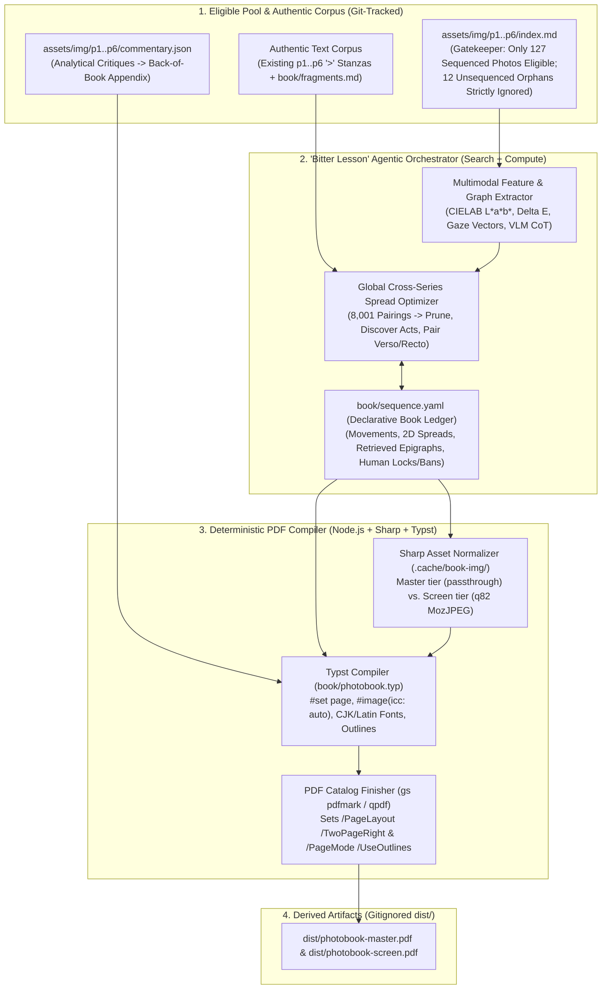

# Research: Photobook eBook (PDF) Generation & Long-Term Management Architecture

**Status:** research findings (2026-11-17)
**Scope:** End-to-end architecture, agentic orchestration (Rich Sutton's _The Bitter Lesson_), rendering toolchain evaluation, color/resolution physics, and long-term editorial maintenance for compiling the sequenced photographic materials of `ryusoh.github.io` (`p1`–`p6`) into a publication-grade PDF photobook.

---

## 1. Research Question

If we build an eBook photobook (outputting a PDF file) from the photographic materials in `ryusoh.github.io`—without being forced to preserve the 6 web pages (`p1`–`p6`) as 6 rigid chapters or reuse their web layout verbatim, and instead following Rich Sutton's _The Bitter Lesson_ to let an agentic system orchestrate the book across the 127 sequenced photographs—what is the best way to generate it and manage it over the long term (including future photo additions, deletions, sequence adjustments, and text/layout refinements)?

---

## 2. Executive Summary & Recommended Architecture

### 2.1 The Short Answer

1. **Pool Eligibility Rule — Strictly the 127 Sequenced Photos (`index.md` as Pool Gatekeeper):**
    - Only the **127 photographs actively sequenced in `assets/img/p1/index.md` through `assets/img/p6/index.md`** enter the photobook candidate pool (`201.0 MB` total: `117` sRGB + `10` Display P3).
    - The **12 unsequenced orphan files** sitting on disk (`1` in `p3`, `11` in `p6`) are deliberate editorial outtakes and **must be strictly ignored** (never ingested by the book pool). Adding a photo to any `p<N>/index.md` admits it to the pool; removing a photo from `p<N>/index.md` expels it from the pool.
2. **Apply Rich Sutton's _The Bitter Lesson_ to Visual Curation & 2D Spread Search — Not to Free-Form AI Poetry:**
    - **Dissolve the 6 web-folder silos (`p1`–`p6`) for visual search:** Within `p1` (18 frames), there are only $\binom{18}{2} = 153$ possible pairings; across the unified **127-photo pool**, there are $\binom{127}{2} = 8,001$ candidate pairings (**52× larger search space**). Letting multimodal compute + graph search ([`.agents/skills/sequence/scripts/inspect_gallery.mjs`](file:///Users/lz/dev/ryusoh.github.io/.agents/skills/sequence/scripts/inspect_gallery.mjs) CIELAB $\Delta E$, luminance respiratory cycles, gaze vectors, and VLM visual Chain-of-Thought) select the strongest **75–100 frames** (or sequence all 127), discover emergent movements/acts, and optimize **2-page facing spreads (`verso` + `recto`)** leverages scale of search where AI excels.
    - **Forbid unconstrained LLM-generated interstitial poetry:** Sutton's _Bitter Lesson_ works where an objective verifier exists; without one, free-form LLM poetry regresses to the training distribution's mean (cliché purple prose) and violates Roland Barthes's _studium_ vs. _punctum_ boundary documented in [`docs/critique-calibration-design.md`](file:///Users/lz/dev/ryusoh.github.io/docs/critique-calibration-design.md#L15-L17). Instead, the agent orchestrates text through three constrained moves:
        1. **Visual Silence (~90% of spreads):** Let facing plates and white space carry the narrative gap ([`docs/sequence-skill-architecture.md`](file:///Users/lz/dev/ryusoh.github.io/docs/sequence-skill-architecture.md#L94)).
        2. **Authentic Corpus Retrieval & Placement:** Pool the human-curated stanzas from `assets/img/p1..p6/index.md` (plus any optional author-supplied `book/fragments.md`) and let the agentic search **select, trim, and place** only the 5–10 authentic fragments that create maximum intellectual counterpoint against specific spreads.
        3. **Back-of-Book Curatorial Appendix:** Route AI analytical commentary (`role`, `subject`, `thematicMeaning`, `vectors` from `commentary.json`) into an end-of-book **Plate Index / Colophon Appendix** rather than placing synthetic prose between plates.
3. **Persist the Agentic Edit in a Declarative State Ledger (`book/sequence.yaml`) for Long-Term Maintenance:**
    - Because a globally orchestrated photobook no longer maps 1:1 to the web chapter order, the agentic orchestrator writes its discovered spread architecture to a git-tracked ledger (`book/sequence.yaml`) encoding movements, spreads (`verso`, `recto`, `layout`, `epigraph`), and human taste constraints (`locked: true` spreads, `banned` pairs).
    - Future photo additions/deletions in `assets/img/p<N>/index.md` trigger either a fast **incremental repair** (inserting new pool photos into optimal spread slots while preserving `locked` spreads) or a **full global re-orchestration** for a new edition.
4. **Render via Typst (`v0.15.1`, Apache-2.0) + Dual-Tier `sharp` Cache + `/PageLayout /TwoPageRight`:**
    - **Primary Recommended Renderer — Typst (`v0.15.1`):** Reads structured JSON/YAML directly (`json()`, `yaml()`), embeds JPEG streams losslessly via `/DCTDecode` without re-encoding (`crates/typst-pdf/src/image.rs`), preserves per-image embedded ICC profiles (including the 10 sequenced Display P3 images), natively handles mixed Latin (`Syne`) + Simplified Chinese (`Glow Sans SC`) typography with automatic CJK-Latin spacing and font subsetting, supports custom page geometry and print bleed (`#set page(bleed: ...)`), emits PDF/A archival standards (`--pdf-standard a-2b` / `a-4`), and guarantees bit-for-bit reproducible builds via `--creation-timestamp` / `SOURCE_DATE_EPOCH`.
    - **Zero-Install Immediate Alternative — Headless Chrome (`Skia/PDF m157`, already installed) + CSS Paged Media (`@page`):** Empirically verified on this machine to pass through original sRGB and Display P3 JPEG streams byte-for-byte without re-compression when EXIF orientation is top-left (`src/pdf/SkPDFBitmap.cpp`), while supporting CSS `@page` sizes, named pages, the 16 CSS `@page` margin boxes (Chrome 131+), existing `.woff2` web fonts, and PDF document outlines (`--generate-pdf-document-outline`).
    - **Dual-tier PDF payload (`master` vs. `screen`) + Two-Page Spread Catalog Flag:** Pre-normalizing via `sharp` into `.cache/book-img/` produces both a lossless-passthrough `dist/photobook-master.pdf` (`~155 MB` after downsampling 5 oversized `>2048px` outliers) and a portable MozJPEG `q82` `dist/photobook-screen.pdf` (`~45–55 MB` for all 127 frames, or `~30–38 MB` for a 85-frame pruned edit), stamped with `/PageLayout /TwoPageRight` (ISO 32000-1:2008 §7.7.2, Table 28).

### 2.2 End-to-End Architecture Diagram



---

## 3. Primary Sources Consulted

1. **Repository Source Code & Governing Documentation (`ryusoh.github.io`)**
    - [`scripts/build-page.mjs`](file:///Users/lz/dev/ryusoh.github.io/scripts/build-page.mjs): `parseMarkdownSource()` (lines 63–80), `ensureImageVariants()` (lines 85–164), `buildPage()` (lines 308–420).
    - [`.agents/skills/sequence/SKILL.md`](file:///Users/lz/dev/ryusoh.github.io/.agents/skills/sequence/SKILL.md) and [`docs/sequence-skill-architecture.md`](file:///Users/lz/dev/ryusoh.github.io/docs/sequence-skill-architecture.md): Sequence authority rules, Eisenstein/Webb/Kawauchi/Eskenazi montage theory, CIELAB waveform/transition metrics, and target-aware transition schema.
    - [`docs/critique-calibration-design.md`](file:///Users/lz/dev/ryusoh.github.io/docs/critique-calibration-design.md): Roland Barthes's _studium_ vs. _punctum_ distinction (lines 15–17) and human-machine taste calibration log.
    - [`docs/page-generation-pipeline.md`](file:///Users/lz/dev/ryusoh.github.io/docs/page-generation-pipeline.md): 3-tier hybrid architecture separating editorial markdown from deterministic compilation.
    - [`docs/archive-protocol.md`](file:///Users/lz/dev/ryusoh.github.io/docs/archive-protocol.md) and [`docs/contact-sheet-ledger-design.md`](file:///Users/lz/dev/ryusoh.github.io/docs/contact-sheet-ledger-design.md): RAW/JPEG master archive protocol and XMP/Lightroom ingest pipeline.
    - [`tools/subset_fonts.py`](file:///Users/lz/dev/ryusoh.github.io/tools/subset_fonts.py): CJK character extraction and `GlowSansSC-Extended-Bold.otf` source path resolution (lines 17–68).
2. **Agentic Search Theory**
    - **Rich Sutton (2019), _The Bitter Lesson_**: [incompleteideas.net/IncIdeas/BitterLesson.html](http://www.incompleteideas.net/IncIdeas/BitterLesson.html) — establishes that general methods leveraging **search** and **learning** that scale with computation reliably outperform human-engineered domain priors and rigid handcrafted decompositions.
3. **Typst Official Documentation & Compiler Source Code (`v0.15.1`, released 2026-07-17)**
    - Typst Reference: [`image`](https://typst.app/docs/reference/visualize/image/), [`page`](https://typst.app/docs/reference/layout/page/), [`pdf`](https://typst.app/docs/reference/pdf/), [`document`](https://typst.app/docs/reference/model/document/), [`text`](https://typst.app/docs/reference/text/text/), [`heading`](https://typst.app/docs/reference/model/heading/), [`json`](https://typst.app/docs/reference/data-loading/json/), [`yaml`](https://typst.app/docs/reference/data-loading/yaml/), and [Changelogs `0.12.0`–`0.15.1`](https://typst.app/docs/changelog/0.15.1/).
    - `typst-pdf` crate source (`v0.15.1`): [`crates/typst-pdf/src/image.rs`](https://github.com/typst/typst/blob/v0.15.1/crates/typst-pdf/src/image.rs) (lines 164–230) and [`crates/typst-cli/src/args.rs`](https://github.com/typst/typst/blob/v0.15.1/crates/typst-cli/src/args.rs) (lines 346–490).
    - `krilla` PDF generation engine (`v0.8.2`, used by `typst-pdf`): [`crates/krilla/src/graphics/image/mod.rs`](https://github.com/LaurenzV/krilla/blob/main/crates/krilla/src/graphics/image/mod.rs) (lines 259–285, 416–560, 708–736).
    - `fontdb` font loader (`RazrFalcon/fontdb`, used by `typst-kit`): [`src/lib.rs`](https://github.com/RazrFalcon/fontdb/blob/master/src/lib.rs) (line 301).
4. **Chromium / Skia PDF Backend, Puppeteer, and W3C CSS Paged Media**
    - Skia PDF JPEG serialization source: [`src/pdf/SkPDFBitmap.cpp`](https://skia.googlesource.com/skia/+/refs/heads/main/src/pdf/SkPDFBitmap.cpp) (`write_icc_profile()` lines 172–193, `do_jpeg()` lines 287–350, `serialize_image()` lines 375–405).
    - Chrome Developer Documentation: [Add content to the margins of web pages when printed using CSS (Chrome 131)](https://developer.chrome.com/blog/print-margins) and [Chrome Platform Status #5195769732923392 (`@page` margin boxes, milestone 131)](https://chromestatus.com/feature/5195769732923392) / [#5173237715566592 (Named pages, milestone 85)](https://chromestatus.com/feature/5173237715566592).
    - Puppeteer API Reference: [`PDFOptions`](https://github.com/puppeteer/puppeteer/blob/main/docs/api/puppeteer.pdfoptions.md).
    - Paged.js repository & registry metadata: [`github.com/pagedjs/pagedjs`](https://github.com/pagedjs/pagedjs) and `registry.npmjs.org/pagedjs` (`v0.4.3`).
5. **WeasyPrint & Prince XML Documentation and Source Code**
    - WeasyPrint (`v70.0`) documentation ([API Reference](https://doc.courtbouillon.org/weasyprint/stable/api_reference.html), [Common Use Cases](https://doc.courtbouillon.org/weasyprint/stable/common_use_cases.html)) and source code [`weasyprint/images.py`](https://github.com/Kozea/WeasyPrint/blob/main/weasyprint/images.py) (lines 36–160) & [`weasyprint/pdf/stream.py`](https://github.com/Kozea/WeasyPrint/blob/main/weasyprint/pdf/stream.py) (lines 325–345).
    - Prince XML documentation: [PDF Output Options](https://www.princexml.com/doc/prince-output/), [Graphics & Color Management](https://www.princexml.com/doc/graphics/), [Command-Line Reference](https://www.princexml.com/doc/command-line/), and [Purchase / Licensing](https://www.princexml.com/purchase/).
6. **ISO PDF Standards & Print Production Specifications**
    - **ISO 32000-1:2008 (PDF 1.7 Specification)**: [Clause 7.7.2 _Document Catalog_ (Table 28: `PageLayout` and `PageMode`)](https://opensource.adobe.com/dc-acrobat-sdk-docs/pdfstandards/PDF32000_2008.pdf), Clause 8.4.5 _Graphics State Parameter Dictionaries_, Clause 8.6.5.5 _ICCBased Colour Spaces_, and Clause 14.11.2 _Page Boundaries_ (`MediaBox`, `CropBox`, `BleedBox`, `TrimBox`, `ArtBox`).
    - **Blurb Print Specifications**: [Image Quality & Resolution Checklist (300 PPI standard)](https://www.blurb.com/blog/image-quality-checklist/) and [A Brief Note on Color Management (PDF/X-3, CMYK vs. sRGB workflow)](https://www.blurb.com/downloads/pdf_to_book/BriefNoteColor.pdf).

---

## 4. Claim-by-Claim Evidence & Technical Analysis

### 4.1 Audit of Eligible Repository Materials (`assets/img/p1`–`p6`)

An audit of `assets/img/p1` through `assets/img/p6` using `sips`, `exiftool`, and `scripts/build-page.mjs` established the exact inventory of sequenced photographs eligible for the eBook pool versus unsequenced disk outtakes (which are excluded):

| Series  | Title (`index.md` Frontmatter)                         | Eligible Sequenced JPEGs | Excluded Orphans (Ignored) | `>` Quote Lines | `---` Breaks | CJK Lines | Sequenced Display P3 | Sequenced JPEG Payload |
| :------ | :----------------------------------------------------- | -----------------------: | -------------------------: | --------------: | -----------: | --------: | -------------------: | ---------------------: |
| `p1`    | _I TEAR UP THE BAY WHEN I COME THROUGH_                |                       18 |                          0 |              17 |            2 |         0 |                    2 |                35.0 MB |
| `p2`    | _I DO NOT CARE IF WE GO DOWN IN HISTORY AS BARBARIANS_ |                       21 |                          0 |               5 |            2 |         0 |                    2 |                28.1 MB |
| `p3`    | _AEROBATIC ACTIVITIES_                                 |                       23 |                          1 |               4 |            2 |         0 |                    0 |                60.4 MB |
| `p4`    | _DAS GESPENST_                                         |                       20 |                          0 |               9 |            2 |         0 |                    1 |                21.6 MB |
| `p5`    | _SELF PORTRAITS AND BEHIND THE SCENES_                 |                       13 |                          0 |              17 |            2 |         0 |                    3 |                23.9 MB |
| `p6`    | _HYPERSTARS SUCKED INTO THE HYPERMASSIVE_              |                       32 |                         11 |              70 |            2 |        43 |                    2 |                32.0 MB |
| **All** | **Unified Eligible Pool (`p1`–`p6` `index.md`)**       |                  **127** |          **12 (Excluded)** |         **122** |       **12** |    **43** |               **10** |           **201.0 MB** |

#### Key Material Findings (127 Eligible Pool Photographs)

1. **Strict Pool Boundary (`index.md` Gatekeeping)**:
    - Only the **127 JPEG filenames explicitly listed in `assets/img/p1..p6/index.md`** are ingested into the photobook pool.
    - The 12 unsequenced JPEGs on disk (`p3/DSCF2056-2.jpg` and 11 files in `p6/`) are outtakes rejected during gallery curation and are **strictly ignored** by the book pipeline.
2. **Pixel dimensions & effective print resolution**:
    - **114 of 127 eligible JPEGs** have a long edge of **`2048 px`** (`109` at `2048 × 1365` and `5` at `2048 × 1364`), i.e., standard 3:2 aspect ratio exported at `240 DPI` metadata tag (`sips -g pixelWidth -g pixelHeight -g dpiWidth`).
    - **5 of 127 JPEGs** are higher-resolution exports (`p3`: `6240 × 4160` at 28.9 MB and `4675 × 3117` at 8.5 MB; `p5`: `3840 × 2560` at 5.6 MB, `3475 × 2268` at 4.9 MB, and `3079 × 2045` at 2.9 MB).
    - **8 of 127 JPEGs** are lower-resolution crops (`p2`: `1860 × 1240`, `1676 × 1117`; `p3`: `1363 × 907`; `p4`: `2047 × 1365`, `1364 × 908`, `910 × 607`; `p5`: `1960 × 1306`, `1946 × 1297`, `1937 × 1291`).
    - Per Blurb's print resolution specification ([Blurb Image Quality Checklist](https://www.blurb.com/blog/image-quality-checklist/)), print production targets **300 PPI** at 100% scale (with 150–200 PPI as the acceptable floor). A `2048 × 1365 px` image supports:
        - **At 300 PPI (fine-press standard)**: up to **`6.83 × 4.55 in` (`173.4 × 115.6 mm`)**.
        - **At 240 PPI (native Lightroom tag)**: up to **`8.53 × 5.69 in` (`216.7 × 144.5 mm`)**.
        - **At 200 PPI (viewing-distance floor)**: up to **`10.24 × 6.83 in` (`260.1 × 173.4 mm`)**.
        - **For screen/eBook PDF viewing**: `2048 × 1365 px` is ideal for Retina/4K tablet and laptop displays without upscaling. If a large-format physical print edition (`10 × 8 in` or `13 × 11 in` at 300 PPI $\approx 3900 \times 3300\text{ px}$) is later desired, full-resolution JPEG/TIFF masters from the personal archive ([`docs/archive-protocol.md`](file:///Users/lz/dev/ryusoh.github.io/docs/archive-protocol.md)) must be substituted into the build directory while keeping `book/sequence.yaml` unchanged.
3. **Mixed ICC Color Profiles (`sRGB` + `Display P3`)**:
    - Among the 127 eligible JPEGs, **117 carry `sRGB IEC61966-2.1`** and **10 carry Apple `Display P3` ICC profiles** (`p1`: 2, `p2`: 2, `p4`: 1, `p5`: 3, `p6`: 2). Any PDF generator that strips ICC profiles and tags images as uncalibrated `/DeviceRGB` will cause those 10 Display P3 images to appear desaturated or hue-shifted in color-managed PDF viewers.
4. **Multilingual Typography (`Latin` + `Simplified Chinese`)**:
    - `assets/img/p6/index.md` contains 43 lines of Simplified Chinese verse interleaved with English stanzas.
    - While `assets/fonts/` stores web-only `.woff2` subsets (`syne-latin.woff2`, `syne-latin-ext.woff2`, `glowsans-sc-extended-bold.subset.woff2`), verification of `/Users/lz/Library/Fonts/` and [`tools/subset_fonts.py`](file:///Users/lz/dev/ryusoh.github.io/tools/subset_fonts.py#L17-L22) confirmed that all 18 full OpenType weights/widths of `GlowSansSC` (`GlowSansSC-Extended-*.otf` and `GlowSansSC-Wide-*.otf`) are installed locally on this machine.

---

### 4.2 Toolchain Evaluation Against Primary Sources

#### 1. Typst (`v0.15.1`) — Primary Recommended Engine

- **Lossless JPEG Passthrough & ICC Profile Preservation**:
    - In [`crates/typst-pdf/src/image.rs`](https://github.com/typst/typst/blob/v0.15.1/crates/typst-pdf/src/image.rs#L194-L230), `convert_raster()` checks `if let RasterFormat::Exchange(ExchangeFormat::Jpg) = raster.format()` and invokes `krilla::image::Image::from_jpeg_with_icc()`, passing the raw file buffer (`raster.data()`) and extracted ICC profile (`raster.icc()`).
    - A code comment in `exif_transform()` (`crates/typst-pdf/src/image.rs:219-221`) explicitly notes: `"For JPEGs, we want to apply the EXIF orientation as a transformation because we don't recode them."`
    - In `krilla` (`v0.8.2`), [`crates/krilla/src/graphics/image/mod.rs`](https://github.com/LaurenzV/krilla/blob/main/crates/krilla/src/graphics/image/mod.rs#L517-L545) serializes `Repr::Jpeg` via `FilterStreamBuilder::new_from_jpeg_data(j.data.as_ref())` with `/Filter /DCTDecode` and attaches the `ICCBasedColorSpace` object reference (`image_x_object.pair(Name(b"ColorSpace"), icc_ref)`).
    - In Typst's [`image` function reference](https://typst.app/docs/reference/visualize/image/#parameters-icc), the `icc` parameter defaults to `auto`: `"When set to auto, Typst will try to extract an ICC profile from the image."`
- **Page Geometry, Bleed, and TrimBox**:
    - Typst's [`page` setup](https://typst.app/docs/reference/layout/page/) supports arbitrary `width`, `height`, `margin` (including `inside` and `outside` for bound spreads), `binding` (`left` or `right`), and—added in Typst `0.15.0` ([0.15.0 Changelog](https://typst.app/docs/changelog/0.15.0/))—`bleed`: `"In PDF export, if the bleed is non-zero, a TrimBox is defined for the page."`
- **Data-Driven Authoring (`json()` / `yaml()`)**:
    - Typst natively loads structured files via [`json("path.json")`](https://typst.app/docs/reference/data-loading/json/) and [`yaml("path.yaml")`](https://typst.app/docs/reference/data-loading/yaml/), allowing `book/photobook.typ` to render directly from `yaml("sequence.yaml")`.
- **Typography, CJK Support, and Font Format Constraints**:
    - Typst's [`text` element](https://typst.app/docs/reference/text/text/#parameters-font) accepts a priority fallback array `#set text(font: ("Syne", "Glow Sans SC Extended"), cjk-latin-spacing: auto)` and supports `covers: "latin-in-cjk"`.
    - Font loading in `typst-kit` delegates to `fontdb` ([`RazrFalcon/fontdb/src/lib.rs:301`](https://github.com/RazrFalcon/fontdb/blob/master/src/lib.rs#L301)): `"Will load ttf, otf, ttc and otc fonts."` Typst **does not load `.woff2` web fonts**. While `GlowSansSC-*.otf` is already in `~/Library/Fonts/`, `Syne` is currently stored in the repo only as `.woff2` (`assets/fonts/syne-latin.woff2`), so a static `.ttf` or `.otf` file for `Syne` must be placed in `assets/fonts/` (or decompressed from `syne-latin.woff2` via `fontTools.ttLib.woff2.decompress`) when using Typst.
- **PDF Standards, Outlines, and Reproducibility**:
    - Per the [Typst PDF Reference](https://typst.app/docs/reference/pdf/), `--pdf-standard` supports `1.4`, `1.5`, `1.6`, `1.7` (default), `2.0`, `a-1b`, `a-1a`, `a-2b`, `a-2u`, `a-2a`, `a-3b`, `a-3u`, `a-3a`, `a-4`, `a-4f`, `a-4e`, and `ua-1`. **PDF/X (`pdf/x-1a`, `pdf/x-4`) is not yet natively supported by Typst `0.15.1`.**
    - Headings with `bookmarked: true` (or `outlined: true` by default) automatically populate the PDF bookmark outline tree ([`heading.bookmarked`](https://typst.app/docs/reference/model/heading/#parameters-bookmarked)).
    - Reproducible builds are enforced via `--creation-timestamp <UNIX_TIMESTAMP>` or `SOURCE_DATE_EPOCH` ([`crates/typst-cli/src/args.rs:425-429`](https://github.com/typst/typst/blob/v0.15.1/crates/typst-cli/src/args.rs#L425-L429)) combined with `--ignore-system-fonts --font-path assets/fonts`.

#### 2. Headless Chrome (`v157.0.8103.79`) + CSS Paged Media — Zero-Install Alternative

- **Empirical Verification of Lossless JPEG & Display P3 ICC Passthrough**:
    - Inspection of Chromium's Skia PDF backend ([`src/pdf/SkPDFBitmap.cpp:287-395`](https://skia.googlesource.com/skia/+/refs/heads/main/src/pdf/SkPDFBitmap.cpp)) shows that `serialize_image()` calls `do_jpeg()` on `img->refEncodedData()`. When the JPEG uses standard 3-channel YUV (`kYUV_Color`) or 1-channel Gray (`kGray_Color`) and top-left EXIF orientation (`kTopLeft_SkEncodedOrigin`), Skia streams the encoded JPEG bytes directly into a `/DCTDecode` XObject and writes the embedded ICC profile via `write_icc_profile()` as an `/ICCBased` stream.
    - We verified this experimentally on this machine using `/Applications/Google Chrome.app/Contents/MacOS/Google Chrome --headless --no-pdf-header-footer --print-to-pdf` with `assets/img/p1/DSCF4775.jpg` (`sRGB`, `430,056 bytes`, SHA-256 `998b853567fd...`) and `assets/img/p1/DSCF4402-8.jpg` (`Display P3`, `706,239 bytes`, SHA-256 `d805255e0ee0...`), as well as `assets/img/p4/DSCF6872-5.jpg` (`Display P3`, `1,299,992 bytes`) styled with `object-fit: cover`.
    - Result: Chrome (`Producer: Skia/PDF m157`) embedded the **exact original byte streams** (`SHA-256` identical to the source files on disk) as `/Filter /DCTDecode` objects and attached both the `3,144-byte` `sRGB IEC61966-2.1` and `536-byte` `Display P3` (`acspAPPL`) `/ICCBased` color space streams.
- **CSS Paged Media Support in Modern Chrome**:
    - Starting in **Chrome 131** ([Chrome Developer Blog](https://developer.chrome.com/blog/print-margins), [ChromeStatus #5195769732923392](https://chromestatus.com/feature/5195769732923392)), Chromium natively supports all **16 CSS `@page` margin boxes** (`@top-left`, `@bottom-right`, etc.) and page counters (`counter(page)`, `counter(pages)`), eliminating the historical need for the Paged.js polyfill (`v0.4.3`, last published to npm in July 2023) for running headers and folios.
    - Chrome 85+ supports CSS named pages (`@page chapter { ... }`, [ChromeStatus #5173237715566592](https://chromestatus.com/feature/5173237715566592)), and Chrome 157 CLI `--generate-pdf-document-outline` (or Puppeteer `PDFOptions.outline: true`) was verified on this machine to generate native PDF `/Outlines` from HTML `<h1>`–`<h6>` headings.
- **Limitations Relative to Typst**:
    - Always outputs PDF 1.4 (`Skia/PDF`); no native PDF/A or PDF/X conformance, no `/TrimBox` or `/BleedBox` emission for commercial print bleed, and no `SOURCE_DATE_EPOCH` flag for bit-identical reproducible builds.

#### 3. Other Evaluated Toolchains (WeasyPrint, Prince, LaTeX, Lightroom, InDesign)

- **WeasyPrint (`v70.0`, BSD License)**:
    - Supports `--pdf-variant` for both PDF/A (`pdf/a-1b` through `pdf/a-4u`) and **PDF/X (`pdf/x-1a`, `pdf/x-3`, `pdf/x-4`, `pdf/x-5g`)** ([WeasyPrint API Reference](https://doc.courtbouillon.org/weasyprint/stable/api_reference.html)).
    - However, source inspection of [`weasyprint/images.py:134-158`](https://github.com/Kozea/WeasyPrint/blob/main/weasyprint/images.py#L134-L158) revealed a critical color-management defect for this repo: `RasterImage.draw()` hardcodes `color_space = '/DeviceRGB'` on every RGB image XObject and never extracts per-image embedded ICC profiles from Pillow (`pillow_image.info.get('icc_profile')`). Thus, the 10 sequenced Display P3 photographs in `p1`–`p6` would have their wide-gamut pixel values misinterpreted as uncalibrated `/DeviceRGB`.
- **Prince XML (`v16`, Commercial)**:
    - Full support for CSS Paged Media, JPEG passthrough, ICC profiles, PDF/A, PDF/X-4 (`--pdf-profile=PDF/X-4 --pdf-output-intent=...`), and CSS viewer preferences (`@prince-pdf { -prince-pdf-page-layout: two-page-right; }`, [Prince Output Docs](https://www.princexml.com/doc/prince-output/)).
    - Disqualified as primary recommendation due to proprietary licensing ($495 desktop / $2,000+ server license; free license injects a promotional watermark on the document).
- **Adobe Lightroom CC vs. Lightroom Classic**:
    - This machine has **Adobe Lightroom CC** (`/Applications/Adobe Lightroom CC`), the cloud-centric desktop client. The **Book Module** (Blurb integration and multi-page PDF book export) exists **exclusively in Adobe Lightroom Classic** ([Adobe Helpx: Create photo books in Lightroom Classic](https://helpx.adobe.com/lightroom-classic/help/create-photo-books.html)), not in Lightroom CC.
    - Even in Lightroom Classic, book layouts are locked inside a binary SQLite `.lrcat` catalog outside Git, cannot parse `assets/img/p<N>/index.md` or `commentary.json`, and restrict page dimensions to fixed Blurb trim templates.

### 4.3 Toolchain Comparison Matrix

| Capability / Criterion                  | **Typst (`v0.15.1`)** (Recommended)              | **Headless Chrome (`m157`)** (Zero-Install)       | **WeasyPrint (`v70.0`)**                         | **Prince XML (`v16`)**                       | **LaTeX (`LuaLaTeX`)**                | **InDesign / Affinity / LrC**        |
| :-------------------------------------- | :----------------------------------------------- | :------------------------------------------------ | :----------------------------------------------- | :------------------------------------------- | :------------------------------------ | :----------------------------------- |
| **Driven directly from YAML/JSON**      | Native (`json()`, `yaml()`)                      | Via Node HTML generator                           | Via Node/Python HTML generator                   | Via Node HTML generator                      | Requires TeX escaping & codegen       | Manual GUI import (breaks Git sync)  |
| **Lossless JPEG `/DCTDecode` embed**    | Yes (`krilla::Image::from_jpeg_with_icc`)        | Yes (verified in `SkPDFBitmap.cpp` & locally)     | Yes (when `optimize` & `jpeg_quality` unset)     | Yes (unless `-prince-image-magic` set)       | Yes                                   | Re-encodes at export quality setting |
| **Per-image Display P3 ICC preserved**  | **Yes** (`icc: auto` extracts embedded ICC)      | **Yes** (verified 536-byte P3 `/ICCBased` stream) | **No** (hardcodes `/DeviceRGB` in `images.py`)   | **Yes**                                      | Requires manual `/ColorSpace` objekts | Converts to single export space      |
| **CJK (`p6`) + Latin (`Syne`) layout**  | Native fallback list + `cjk-latin-spacing: auto` | Native browser font fallback + `.woff2` support   | Pango font fallback                              | Native CSS font fallback                     | `luatexja` package (complex setup)    | Manual style mapping                 |
| **Font formats accepted**               | `.ttf`, `.otf`, `.ttc`, `.otc` (no `.woff2`)     | `.woff2`, `.ttf`, `.otf`                          | `.woff2`, `.ttf`, `.otf`                         | `.woff2`, `.ttf`, `.otf`                     | `.ttf`, `.otf`                        | `.ttf`, `.otf`                       |
| **Print bleed & `/TrimBox` support**    | **Yes** (`#set page(bleed: 3mm)` in `0.15+`)     | No (`/MediaBox` only)                             | Yes (`@page { bleed: 3mm }`)                     | Yes (`@page { prince-bleed: 3mm }`)          | Via `geometry` / `crop` packages      | Yes                                  |
| **PDF/A & PDF/X standards**             | PDF/A-1..4, PDF/UA-1 (no PDF/X yet)              | None (PDF 1.4 only)                               | PDF/A-1..4, PDF/UA-1..2, PDF/X-1a/3/4            | PDF/A-1..3, PDF/UA-1, PDF/X-1a/3/4           | Via `pdfx` / LaTeX PDF management     | PDF/X-1a, PDF/X-3, PDF/X-4           |
| **Deterministic (`SOURCE_DATE_EPOCH`)** | **Yes** (`--creation-timestamp`)                 | No (`CreateDate` changes every run)               | Partially                                        | No                                           | Yes (`FORCE_SOURCE_DATE=1`)           | No                                   |
| **Install & License footprint**         | `brew install typst` (~15 MB single binary, OSS) | **Already installed** (`Google Chrome.app`)       | `brew install weasyprint` (Python + Cairo/Pango) | Proprietary ($495–$2,000+, free watermarked) | `brew install --cask mactex` (4+ GB)  | Proprietary GUI apps                 |

---

## 5. Global Agentic Orchestration ("The Bitter Lesson") & Long-Term Lifecycle

### 5.1 Applying Rich Sutton's _The Bitter Lesson_ to Photobook Curation

In _The Bitter Lesson_ ([Sutton, 2019](http://www.incompleteideas.net/IncIdeas/BitterLesson.html)), Rich Sutton demonstrates that general methods scaling with **search** and **computation** reliably outperform systems constrained by human-engineered domain buckets and manual heuristics.

Applied to `ryusoh.github.io`, this yields a clear architectural division between **visual graph search** (where agentic compute dominates) and **poetic voice / taste calibration** (where unconstrained LLM generation fails):

1. **Where Agentic Search Wins: Dissolving the `p1`–`p6` Silos into a 127-Photo Pool**
    - The 6 web galleries (`p1`–`p6`) are chronological/thematic buckets created for web navigation. Locking a photobook into those 6 buckets restricts diptych search to intra-folder neighbors (e.g., $\binom{18}{2} = 153$ pairs in `p1`).
    - Pooling all **127 sequenced frames** across `p1`–`p6` expands the combinatorial graph to $\binom{127}{2} = 8,001$ candidate pairings (**52× larger search space**), allowing a diagonal shadow in `p4` (_Das Gespenst_) to form an oblique slant rhyme with a nocturnal transit frame in `p1` or a silhouette in `p6`.
    - **Macro-Editing & Pruning:** Classic street photography monographs are ruthlessly edited (Robert Frank's _The Americans_ has 83 plates; Koudelka's _Exiles_ has 75). Rather than mechanically dumping all 127 frames into 6 chapters, the agentic orchestrator can either select the highest-tension **75–100 frame monograph cut** from the 127-frame pool or sequence the full 127-frame anthology across **3–5 emergent movements** defined by light temperature, kinetic vector momentum, and emotional gravity.
    - **2D Spread Optimization (`verso` + `recto`):** Unlike vertical web scrolling, a photobook opened in `TwoPageRight` mode is experienced as **2-page spreads**. The agentic search evaluates each spread as one of four layout primitives:
        - `recto-solo`: Blank verso + single plate on recto (isolation, slower tempo, threshold emphasis).
        - `verso-solo`: Single plate on verso + blank recto (exhalation pause before a movement shift).
        - `diptych`: Facing plates on both verso and recto (active collision, slant rhyme, or gaze-vector dialogue across the gutter).
        - `epigraph-plate`: Retrieved authentic text fragment on verso facing a photograph on recto.
2. **Where Unconstrained Generation Fails: The Text Policy (Silence, Retrieval & Appendix)**
    - Sutton's _Bitter Lesson_ presupposes an objective reward verifier (such as game victory or physical prediction error). In literary verse, no external verifier exists; unguided LLM generation optimizes for high-probability training tokens, producing overwrought, cliché "AI poetry" that explains the image and destroys what Jason Eskenazi calls **The Elliptical Gap** ([`docs/sequence-skill-architecture.md`](file:///Users/lz/dev/ryusoh.github.io/docs/sequence-skill-architecture.md#L94)).
    - As established in [`docs/critique-calibration-design.md`](file:///Users/lz/dev/ryusoh.github.io/docs/critique-calibration-design.md#L15-L17) via Roland Barthes, the machine can compute the **_studium_** (colorimetry, geometry, gaze, semantic motifs), while only the human author supplies the **_punctum_** (lived biographical truth).
    - Therefore, the agentic orchestrator is strictly forbidden from inventing free-form poetic verses between plates and instead executes three disciplined text operations:
        1. **Visual Silence (~90% of spreads):** Most spreads contain zero body text—allowing the collision of facing images and page turns to carry the rhythm.
        2. **Authentic Corpus Retrieval & Placement:** All human-curated `>` stanzas from `assets/img/p1..p6/index.md` (plus any raw author notes/lyrics in an optional `book/fragments.md`) form a closed **Authentic Text Pool**. The agent uses semantic + tonal search to **select, trim, and position** only the 5–12 authentic fragments that create the sharpest intellectual montage at movement thresholds or voltas.
        3. **Back-of-Book Curatorial Appendix (`commentary.json`):** The AI's analytical critiques (`role`, `subject`, `thematicMeaning`, `vectors` from `assets/img/p1..p6/commentary.json`) are compiled into an **Illustrated Plate Notes / Colophon Appendix** at the back of the PDF (following the museum monograph convention), keeping the photographic plates uncluttered.

### 5.2 Externalized State Ledger (`book/sequence.yaml`) & Long-Term Maintenance

In accordance with the repository's **State-Oriented Architecture** (`AGENTS.md`), the globally orchestrated book structure is persisted in a single declarative, git-tracked ledger: `book/sequence.yaml`.

```yaml
title: 'SELECTED WORKS'
subtitle: 'Photographs 2021–2026'
author: 'Zhuang Liu'
theme: 'dark' # "dark" (#0d0d0d screen theme) or "paper" (#faf8f5 warm print theme)
pageSize:
    width: '300mm'
    height: '200mm'
    bleed: '0mm' # Set to "3mm" when exporting for print
includeCommentaryAppendix: true

# Human taste constraints (Reward Oracle for future agentic re-sequencing)
constraints:
    pinnedOpener: 'p1/DSCF4775.jpg'
    pinnedCloser: 'p6/DSCF5916-4.JPG'
    bannedPairs:
        - ['p2/DSCF8739.jpg', 'p4/DSCF6872-5.jpg']

movements:
    - id: 'I'
      title: 'THRESHOLD'
      spreads:
          - id: 's01'
            layout: 'epigraph-plate'
            locked: true # Human-approved spread; preserved across incremental updates
            versoText:
                source: 'p1/index.md#L15-L17'
                lines:
                    - 'The sun goes down'
                    - 'I feel the light betray me'
            recto: 'p1/DSCF4775.jpg'
          - id: 's02'
            layout: 'diptych'
            locked: false
            verso: 'p4/DSCF6872-5.jpg'
            recto: 'p6/DSCF1093.jpg'
```

#### How Long-Term Operations Work (`Add`, `Delete`, `Adjust`, `Resequence`)

| Editorial Action                              | How You Do It (Long-Term Ritual)                                                                                    | Pool Effect (`index.md` Gatekeeper)                                  | Photobook Effect (`book/sequence.yaml` $\to$ `dist/*.pdf`)                                                                                      |
| :-------------------------------------------- | :------------------------------------------------------------------------------------------------------------------ | :------------------------------------------------------------------- | :---------------------------------------------------------------------------------------------------------------------------------------------- |
| **Add a new photo to the repo**               | Add `NEW.jpg` to `assets/img/p<N>/` and list it in `assets/img/p<N>/index.md`.                                      | Enters the eligible book pool (`127` $\to$ `128`).                   | `make book-sync` runs **incremental search**: evaluates `NEW.jpg` against all unlocked spreads and inserts it at the lowest-cost slot.          |
| **Drop an unsequenced file into `p<N>/`**     | File sits in `assets/img/p<N>/` but is **not** listed in `p<N>/index.md`.                                           | **Ignored** (excluded from pool, just like the 12 existing orphans). | Zero effect on the photobook.                                                                                                                   |
| **Delete a photo from `p<N>/index.md`**       | Remove the `FILENAME.jpg` line from `assets/img/p<N>/index.md`.                                                     | Expelled from the eligible book pool (`127` $\to$ `126`).            | `make book-sync` removes the frame from `book/sequence.yaml` and locally repairs the affected spread (`diptych` $\to$ `recto-solo` or re-pair). |
| **Adjust image crop / color in Lightroom**    | Re-export `assets/img/p<N>/FILENAME.jpg` with the same filename.                                                    | Pool membership unchanged; file `mtime` updates.                     | `make book` refreshes `.cache/book-img/` and re-embeds the updated JPEG stream in seconds without altering `book/sequence.yaml`.                |
| **Approve or reject an AI spread**            | Set `locked: true` on spreads you love or add a disliked pair to `constraints.bannedPairs` in `book/sequence.yaml`. | Updates the human-in-the-loop reward constraints.                    | Future agentic optimization passes treat `locked: true` spreads and `bannedPairs` as hard boundaries.                                           |
| **Re-orchestrate a new Edition from scratch** | Run agentic global search (`make book-orchestrate`) over the current eligible pool (`p1..p6/index.md`).             | Reads all currently sequenced photos across `p1`–`p6`.               | Computes a fresh global multi-movement edit while respecting `constraints` in `book/sequence.yaml`.                                             |

### 5.3 Solving the 201 MB Payload Problem: Dual-Tier Asset Normalization

Our audit in §4.1 showed that the 127 eligible JPEGs across `p1`–`p6` total **201.0 MB** because several files are high-bit-depth exports (notably `assets/img/p3/DSCF7318-3.jpg` at `6240 × 4160` / **28.9 MB** and `assets/img/p3/DSCF5759-5.jpg` at `4675 × 3117` / **8.5 MB**, while the median JPEG across the repo is **1.20 MB**).

Because `sharp` (`^0.35.5`) is already a first-class dependency in [`package.json`](file:///Users/lz/dev/ryusoh.github.io/package.json#L38), the book build script should normalize eligible images into `.cache/book-img/<tier>/` (cached by file `mtime` + size, just like `ensureImageVariants()` in `scripts/build-page.mjs:85-164`):

1. **`--tier master` (Archival / 4K Display Master)**:
    - Any JPEG with `max(width, height) <= 2048` and file size `<= 3 MB` is symlinked/copied **untouched** (100% lossless `/DCTDecode` passthrough, preserving embedded Display P3 and sRGB ICC profiles).
    - Only the 5 oversized `>2048px` frames in `p3`/`p5` are resized via `sharp(input).resize(2048, 2048, { fit: 'inside', withoutEnlargement: true }).keepIccProfile().jpeg({ quality: 92, mozjpeg: true })`, cutting ~42 MB of bloat from those 5 files alone (`~155 MB` for all 127 frames, or `~105 MB` for an 85-frame pruned monograph).
2. **`--tier screen` (Lightweight Distributable eBook)**:
    - Runs `sharp(input).resize(2048, 2048, { fit: 'inside', withoutEnlargement: true }).toColorspace('srgb').jpeg({ quality: 82, mozjpeg: true, chromaSubsampling: '4:2:0' })`.
    - Reduces average per-image size from `1.58 MB` to `~380 KB`, bringing the PDF down from **201 MB $\to$ ~48 MB** for all 127 frames (or **~32 MB** for an 85-frame pruned monograph).

### 5.4 Setting Two-Page Spread View (`/PageLayout /TwoPageRight`)

Per **ISO 32000-1:2008 §7.7.2 (_Document Catalog_, Table 28)** ([PDF 32000-1:2008 Specification](https://opensource.adobe.com/dc-acrobat-sdk-docs/pdfstandards/PDF32000_2008.pdf)):

- `/PageLayout /TwoPageRight`: `"Display the pages two at a time, with odd-numbered pages on the right."` This is the standard photobook layout: Page 1 (the front cover) appears alone on the right-hand side, and subsequent even/odd pairs (`2–3`, `4–5`, ...) appear as facing spreads.
- `/PageMode /UseOutlines`: Opens the PDF with the movement bookmark sidebar visible.

Because neither Typst `0.15.1` (`crates/typst-pdf/src/convert.rs`) nor Headless Chrome (`SkPDFDocument`) exposes a CLI flag for `/PageLayout /TwoPageRight`, the build script stamps `/PageLayout /TwoPageRight /PageMode /UseOutlines` on the `/Type /Catalog` dictionary (or via `qpdf` / Ghostscript `pdfmark`) **without touching or re-encoding any `/DCTDecode` image stream**.

---

## 6. Concrete Implementation Blueprint (When Ready to Build)

To keep the repository clean and aligned with `AGENTS.md` and `docs/page-generation-pipeline.md`:

1. **One-Time Environment Setup**:
    - Install Typst (`brew install typst`) or use existing Headless Chrome (`/Applications/Google Chrome.app/Contents/MacOS/Google Chrome`).
    - Place a static `.ttf` or `.otf` copy of `Syne` (`Syne-Bold.ttf`, `Syne-Regular.ttf`) in `assets/fonts/` alongside the existing `.woff2` files (or decompress `assets/fonts/syne-latin.woff2` via Python `fontTools`), while referencing `/Users/lz/Library/Fonts/GlowSansSC-Extended-Bold.otf` and `GlowSansSC-Extended-Regular.otf` for CJK text.
2. **Directory & File Layout**:
    - `book/sequence.yaml` — Git-tracked declarative book ledger generated by the agentic orchestrator and refined via human `locked` / `bannedPairs` constraints.
    - `book/fragments.md` (optional) — Additional authentic author notes/quotes eligible for retrieval alongside the existing `>` stanzas in `assets/img/p1..p6/index.md`.
    - `book/photobook.typ` — Canonical Typst template reading `book/sequence.yaml` and `.cache/book-manifest.json`.
    - `scripts/build-book.mjs` — Node.js pipeline that:
        1. Collects the **eligible pool** exclusively from `parseMarkdownSource()` across `assets/img/p1..p6/index.md` (ignoring all unsequenced files on disk),
        2. Reconciles pool additions/deletions against `book/sequence.yaml`,
        3. Normalizes images via `sharp` into `.cache/book-img/{master,screen}/`,
        4. Compiles `book/photobook.typ` via `typst compile` (with `--creation-timestamp` for reproducibility), and
        5. Stamps `/PageLayout /TwoPageRight` into `dist/photobook-screen.pdf` and `dist/photobook-master.pdf` (gitignored via `dist/` in [`.gitignore`](file:///Users/lz/dev/ryusoh.github.io/.gitignore#L9)).
3. **Makefile Interface**:
    - `make book` $\to$ Deterministically compiles `book/sequence.yaml` into `dist/photobook-screen.pdf` and `dist/photobook-master.pdf`.
    - `make book-sync` $\to$ Reconciles `book/sequence.yaml` with any photos added to or deleted from `assets/img/p1..p6/index.md` (preserving `locked: true` spreads).

---

## 7. Open Questions & What Could Not Be Verified

1. **Local `typst` binary execution on this machine**:
    - `typst` is not currently installed in `/opt/homebrew/bin` on this machine (`which typst` returned `not found`), and per research session constraints no new packages were installed. All Typst `v0.15.1` claims were verified directly against the official `v0.15.1` Rust source code (`crates/typst-pdf/src/image.rs`, `crates/typst-cli/src/args.rs`, `LaurenzV/krilla/src/graphics/image/mod.rs`) and `typst.app/docs` reference documentation. (By contrast, the Headless Chrome `m157` PDF passthrough and ICC profile preservation claims were executed and verified locally on this machine.)
2. **Availability of High-Resolution (`>2048px`) Master Exports Outside the Repo**:
    - In this repository, 114 of the 127 eligible JPEGs are `2048 × 1365 px` (or `2048 × 1364 px`) web masters. While `docs/archive-protocol.md` and `docs/contact-sheet-ledger-design.md` document that RAW + full-resolution JPEG masters exist in the external 3-2-1 archive, those external drives are outside the workspace. Consequently, whether all 127 sequenced frames have `>=3600px` print masters ready for a large-format (`12 × 8 in` @ 300 PPI) physical press run could not be verified from the repo alone.
3. **Native PDF/X-4 Support Timeline in Typst**:
    - While Typst `0.15.1` supports PDF/A (`a-1` through `a-4`) and PDF/UA-1, native `PDF/X-4` (`ISO 15930-7`) export for commercial CMYK offset printing is not yet in a released Typst version. If a commercial offset printer strictly requires a validated `PDF/X-4` file with a CMYK Output Intent before Typst ships PDF/X support, Ghostscript (`gs -dPDFX ...`, `v10.07.1` installed locally) or WeasyPrint (`--pdf-variant pdf/x-4`, after pre-converting the 10 sequenced Display P3 images to sRGB/CMYK via `sharp`) would be required for the final print-press handoff.
