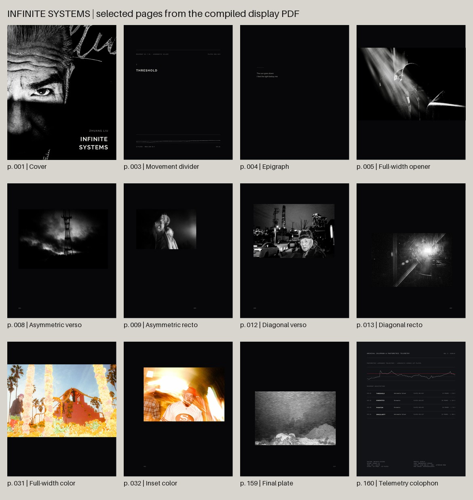
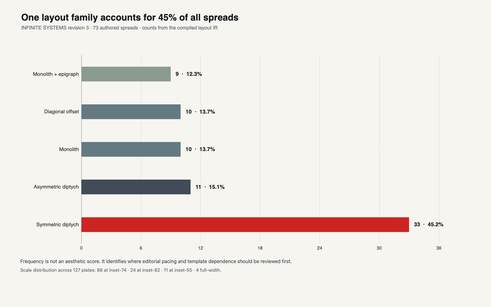
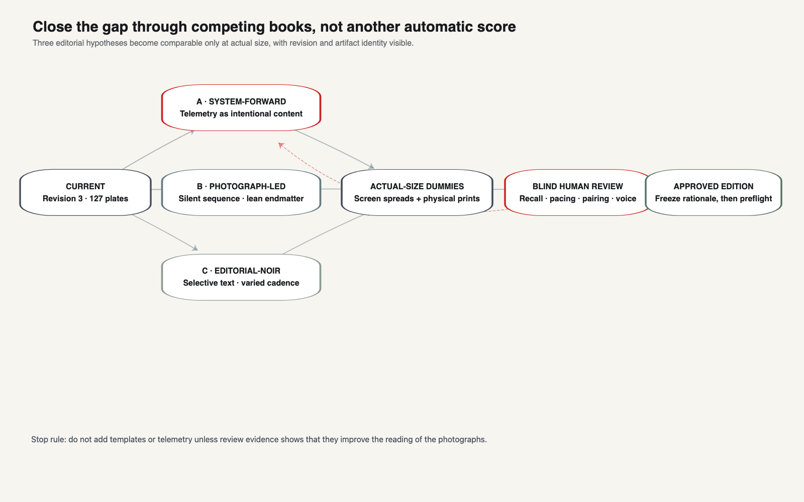

# Infinite Systems: Closing the Gap to Benchmark Photobook Design

**Research report — 17 November 2026**
**Scope:** visual and editorial review of the current 164-page display/screen PDFs, compared with documented practices behind Magnum-associated and comparable photobooks. This is an artifact review, not a claim that Magnum has a single visual style or that aesthetic quality can be reduced to a score.

## Executive assessment

The short answer is that **Infinite Systems is production-strong but has not yet demonstrated benchmark-level editorial and material coherence**. The current artifact already has a controlled dark field, a recognizable typographic identity, a complete sequence ledger, verified movement telemetry, and a substantial repertoire of spread layouts. Those are meaningful achievements, but they answer different questions from the ones that distinguish an exceptional photobook: whether every included photograph earns its place, whether adjacent images create meanings neither carries alone, whether the book's pace produces tension and recovery, and whether its physical form is inseparable from the work. The principal risk is not insufficient graphic sophistication; it is that **the production system—completeness, modality blocks, telemetry, and repeated templates—can become more visible than the photographs' accumulating meaning**.

There is no defensible single “Magnum look” to imitate. Magnum's own presentation of its publishing history emphasizes distinctive visions, dummy books, plan sheets, original prints, sequencing, editing, and design, while the documented practices of Mark Power, Alex Webb and Rebecca Norris Webb, Jim Goldberg, Susan Meiselas, and Trent Parke differ sharply from one another. The transferable standard is therefore not monochrome versus color, large photographs versus small ones, or silence versus text. It is **the degree to which selection, sequence, language, materials, and production decisions arise from the particular body of work**. [Magnum Photos](kimi-cite://web?url=https%3A%2F%2Fwww.magnumphotos.com%2Fevent%2Fevents%2Fexhibitions%2Fmagnum-between-pages-1943-2026%2F&text=distinctive%20visions%2C%20sequencing%2C%20editing%2C%20and%20design 'citation')

The recommended way to close the gap is to produce **three competing maquettes**, not to add another optimizer term or declare the current edition finished: a system-forward edition that makes telemetry intentional content; a photograph-led edition that removes most explanatory apparatus; and an editorial-noir edition with selective text and more deliberately varied cadence. At least one candidate must relax strict modality separation and `requireCompletePool`, because otherwise the comparison cannot reveal whether those constraints are helping the work or merely making the pipeline predictable. All three should be reviewed at actual size, on facing-page screen proofs and physical prints, by readers who can assess recall, pacing, pairing, voice, and attention without knowing which candidate the production system favors.

## 1. Evidence base and current-artifact audit

This review examined both compiled PDFs, complete contact sheets, representative rasterized pages, the sequence ledger, and the compiled layout IR. The display and screen editions each contain **164 pages, 127 plates, and 73 spreads** at **210 × 260 mm**, with no bleed recorded in the audited layout. The 73 spreads comprise 33 symmetric diptychs, 11 asymmetric diptychs, 10 diagonal offsets, 10 monoliths, and 9 monolith-plus-epigraph arrangements. Across the plates, 88 use `inset-74`, 24 use `inset-82`, 11 use `inset-55`, and four carry the nominal `full-bleed` label. [Layout audit](kimi-cite://text?path=%2FUsers%2Flz%2Fdev%2Fryusoh.github.io%2F.cache%2Fbook-runs%2Fmagnum-review%2Flayout-audit.json&text=%22spreadLayouts%22 'citation')

The montage makes the current design's underlying proposition visible: dark architectural framing, a small technical information layer, isolated cinematic photographs, and recurrent numerical or systematic annotation. It also shows why the review must distinguish **design consistency** from **editorial necessity**. A repeated margin, folio, or symmetrical pairing can create a stable field for difficult images; equally, it can make unrelated photographs feel like interchangeable instances of a template. The PDF evidence identifies where that question is most urgent, but cannot settle it. No physical dummy, paper sample, bound opening, press proof, or external reader panel was available, so material and reader-response conclusions remain hypotheses rather than observed facts.

The movement structure is internally accurate. THRESHOLD covers plates 001–019 with mean luma 50.9; KINEMATICS covers 020–057 with 129.9; PHANTOM covers 058–095 with 78.9; and SINGULARITY covers 096–127 with 108.4. Nine epigraph pages are present, two with explicit attributions. Eighteen pages are intentionally empty: four movement voids, four phase-reset voids, and ten empty spread versos. These counts describe the designed cadence; they do not establish whether every pause is felt as productive silence or as a mechanical reset. [Layout audit](kimi-cite://text?path=%2FUsers%2Flz%2Fdev%2Fryusoh.github.io%2F.cache%2Fbook-runs%2Fmagnum-review%2Flayout-audit.json&text=%22dividerTelemetry%22 'citation')

| Audited dimension         |                                                 Current artifact | Editorial implication                                                                                             |
| ------------------------- | ---------------------------------------------------------------: | ----------------------------------------------------------------------------------------------------------------- |
| Trim and extent           |                                          210 × 260 mm; 164 pages | A substantial portrait object whose proportions need to be justified against the predominantly 3:2 images.        |
| Photographic content      |                                         127 plates in 73 spreads | Enough material for a full book, but completeness is not evidence that every plate improves the sequence.         |
| Dominant spread family    |                          33 symmetric diptychs, 45.2% of spreads | The first pacing-review target; not an automatic defect or a reason to impose a quota for other layouts.          |
| Dominant plate scale      |                         88 plates at `inset-74`, 69.3% of plates | A strong default that may unify the book or flatten differences in visual and emotional pressure.                 |
| Nominal full-width plates |                                      Four plates at 210 × 140 mm | These span the page width but retain vertical margins; they should not be described as full-page bleed images.    |
| Deliberate empty pages    |                                                         18 pages | Potentially valuable silence, but each cluster needs a reader-facing rationale rather than only a structural one. |
| Text and system apparatus | Nine epigraphs, movement telemetry, system colophon, plate index | A distinctive voice if intentional; a competing narrative if the photographs are meant to carry the book alone.   |

One important design drift needs explicit testing rather than silent correction. The earlier book specification described a **300 × 200 mm landscape trim** matching the source photographs' 3:2 geometry, whereas the current artifact is a 210 × 260 mm portrait book. The earlier zero-crop/full-page rationale therefore cannot simply be transferred to the present object. Portrait orientation may be a productive intervention—turning each landscape frame into an event within a taller dark field—or it may repeatedly create letterboxed images with inactive space above and below. Only alternate-trim maquettes at actual size can distinguish those possibilities. [Ebook research](kimi-cite://md-line?path=%2FUsers%2Flz%2Fdev%2Fryusoh.github.io%2Fdocs%2Fphotobook-ebook-research.md&line=452&text=Canvas%3A%20%60%23070709%60%20Obsidian%20Void%20%28%60300%20%C3%97%20200%20mm%60 'citation')

## 2. Existing strengths that should survive revision

The current book has a coherent visual vocabulary and should not be stripped back merely because restraint is associated with other photographers' books. The obsidian ground, red rule, monospaced metadata, and Syne title create an identifiable system; the opening shaft of light and the late return to a single strong image give the artifact legible thresholds. The four movements provide a large-scale orientation structure, and the direct renders confirm that their telemetry is populated correctly. The edition also avoids the common failure of treating the index and production information as an unrelated appendix: both belong to the same graphic language as the cover and dividers. These are real design assets, and the proposed alternatives should test their prominence rather than assume their removal is inherently more sophisticated.

The production architecture is equally valuable. The existing specification separates observed assets, reviewed editorial state, deterministic layout, rendering, proofing, and release approval; it requires alt text and deterministic reading order, font provenance, structural checks, exact-artifact raster review, and human sign-off. It also states that an interactive estimate cannot approve an export. Those controls protect the work while its visual argument changes, and they are unusually strong foundations for experimentation. **Accessibility, provenance, and reproducibility are not aesthetic proof, but they are necessary infrastructure for a durable edition.** [Ebook research](kimi-cite://md-line?path=%2FUsers%2Flz%2Fdev%2Fryusoh.github.io%2Fdocs%2Fphotobook-ebook-research.md&line=575&text=Automated%20preflight%20proves%20structural%2C%20colorimetric%2C%20and%20standards%20invariants 'citation')

The right response is therefore conservation plus challenge. Conserve source immutability, candidate revisioning, alt text, font embedding, color actions, proof hashes, and the authoritative PDF boundary. Challenge the editorial assumptions those systems currently encode: that every pool member must appear, that monochrome and color must remain separated, that the present portrait trim is settled, and that telemetry deserves its current narrative prominence. A benchmark workflow should make it safer to ask those questions, not make the existing answers harder to change.

## 3. What the benchmark books actually teach

The strongest comparative lesson is that a photobook is an **authored reading system**, not a portfolio with pagination. Mark Power and Stuart Smith reduced more than 4,000 images to 600 physical prints and then to 196 selections, using pairings to discover both cancellation and a “third thing” between photographs. Power also warns against a relentless sequence of “big pictures,” insisting on quieter intervals. The important numbers are not a recommended reduction ratio; they demonstrate that selection and sequence are separate rounds of judgment, and that the final edit can be much smaller than the available body of work. [Magnum Photos](kimi-cite://web?url=https%3A%2F%2Fwww.magnumphotos.com%2Ftheory-and-practice%2Fmark-power-the-language-of-pictures-exploring-sequencing%2F&text=There%20have%20to%20be%20moments%20of%20quiet%20as%20well. 'citation')

Michael Mack's discussion with Alec Soth prevents that lesson becoming an arbitrary doctrine of brevity. Mack says a typical 75-image submission may need only 35–40 images, but _Songbook_ unusually expanded from roughly 40–45 to 74 because the project could sustain that extent. The benchmark is not “always cut”; it is **let the work determine its necessary duration**. _Sleeping by the Mississippi_ is discussed in terms of voice, range, sequence, and simplicity rather than surface styling. For Infinite Systems, 127 plates may be right, excessive, or even insufficient; the present artifact alone cannot prove which. [Magnum Photos](kimi-cite://web?url=https%3A%2F%2Fwww.magnumphotos.com%2Ftheory-and-practice%2Faccess-ideas-alec-soth-michael-mack-conversation-book-publishing-photography%2F&text=voice%2C%20range%2C%20sequence%2C%20and%20simplicity 'citation')

| Benchmark practice                                    | What it contributes                                                                                                                    | Consequence for Infinite Systems                                                                                                                                                                                                                                                                                                                                                                  |
| ----------------------------------------------------- | -------------------------------------------------------------------------------------------------------------------------------------- | ------------------------------------------------------------------------------------------------------------------------------------------------------------------------------------------------------------------------------------------------------------------------------------------------------------------------------------------------------------------------------------------------- |
| Physical editing with Mark Power and Stuart Smith     | Large pools become prints, then selections; pairings can cancel out or create a “third thing.”                                         | Compare edits through printed spreads and test relationships, not only individual image strength. [Magnum Photos](kimi-cite://web?url=https%3A%2F%2Fwww.magnumphotos.com%2Ftheory-and-practice%2Fmark-power-the-language-of-pictures-exploring-sequencing%2F&text=third%20thing 'citation')                                                                                                       |
| _Slant Rhymes_                                        | Eighty photographs operate as visual and emotional rhymes; an intimate format and tipped-in cover echo a poetry book.                  | Treat pairing, scale, and cover as parts of one proposition rather than independent decoration. [Magnum Photos](kimi-cite://web?url=https%3A%2F%2Fwww.magnumphotos.com%2Farts-culture%2Fart%2Falex-webb-slant-rhymes%2F&text=slant%20rhymes 'citation')                                                                                                                                           |
| _Brooklyn: The City Within_                           | Three movements have different rhythms; a smaller central trim becomes a “book within a book.”                                         | A structural device is strongest when it embodies the subject, not when it merely differentiates chapters. [Magnum Photos](kimi-cite://web?url=https%3A%2F%2Fwww.magnumphotos.com%2Ftheory-and-practice%2Fbrooklyn-the-city-within-alex-webb-rebecca-norris-webb-new-york-street-photography%2F&text=book%20within%20a%20book 'citation')                                                         |
| Jim Goldberg's _Rich and Poor_ and _Raised by Wolves_ | Handwriting, conversations, notes, drawings, correspondence, receipts, and objects arise from the history and subjects of the work.    | Text and archival devices need an evidentiary or narrative role, not a generic “documentary” appearance. [Magnum Photos](kimi-cite://web?url=https%3A%2F%2Fwww.magnumphotos.com%2Farts-culture%2Fart%2Fjim-goldberg-raised-by-wolves%2F&text=official%20correspondence 'citation')                                                                                                                |
| Susan Meiselas's Nicaraguan work                      | Editions use interviews, letters, poems, statistics, and films to contextualize images and acknowledge historical incompleteness.      | Telemetry should remain if it supplies knowledge the photographs cannot, not simply because the build can calculate it. [Aperture](kimi-cite://web?url=https%3A%2F%2Faperture.org%2Feditorial%2Fhow-susan-meiselas-documented-nicaraguas-revolution%2F&text=interviews%2C%20letters%2C%20poems%2C%20statistics%2C%20and%20films 'citation')                                                       |
| MACK design and dummy practice                        | Materials, binding, margins, grain direction, and opening behavior are interdependent; physical dummies expose decisions screens hide. | The PDF cannot be the final evidence for a physical book. [AIGA Eye on Design](kimi-cite://web?url=https%3A%2F%2Feyeondesign.aiga.org%2Fdesigning-the-invisible-macks-morgan-crowcroft-brown-on-the-understated-art-of-the-photo-book%2F&text=The%20materials%20are%20the%20design. 'citation')                                                                                                   |
| Trent Parke's _Cue the Sun_                           | A text-free travelogue uses a double-printed fold-out concertina to divide night and day.                                              | Silence and unconventional construction can carry structure when the form and subject coincide. [Aperture](kimi-cite://web?url=https%3A%2F%2Faperture.org%2Feditorial%2F8-summer-reads-from-apertures-editors%2F&text=double-printed%20fold-out%20concertina 'citation')                                                                                                                          |
| Jason Eskenazi's _Wonderland_                         | A fairy-tale structure guides a non-literal sequence; leitmotifs are separated to leave room for imagination and flow.                 | A conceptual armature can organize the book without requiring literal groups or repetitive visual matches. [Eric Kim Photography](kimi-cite://web?url=https%3A%2F%2Ferickimphotography.com%2Fblog%2F2012%2F10%2F18%2Finterview-with-jason-eskanazi-on-wonderland-a-fairytale-of-the-soviet-monolith-a-10-year-odyssey-around-the-former-soviet-union%2F&text=room%20for%20imagination 'citation') |

These examples also disprove a simplistic opposition between formal and content-led sequencing. Melissa Harris praises the formal sequence of Josef Koudelka's _Chaos_ but chooses content, chronology, and “Pause” sections for his biography because the book has a different job. The correct sequence depends on what the edition is trying to make legible. Infinite Systems must decide whether it is primarily a photographic narrative, an essay about systems, an archive of urban perception, or a hybrid; its layout and telemetry cannot make that decision on its behalf. [Aperture](kimi-cite://web?url=https%3A%2F%2Faperture.org%2Feditorial%2Fthe-inside-story-of-josef-koudelkas-groundbreaking-career%2F&text=content%2C%20chronology 'citation')

## 4. Gap register and closure priorities

The gaps below are **review priorities, not objective aesthetic verdicts**. A high-frequency template or an unusual data layer is not inherently inferior; the gap is the absence of comparative evidence showing that the choice improves this book. This distinction matters because the current pipeline can measure layout validity and reproducibility far more easily than resonance. A defensible design process uses measurements to locate questions, then uses competing artifacts and human reading to answer them.

The highest-priority risks sit upstream of graphic refinement. If the wrong edit is locked in, or if modality rules prevent the strongest sequence, better typography will only produce a more polished version of the wrong book. Trim, scale, text, cover, and material choices remain important, but they should be tested after or alongside genuinely different selections and orders—not used as substitutes for editorial comparison.

| Priority                         | Gap in demonstrated design logic                                                                                                                                                              | Closure action                                                                                                                                                  | Evidence required to close it                                                                                                |
| -------------------------------- | --------------------------------------------------------------------------------------------------------------------------------------------------------------------------------------------- | --------------------------------------------------------------------------------------------------------------------------------------------------------------- | ---------------------------------------------------------------------------------------------------------------------------- |
| **P0 — final edit**              | `requireCompletePool: true` makes completeness an invariant, so the current artifact does not show that every plate survives an independent final edit.                                       | Generate a complete-pool candidate and at least one freely reduced candidate; record why excluded images weaken or strengthen the whole.                        | A reviewed selection rationale and blind comparison showing which edition has stronger recall, coherence, and duration.      |
| **P0 — sequence freedom**        | Strict monochrome/color blocks may prevent cross-modality rhymes, interruptions, or transitions that are more meaningful than the present grouping.                                           | Produce at least one candidate that relaxes modality separation while retaining locks, provenance, and reproducibility.                                         | Spread-level review of pairings and transitions, with no requirement that the relaxed candidate win.                         |
| **P0 — independent judgment**    | Internal telemetry and author review cannot substitute for a reader encountering the work without knowledge of the system.                                                                    | Use a small blind human panel and actual-size dummies; collect observations before explaining the design rationale.                                             | Anonymous notes, recall results, points of confusion, and a documented editorial decision.                                   |
| **P1 — pacing**                  | Symmetric diptychs account for 33 of 73 spreads, and `inset-74` covers 88 of 127 plates; repetition may be creating a default cadence rather than an expressive one.                          | Review the entire sequence as printed thumbnails and facing-page spreads; change scale or pairing only where the desired reading changes.                       | Before/after sequence sheets identifying tension, quiet, redundancy, and the role of every deliberate pause.                 |
| **P1 — trim and scale**          | The portrait object repeatedly places landscape photographs within tall dark pages; the earlier landscape-trim rationale no longer applies.                                                   | Compare the current 210 × 260 mm format with the earlier 300 × 200 mm proposition and one deliberately chosen alternative, without assuming either is superior. | Actual-size prints showing image presence, margins, gutter behavior, handling, and the effect on the four full-width plates. |
| **P1 — narrative prominence**    | Movement telemetry, dividers, index, and system colophon may explain the mechanism before the photographs have established their own meanings.                                                | Test system-forward, demoted, and removed treatments; keep data only where it changes the reader's understanding.                                               | Reader evidence showing where attention goes and whether the data is remembered as content or apparatus.                     |
| **P1 — text/image relation**     | Nine epigraphs create nine textual interventions, but only two carry explicit attribution; provenance and individual function need review without assuming all unattributed text is external. | Write a one-sentence purpose for each fragment, verify its provenance, and compare its inclusion, relocation, and removal.                                      | A fragment ledger with source/status, intended effect, and reviewed spread evidence.                                         |
| **P1 — material coherence**      | Paper, binding, opening resistance, shadow reproduction, page-turn sound, and the relationship between dark fields and reflected light remain unverified.                                     | Produce a bound or faithfully assembled physical dummy and representative dark/image proofs on candidate stocks.                                                | A physical-proof review covering opening, show-through, glare, shadow separation, and sequence rhythm.                       |
| **P2 — small information layer** | Small folios, technical labels, cover metadata, and index typography may read differently at actual size than in a scaled contact sheet.                                                      | Compare two or three actual-size hierarchy treatments rather than imposing an arbitrary point-size mandate.                                                     | Legibility observations at intended viewing distance and confirmation that metadata does not compete with the plates.        |

The frequency chart is deliberately descriptive. It does not say that 45.2% symmetry is too much, or that the book needs more diagonal offsets. Consistent placement can be exactly right when it grows from the project; MACK designer Morgan Crowcroft-Brown emphasizes understated design in service of the work, not variety for its own sake. The actionable conclusion is narrower: because symmetric diptychs and one inset scale are the dominant reading conditions, **they are where a reviewer should look first for accidental monotony or meaningful restraint**. [AIGA Eye on Design](kimi-cite://web?url=https%3A%2F%2Feyeondesign.aiga.org%2Fdesigning-the-invisible-macks-morgan-crowcroft-brown-on-the-understated-art-of-the-photo-book%2F&text=design%20should%20serve%20the%20work 'citation')

## 5. Editing, pairing, and the shape of time

The largest editorial gap is the possibility that **asset completeness has been mistaken for a completed edit**. A reproducible book pipeline benefits from a known inventory, but the reader does not experience inventory correctness; the reader experiences duration, recurrence, expectation, and release. An image can be excellent and still weaken a sequence by repeating a neighbor's effect, resolving a tension too early, or keeping the book at one emotional temperature. Conversely, a quiet or imperfect frame may become necessary because of what follows it. These are relational judgments that no source hash, luma value, or per-image quality metric can settle.

Power and Smith's process offers a concrete alternative: move away from screen-scale thumbnails, make physical prints, edit aggressively, and then study pairs. Their observation that two images can cancel each other out is as important as the more attractive idea that they can create a third meaning. A symmetric spread is not neutral merely because its geometry is balanced. It asks the reader to compare, and comparison can intensify or flatten both photographs. The current 33 symmetric spreads therefore need individual relationship statements—contrast, rhyme, displacement, temporal jump, scale shift, or deliberate refusal—not a generic assertion that symmetry is part of the system. [Magnum Photos](kimi-cite://web?url=https%3A%2F%2Fwww.magnumphotos.com%2Ftheory-and-practice%2Fmark-power-the-language-of-pictures-exploring-sequencing%2F&text=cancel%20out 'citation')

_Slant Rhymes_ shows that a pair can be visual and emotional without being literally matched. Its photographs and texts often begin independently and meet late in the process, allowing resonance rather than illustration. That is a useful corrective to an optimizer built around measurable similarity: shared color, repeated geometry, and luma continuity are visible properties, but the strongest transition may be a contradiction in subject, distance, tenderness, or social charge. The current book should retain its computational tools for proposing alternatives while making **surprise and accumulated meaning** explicit human-review criteria. [Magnum Photos](kimi-cite://web?url=https%3A%2F%2Fwww.magnumphotos.com%2Farts-culture%2Fart%2Falex-webb-slant-rhymes%2F&text=visual%20and%20emotional 'citation')

Pacing also has an emotional and ethical dimension. Magnum's discussion of street photography stresses different working tempos and the changed photographer–subject relationship produced by direct flash; Carolyn Drake describes that encounter as an exchange. A sequence of visually forceful street images can therefore feel not only formally relentless but socially airless. Quiet plates, distant views, ambiguity, or a blank page may do more than vary the design: they may change how the reader understands the photographer's presence. The existing 18 empty pages deserve review at this level, not just as structural separators. [Magnum Photos](kimi-cite://web?url=https%3A%2F%2Fwww.magnumphotos.com%2Ftheory-and-practice%2Fthe-joy-of-seeing-magnum-street-photography%2F&text=direct%20exchange 'citation')

A practical closure pass should ask four different questions in separate rounds. First, which photographs are indispensable to the book's voice? Second, which neighboring relationships create a meaning worth keeping? Third, where does the sequence need silence, delay, or contradiction? Fourth, does the four-movement armature remain visible in recollection after the telemetry labels are hidden? Keeping those rounds distinct prevents a strong individual plate, a clever pairing, or a mathematically smooth transition from compensating for a weakness elsewhere.

## 6. Text, telemetry, and narrative authority

Infinite Systems currently speaks in two registers: the photographs and the technical voice that frames them. That duality could become the book's most distinctive quality, but only if the relationship is intentional. Mean luma, plate ranges, waveform traces, and a detailed index tell the reader that the sequence is measurable; they do not necessarily explain why it matters. If the work concerns systems observing urban life, the data may function as a second narrator whose limitations become meaningful. If the work concerns memory, estrangement, or embodied passage, the same data may prematurely convert ambiguity into dashboard certainty. The design question is therefore **what kind of authority the technical voice should hold**, not whether data is intrinsically desirable.

The benchmark examples support several different answers. Goldberg's subject-written portraits and heterogeneous documentary materials make language part of the ethical and historical encounter; Meiselas uses added contextual material to address incompleteness and later historical understanding; the Webbs allow text and image to resonate without one simply explaining the other. None treats text as a universal upgrade. For the current epigraphs, each fragment should be classified by function—threshold, countervoice, caption, historical evidence, original narration, or pause—and tested against the same spread without it. The presence of only two explicit attributions is a provenance-review prompt, not proof of a rights defect, because unattributed fragments may be original writing. [Magnum Photos](kimi-cite://web?url=https%3A%2F%2Fwww.magnumphotos.com%2Farts-culture%2Fart%2Fjim-goldberg-raised-by-wolves%2F&text=subjects%20writing 'citation')

A useful test is to hide every textual and numerical layer except legally or semantically required information, then ask readers to reconstruct the book's movements and concerns. If readers still perceive THRESHOLD, KINEMATICS, PHANTOM, and SINGULARITY as distinct phases, the labels can become quieter. If they perceive different and richer associations, the official movement names may be constraining the work. If the sequence collapses without its labels, the problem lies in the photographic architecture rather than in insufficient explanation. This is a much more informative test than asking reviewers whether they “like” the telemetry.

The colophon and index need the same scrutiny. They may be an integral second reading of the book, translating visual recurrence into measurable recurrence; they may also be most useful as production evidence stored outside the reader's primary narrative. A system-forward maquette should make the former argument boldly, while a photograph-led maquette should demonstrate what happens when endmatter becomes lean. The editorial-noir candidate can reserve language for a few high-leverage interruptions. Comparing these positions is preferable to compromising automatically on a medium amount of text.

## 7. Trim, scale, materials, and the book as object

The physical-book gap is the least resolved because a PDF cannot show opening behavior, paper reflection, shadow separation, or the bodily rhythm of page turns. Morgan Crowcroft-Brown's account of MACK design treats thumbnails, sequence sheets, paper, binding, margins, grain direction, and opening as interdependent; “the materials are the design.” MACK's First Book Award similarly requires physical dummies and recommends printing the entire project and moving images by hand. This does not make digital tooling secondary; it means digital precision must eventually be answered by material evidence. [MACK/1854](kimi-cite://web?url=https%3A%2F%2Fwww.1854.photography%2F2021%2F01%2Findustry-insights-mack%2F&text=physical%20dummies 'citation')

For Infinite Systems, the dark ground makes this especially consequential. On screen, `#070709` is a stable field; on paper, a large near-black area can reflect the reader, reveal finger marks, show through from the reverse, or compress shadow distinctions depending on stock and process. The deep-field idea may be strengthened by those effects or undermined by them. A physical proof should therefore include the cover, a movement divider, a dense shadow plate, a symmetric diptych, an epigraph page, an empty verso, and the telemetry colophon. Those samples test the book's actual system rather than an isolated attractive spread.

The four nominally `full-bleed` plates also need semantic precision. Their audited geometry is **210 × 140 mm on a 210 × 260 mm page**, so they are full-width landscape bands, not images running beyond all four trim edges. Their present effect is likely a change in lateral pressure while the dark top and bottom fields remain. That can be compelling, but it is different from a full-page photographic immersion. The layout vocabulary should describe the visible condition accurately, and alternate maquettes should test whether these four moments need wider margins, true full-page treatment in a bleed-capable production specification, or no special status at all. [Layout audit](kimi-cite://text?path=%2FUsers%2Flz%2Fdev%2Fryusoh.github.io%2F.cache%2Fbook-runs%2Fmagnum-review%2Flayout-audit.json&text=%22plateHeightsMm%22 'citation')

Other benchmark objects demonstrate why material devices must be derived rather than borrowed. _Brooklyn: The City Within_ changes trim for a book within a book because geography and authorship change; _Cue the Sun_ uses a concertina to embody night and day; _27 Drafts_ uses black paper, an informal softcover/sketchbook feeling, and spot-varnished handwriting to support the processing of memory; _L.A. Vedute_ uses gutter-spanning spreads and yellow interleaves for architectural and interruptive effects. None supplies a shopping list for Infinite Systems. A concertina, interleave, or black stock would be appropriate only if it clarified this book's particular argument about systems, movement, and perception. [Aperture](kimi-cite://web?url=https%3A%2F%2Faperture.org%2Feditorial%2Fa-look-inside-the-titles-shortlisted-for-the-2024-photobook-awards%2F&text=27%20Drafts 'citation'), [Aperture](kimi-cite://web?url=https%3A%2F%2Faperture.org%2Feditorial%2Fa-look-inside-the-titles-shortlisted-for-the-2023-photobook-awards%2F&text=L.A.%20Vedute 'citation')

## 8. Three competing maquettes

The maquettes should be genuinely different editorial hypotheses, not three color themes applied to the same sequence. Each begins from the same immutable source assets and records its selection, constraints, layout decisions, text treatment, and rationale in a candidate revision. All three retain alt text, source provenance, deterministic rendering, and exact-PDF proofing. None receives an automatic aesthetic score. Their purpose is to make trade-offs visible enough that a human decision becomes informed and specific.

The candidates should be compared in rounds that isolate variables where possible. A selection/order round can use a common neutral layout to reveal whether the photographic architecture differs; a form round can then apply the candidate's intended trim, scale, typography, and text. Without that separation, a reviewer may prefer a cover or a larger image and unintentionally endorse a weaker sequence. The final round, however, must review each candidate as a whole, because the benchmark lesson is precisely that selection and form cannot remain independent forever.

| Maquette               | Editorial hypothesis                                                                                 | Required changes from current revision                                                                                                                                           | What must remain                                                                                                  | Primary failure signal                                                                                        |
| ---------------------- | ---------------------------------------------------------------------------------------------------- | -------------------------------------------------------------------------------------------------------------------------------------------------------------------------------- | ----------------------------------------------------------------------------------------------------------------- | ------------------------------------------------------------------------------------------------------------- |
| **A — System-forward** | The measurable system is a meaningful second reading of the city and the archive.                    | Make telemetry conceptually legible rather than merely present; integrate dividers, waveform, and index as authored content; test a sequence that explains why the data matters. | Strong technical typography, four named movements where useful, complete provenance, selected numerical material. | Readers remember the dashboard more than particular photographs, or cannot explain what the measurements add. |
| **B — Photograph-led** | The images already contain sufficient structure; explanatory apparatus narrows their ambiguity.      | Remove or demote routine telemetry, produce a lean endmatter alternative, test a reduced edit and at least one cross-modality sequence, let quiet pages arise from reading need. | Dark field if it serves the plates, accessible text layer, source records outside the visible narrative.          | The sequence feels arbitrary, flat, or dependent on labels when readers describe it afterward.                |
| **C — Editorial-noir** | A small number of textual and structural interventions can sharpen a cinematic, nocturnal narrative. | Select epigraphs by function, vary cadence only at narratively justified points, revisit trim and the four full-width moments, use pauses as scenes rather than resets.          | The current sense of threshold and return, controlled title voice, rigorous provenance and text governance.       | The design becomes theatrical, repetitive, or more stylistically assertive than the photographic content.     |

Maquette A is not permission to keep every existing data element. It must make the strongest case for data as content, which may mean fewer but more consequential measurements. Maquette B is not automatically the “professional” option because it is quieter; a silent sequence can be just as formulaic as a loud one. Maquette C is not a license to add cinematic clichés or layouts for variety. Each candidate earns its devices by improving the reading of the photographs, and each may lose the review.

The current revision should remain visible as the baseline rather than being silently overwritten. If none of the new candidates improves recall, pacing, pairing, or voice, the correct result may be to retain the current architecture with targeted changes. If reviewers prefer different candidates for different reasons, the final edition can synthesize them only after the synthesis receives its own revision, proof, and review. “Blend the feedback” is not a substitute for another coherent proposition.

## 9. Review protocol and implementation implications

The review should begin with **actual-size facing-page output**, because scaled contact sheets are useful for structure but unreliable for typography, image presence, and perceived emptiness. Print every spread cheaply, trim it, arrange it in order, and use a binding or assembly method sufficient to reproduce the page-turn sequence. MACK's advice to print the whole project and move images physically is relevant precisely because relational decisions become easier when every plate can be removed, exchanged, or paired without running a pipeline. The deterministic system should then record the resulting human decisions, not prevent them. [MACK/1854](kimi-cite://web?url=https%3A%2F%2Fwww.1854.photography%2F2021%2F01%2Findustry-insights-mack%2F&text=printing%20the%20entire%20project 'citation')

A small blind panel should include readers familiar with photobooks and readers who are not, without telling them which candidate is the current favorite or which metrics drove it. The reviewer should first observe uninterrupted reading, then ask for specific recall and relational judgments. Preference alone is too weak: a reader may prefer the most immediately dramatic candidate while remembering less of its sequence. The aim is evidence about how each book works, followed by an editorial decision that remains accountable to the author's intent.

| Review question                                            | Observable evidence                                                                           | Decision it informs                                                              |
| ---------------------------------------------------------- | --------------------------------------------------------------------------------------------- | -------------------------------------------------------------------------------- |
| Which photographs and pairs are recalled after a delay?    | Unprompted plate/spread recall and descriptions of why they stayed in mind.                   | Final selection, pair retention, and identification of interchangeable passages. |
| Where does reading accelerate, stall, or become confusing? | Page-turn observations, spontaneous comments, and recalled points of fatigue or anticipation. | Empty pages, movement boundaries, scale changes, and overall duration.           |
| Do pairs cancel, merely match, or create a third meaning?  | Reviewer descriptions of the relationship rather than individual-image ratings.               | Symmetric diptychs, cross-modality pairings, and alternate transitions.          |
| What do readers think the book is about?                   | Unprompted themes and a reconstructed movement structure.                                     | Telemetry prominence, movement names, and text placement.                        |
| Where does attention go on a spread?                       | First fixation reported or observed, followed by reading-path description.                    | Metadata hierarchy, epigraphs, margins, and relative plate scale.                |
| Does the object change the reading?                        | Handling notes on opening, reflection, page turns, shadow visibility, and format.             | Trim, paper, binding, full-width moments, and dark-field production.             |

Implementation should support this protocol without becoming its subject. The existing candidate revision, lock/ban, preview, proof, and manifest architecture is already the right foundation; what is needed is the ability to represent a reduced-pool proposal and a relaxed-modality proposal as valid candidates. Review reports should link each decision to candidate and artifact hashes, while human notes remain evidence rather than machine-executable truth. Any new metric may help generate alternatives, but it must not become a release condition merely because it is easy to calculate.

Approval and preflight remain separate. Approval freezes the editorial rationale, ledger revision, and exact candidate identity; preflight then proves structure, fonts, images, accessibility, color actions, and reproducibility for that artifact. A later change to sequence, text, trim, or rendering invalidates the relevant visual approval even if all automated checks still pass. This boundary protects both the design process and the production system from false certainty. [Ebook research](kimi-cite://md-line?path=%2FUsers%2Flz%2Fdev%2Fryusoh.github.io%2Fdocs%2Fphotobook-ebook-research.md&line=523&text=Approval%20and%20export%20are%20separate%20actions. 'citation')

## 10. Phased action plan and acceptance gates

The work should proceed in five compact phases, each producing evidence that can change the next one. This avoids spending effort on material refinement before the selection and sequence questions have been answered, while still allowing a system-forward candidate to challenge the assumption that photographs alone should dominate. No phase has a predetermined aesthetic winner.

The stop rule is equally important: **do not add templates, telemetry, or production complexity unless comparative review shows that they improve the reading of the photographs**. If a reduced sequence is clearer, preserve the excluded assets in the source pool rather than deleting them. If modality separation is beneficial, restore it as a reviewed editorial choice rather than an untested invariant. If the portrait trim wins, record why its dark vertical field matters. The goal is not maximal change; it is a book whose major decisions can be explained and whose alternatives have actually been seen.

| Phase                           | Work                                                                                                                           | Deliverable                                                                           | Gate to proceed                                                                            |
| ------------------------------- | ------------------------------------------------------------------------------------------------------------------------------ | ------------------------------------------------------------------------------------- | ------------------------------------------------------------------------------------------ |
| **0 — Baseline freeze**         | Preserve revision 3 PDFs, layout IR, sequence ledger, proofs, and this audit as the comparison baseline.                       | Immutable baseline identifiers and current-design evidence.                           | Exact baseline can be rebuilt or retrieved without ambiguity.                              |
| **1 — Editorial search**        | Generate complete and reduced selections; produce strict and relaxed modality sequences; print neutral-layout sequence sheets. | Candidate ledgers, exclusion/retention rationale, full printed sequences.             | At least three coherent propositions exist, including A, B, and C.                         |
| **2 — Form search**             | Apply candidate-specific trim, scale, text, telemetry, and endmatter decisions; retain source and accessibility metadata.      | Three exact-PDF maquettes and actual-size physical dummies.                           | Every visible difference is intentional and traceable to a candidate revision.             |
| **3 — Blind human review**      | Observe reading, recall, pacing, pairing, voice, and material handling before revealing production rationale.                  | Anonymized review notes and a decision record.                                        | One edition is approved, revised, or the baseline is deliberately retained.                |
| **4 — Final proof and release** | Freeze the approved candidate; render authoritative proofs; run preflight; inspect the exact PDF and physical proof.           | Approved artifact hash, preflight report, human sign-off, and final production notes. | Editorial, accessibility, technical, and material evidence all refer to the same artifact. |

The final acceptance standard is not “looks like Magnum.” It is that the edition has a defensible photographic edit, relationships that produce meaning, a cadence with both pressure and quiet, text whose authority is chosen rather than inherited, and a material form derived from the work. The current system already provides unusually strong controls for making such an edition reproducible and accessible. The remaining gap is to demonstrate **editorial necessity and material coherence through competing books and human evidence**. That is the practical route from a sophisticated generated artifact to a fully authored photobook.
